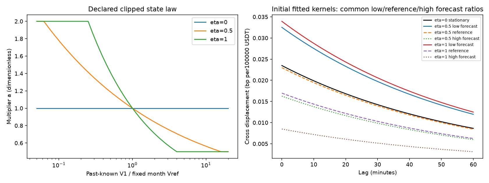
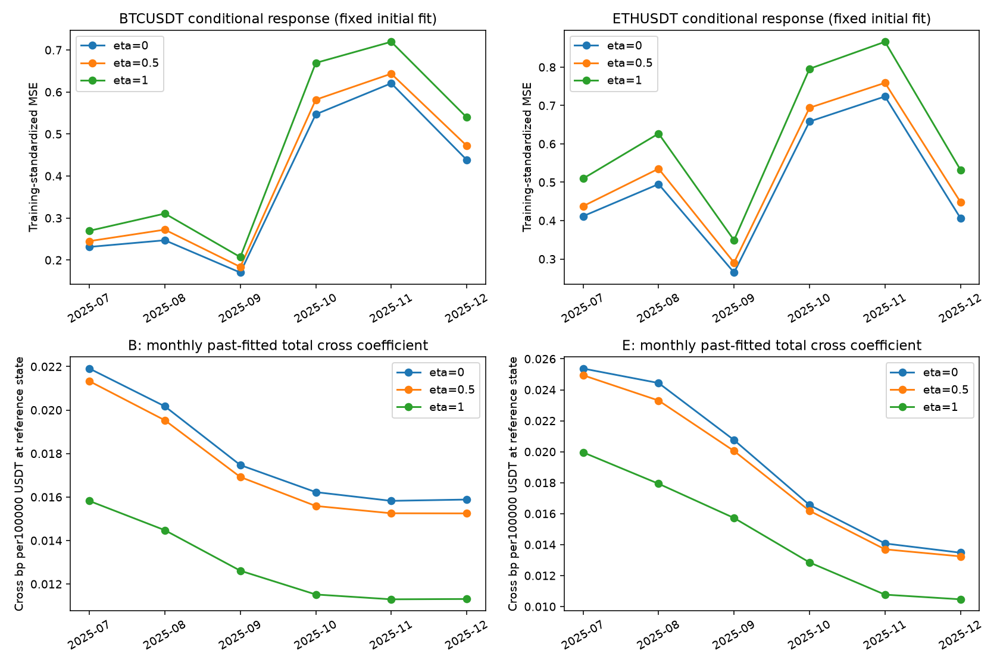
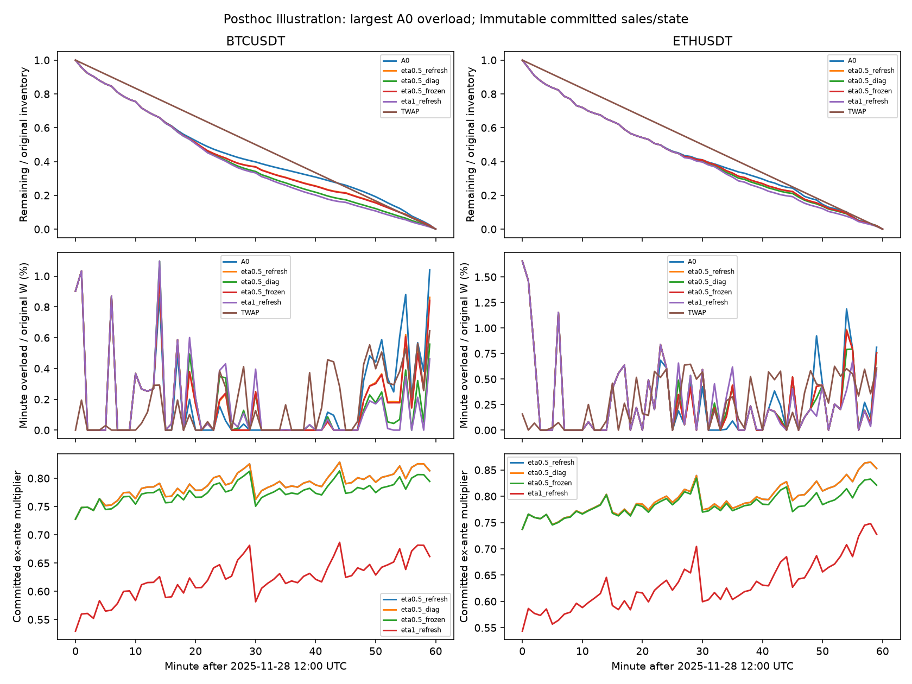
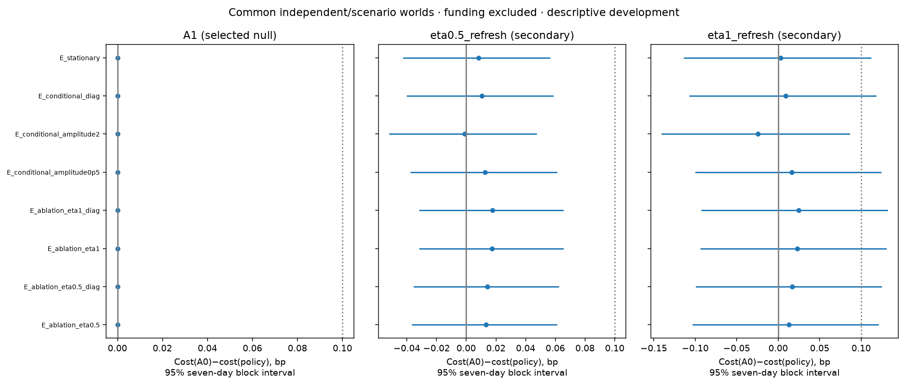
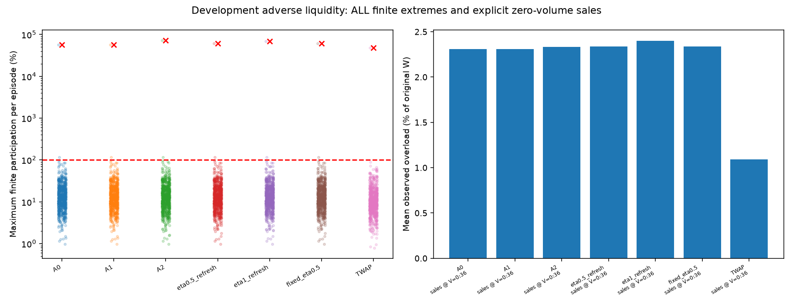

# Stage A: liquidity-dependent admissible transient cross-impact

UTC 2026-10-28T19:42:14.179355+00:00. **Development implementation PASS; H-A1 DOES_NOT_SUPPORT;
selected eta=0. October: CONFIRMATION_HOLD.**
**QA access scope QUALIFIED:** one inherited test loaded unused, previously
inspected2026 derived caches after eta selection; disclosed below.
All development evidence is
exploratory/post-search. No October source values were opened. January–September2026
remain previously inspected background, not a fresh test of Stage A. No Option2
stochastic Volterra-control theory or feedback-optimality research was begun.

## Question, inherited evidence and scope

Does changing transient impact with ex-ante liquidity add value beyond the
successful X2/X3 L25 liquidity-CVaR preference? Prior42% July–September overload
reduction, uncertain modeled cost, stronger TWAP liquidity, and dominated GL
remain unchanged in their separate reports. Here we use original786239 synchronized
training minutes (Jan2024–Jun2025),264960 validation minutes and736 fixed
Jul–Dec2025 development execution episodes. Binance UM BTCUSDT/ETHUSDT one-minute
last-trade prices and USDT quote taker flow; no new source acquisition/dataset.
Data attribution: Binance Vision official futures/um archives; recorded reuse
conditions and source-rebuild details remain in the original
[data documentation](../../data/README.md). Raw archives are not redistributed.
[Protocol](../../docs/extensions/a_liquidity_impact_protocol_v1.md) and
[config](../../configs/extension_a_liquidity_impact.yaml) declare all choices.

## Mathematics, estimator and causal state

G(t,s)=A(t)sum C_a exp(-(t-s)/tau_a)A(s), C_a symmetric PSD in original
cash-consistent q/sqrt(L)→1e4 sqrt(L) return coordinates. a_i is clipped[.5,2]
(Vref/V1)^(eta/2), V1 known strictly before the bar. Vref is the positive-turnover
median of28 complete days before month start. It is separate from each fit's L.
January2024 has no preceding month-start history: identity state is declared for
all candidates, preserving exact original sample/rows; no future reference is
used. Its internal unit-placeholder V1 array is not a turnover forecast and never
sets an inventory/cap. February onward has complete support. This startup
limitation is explicit.

For block diagonal D of the piecewise-constant minute multipliers, exact-cell
H_A=D H0 D and z'H_A z=(Dz)'H0(Dz)>=0 for every signed z. This proves only
frozen-path admissibility. Same-cell triangle and off-time exponential factors
are unchanged, with no extra minute factor. Every committed sale retains its
original ex-ante multiplier. Replans concatenate immutable past A and newly
forecast future A; remaining cost=.5zf'Hff zf+zf'Hfp zp. No state reset or
rewriting past fills. V1 is exogenous to hypothetical orders; feedback is unmodeled.

Regression uses the difference of FULL scaled displacements, not a_t times the
stationary return basis. Current level lags0..H and prior level lags0..H−1
match the original finite-lag return equation at eta0, without an H+1 tail.
This is an approximation to the infinite response; execution integrates the
untruncated exponential over the60-minute horizon. H120 sensitivity is separate.
Receiver-specific state regressors have training-only scales; PSD constraints
apply after restoring economic C. Same nuisance controls, rows, y, target loss
weights and ridge1; tau60 only, eta0/.5/1 only. No execution-cost eta selection.

Original Stage2 eta0 reproduction: largest C discrepancy
5.77e-15, validation standardized MSE discrepancy
3.22e-15. Three actual L25 schedule reproductions
are exact; selected eta0 A1/A3 are explicit A0 aliases, avoiding a changed baseline.

## Observed-data response result — primary empirical layer

Smallest eta within0.1% of minimum is selected; promotion additionally requires
>=.5% relative MSE gain, PSD and timing/state checks. **Selected eta0.**
Eta.5 worsens pooled validation MSE by6.7096% (95% block interval5.0956–8.5050%);
eta1 worsens22.6740% (19.3531–26.2474%). Both fail the response gate, with no new
candidate search. Same-minute public-flow response is descriptive/explanatory,
not a deployable return forecast, own-trade causal law or structural identification.

| model | asset | n | standardized_mse | mae_bps | explanatory_r2 |
| --- | --- | --- | --- | --- | --- |
| S_fit_eta0 | BTCUSDT | 264960 | 0.375526 | 2.86355 | 0.361272 |
| S_fit_eta0 | ETHUSDT | 264960 | 0.493292 | 4.62721 | 0.437279 |
| S_fit_eta0.5 | BTCUSDT | 264960 | 0.399549 | 2.93721 | 0.320411 |
| S_fit_eta0.5 | ETHUSDT | 264960 | 0.527563 | 4.74374 | 0.398184 |
| S_fit_eta1 | BTCUSDT | 264960 | 0.452458 | 3.11195 | 0.230419 |
| S_fit_eta1 | ETHUSDT | 264960 | 0.613356 | 5.06642 | 0.300316 |
| S_fixed_eta0.5 | BTCUSDT | 264960 | 0.399537 | 2.93573 | 0.320431 |
| S_fixed_eta0.5 | ETHUSDT | 264960 | 0.52606 | 4.73086 | 0.399899 |
| S_fixed_eta1 | BTCUSDT | 264960 | 0.468679 | 3.11529 | 0.202828 |
| S_fixed_eta1 | ETHUSDT | 264960 | 0.626138 | 5.01219 | 0.285736 |
| S_fit_eta0 | pooled | 264960 | 0.434409 | 3.74538 | 0.399275 |
| S_fit_eta0.5 | pooled | 264960 | 0.463556 | 3.84048 | 0.359298 |
| S_fit_eta1 | pooled | 264960 | 0.532907 | 4.08918 | 0.265368 |
| S_fixed_eta0.5 | pooled | 264960 | 0.462799 | 3.8333 | 0.360165 |
| S_fixed_eta1 | pooled | 264960 | 0.547408 | 4.06374 | 0.244282 |

Positive contrast below favors the new model. Standardized squared-error
averages use paired7-calendar-day blocks500draws seed20261027. The fixed-C
sensitivity keeps old stationary C AND nuisance terms, changing state mechanism
only; S_fit re-estimates the complete constrained model.

| model | mean | ci_low | ci_high | relative_reduction | relative_ci_low | relative_ci_high |
| --- | --- | --- | --- | --- | --- | --- |
| S_fit_eta0.5 | -0.0291469 | -0.0358187 | -0.0233436 | -0.0670955 | -0.0850499 | -0.0509555 |
| S_fit_eta1 | -0.0984979 | -0.115321 | -0.0849301 | -0.22674 | -0.262474 | -0.193531 |
| S_fixed_eta0.5 | -0.0283895 | -0.0346153 | -0.0231469 | -0.0653521 | -0.084282 | -0.0494838 |
| S_fixed_eta1 | -0.112999 | -0.130808 | -0.100196 | -0.260122 | -0.331806 | -0.206045 |

H120 refits (same candidates and dates; no tail-based re-selection):

| model | standardized_mse | mae_bps | explanatory_r2 |
| --- | --- | --- | --- |
| S_fit_eta0 | 0.435155 | 3.75013 | 0.398265 |
| S_fit_eta0.5 | 0.46559 | 3.85113 | 0.356529 |
| S_fit_eta1 | 0.537096 | 4.10848 | 0.259728 |

The failure persists at H120 (about7.0%/23.4% worse), so the eta result is not
explained by selecting a more favorable truncation convention. Full per-asset,
monthly, weekday/weekend, low/high STRICTLY PAST activity groups are in
response_metrics.csv; training-only regime threshold reused from Stage2.
Monthly own-window B/E parameter drift and eigendiagnostics are in
monthly_parameters.csv. Minimum economic component eigenvalue=0.312041.
State distributions/clip rates below are diagnostics, not additional tuning.

| month | rows | identity_warmup | minimum_a | maximum_a | clip_fraction_eta1 |
| --- | --- | --- | --- | --- | --- |
| 2024-01 | 44640 | 44640 | 1 | 1 | 0 |
| 2024-02 | 41760 | 0 | 0.5 | 2 | 0.00639368 |
| 2024-03 | 44640 | 0 | 0.5 | 1.88248 | 0.0579301 |
| 2024-04 | 43200 | 0 | 0.5 | 2 | 0.00103009 |
| 2024-05 | 44640 | 0 | 0.5 | 2 | 0.0047267 |
| 2024-06 | 43200 | 0 | 0.5 | 2 | 0.0233449 |
| 2024-07 | 44640 | 0 | 0.5 | 2 | 0.0116263 |
| 2024-08 | 44640 | 0 | 0.5 | 2 | 0.0125 |
| 2024-09 | 43200 | 0 | 0.5 | 2 | 0.012581 |
| 2024-10 | 44640 | 0 | 0.5 | 2 | 0.0207213 |
| 2024-11 | 43200 | 0 | 0.5 | 2 | 0.0580787 |
| 2024-12 | 44640 | 0 | 0.5 | 2 | 0.00649642 |
| 2025-01 | 44640 | 0 | 0.5 | 2 | 0.0104055 |
| 2025-02 | 40320 | 0 | 0.5 | 2 | 0.00851935 |
| 2025-03 | 44640 | 0 | 0.5 | 2 | 0.0236671 |
| 2025-04 | 43200 | 0 | 0.5 | 2 | 0.0103125 |
| 2025-05 | 44640 | 0 | 0.5 | 2 | 0.00336022 |
| 2025-06 | 43200 | 0 | 0.5 | 2 | 0.0021875 |
| 2025-07 | 44640 | 0 | 0.5 | 2 | 0.00573477 |
| 2025-08 | 44640 | 0 | 0.5 | 2 | 0.00804211 |
| 2025-09 | 43200 | 0 | 0.5 | 2 | 0.0293634 |
| 2025-10 | 44640 | 0 | 0.5 | 2 | 0.0207213 |
| 2025-11 | 43200 | 0 | 0.5 | 2 | 0.0229514 |
| 2025-12 | 44640 | 0 | 0.5 | 2 | 0.0523746 |

Calendar-state distributions (including the declared startup identity):

| period | eta | asset | n | minimum | p01 | p10 | median | p90 | p99 | maximum | clip_low_share | clip_high_share |
| --- | --- | --- | --- | --- | --- | --- | --- | --- | --- | --- | --- | --- |
| training | 0.5 | BTCUSDT | 787680 | 0.548457 | 0.681527 | 0.811717 | 1.00259 | 1.20698 | 1.3697 | 1.60858 | 0 | 0 |
| training | 0.5 | ETHUSDT | 787680 | 0.562791 | 0.716897 | 0.832653 | 1 | 1.17903 | 1.31437 | 1.56607 | 0 | 0 |
| training | 1 | BTCUSDT | 787680 | 0.5 | 0.5 | 0.658885 | 1.00518 | 1.4568 | 1.87607 | 2 | 0.0179413 | 0.00440915 |
| training | 1 | ETHUSDT | 787680 | 0.5 | 0.513942 | 0.693312 | 1 | 1.39011 | 1.72757 | 2 | 0.0074967 | 0.000662706 |
| validation | 0.5 | BTCUSDT | 264960 | 0.533653 | 0.707867 | 0.82882 | 1.0116 | 1.22699 | 1.44842 | 1.82181 | 0 | 0 |
| validation | 0.5 | ETHUSDT | 264960 | 0.5643 | 0.723018 | 0.833006 | 1.01123 | 1.22173 | 1.44966 | 1.85588 | 0 | 0 |
| validation | 1 | BTCUSDT | 264960 | 0.5 | 0.501076 | 0.686943 | 1.02334 | 1.50549 | 2 | 2 | 0.00979771 | 0.0159609 |
| validation | 1 | ETHUSDT | 264960 | 0.5 | 0.522756 | 0.6939 | 1.02259 | 1.49263 | 2 | 2 | 0.00528759 | 0.0152853 |




## Matched execution and independent scenario evaluation

A0 is immutable original X2/X3 L25; A1 uses selected eta0 (exact A0 alias);
A2 is same-B-self diagonal WITH the same L25 CVaR; A3 selected eta0 also aliases
A0. Failed secondary eta.5/1 refresh/diag/frozen variants and fixed-C .5/1 remain
reported rather than promoted. N and unchanged TWAP are context. All use original
X0=.02sum(V0), cap=.1V0, V1, full Sigma/beta, CVaR90 lambda25/twelve paired paths,
60min/five-minute MPC and assumed fee5bp/halfspread1bp. Neither risk nor CVaR
preference is paid cash. A0 caches are reused; new policies have immutable
prefix receipts, state ledger, complete schedule and post-commit scoring.

B_eta refits365 preceding complete days, tau60/ridge1. Conditional evaluator
refits180d ending30d before month, tau5/30/ridge1, own L/standardization. E_stationary
is the OLD independent E1. Conditional evaluation uses ONE common per-minute V1
state path known BEFORE each respective minute, separate from each policy's
five-minute forecast/commitment state ledger. Full cash uses recorded next closes,
exact-cell transient, frozen V0 temporary, assumed fees/spread; funding is omitted,
not assumed zero. No local objective sum, future-volume cap or reconstructed fills.

At selected eta0, E_conditional and eta-strength0 alias E_stationary exactly.
Conditional diagonal and amplitude.5/2 remain adverse/null worlds. Secondary
independently fitted eta.5/1 full/diagonal evaluators remain labeled ablation
worlds. All worlds are common across every arm; alias mappings are in episode
receipts. No optimizer self-score is the sole or primary evidence.

| policy | episodes | mean_bps | median_bps | p95_bps | path_usdt | transient_usdt | temporary_usdt |
| --- | --- | --- | --- | --- | --- | --- | --- |
| A0 | 736 | 9.33565 | 7.58094 | 49.0177 | 4378.51 | 2004.57 | 429.912 |
| A1 | 736 | 9.33565 | 7.58094 | 49.0177 | 4378.51 | 2004.57 | 429.912 |
| A2 | 736 | 9.33183 | 7.57228 | 48.87 | 4350.57 | 2025.67 | 431.846 |
| A3 | 736 | 9.33565 | 7.58094 | 49.0177 | 4378.51 | 2004.57 | 429.912 |
| N | 736 | 9.24972 | 8.03351 | 43.2318 | 3852.07 | 2103.13 | 584.219 |
| TWAP | 736 | 9.39303 | 7.70307 | 57.8222 | 4772.87 | 1968.4 | 323.073 |
| eta0.5_diag | 736 | 9.32939 | 7.64382 | 48.6207 | 4335.09 | 2046.78 | 436.765 |
| eta0.5_frozen | 736 | 9.32818 | 7.46947 | 48.7257 | 4350.07 | 2026.41 | 435.928 |
| eta0.5_refresh | 736 | 9.32745 | 7.46653 | 48.6302 | 4348.5 | 2026.51 | 435.944 |
| eta1_diag | 736 | 9.33898 | 7.63665 | 48.358 | 4330.17 | 2081.89 | 443.46 |
| eta1_frozen | 736 | 9.33399 | 7.62243 | 48.2369 | 4333.71 | 2065.41 | 442.988 |
| eta1_refresh | 736 | 9.33277 | 7.60416 | 48.2201 | 4332.22 | 2065.68 | 443.096 |
| fixed_eta0.5 | 736 | 9.32742 | 7.46496 | 48.7334 | 4349.14 | 2025.69 | 435.956 |
| fixed_eta1 | 736 | 9.32739 | 7.54501 | 48.1668 | 4333.78 | 2047.73 | 444.291 |

Main stationary-world differences, cost(control)−cost(new), bp of original W,
funding excluded; positive favors new. All other worlds, monthly, weekday/weekend
and development-fixed past-liquidity terciles are in execution_contrasts.csv.

| control | new | mean | ci_low | ci_high | negative_share | p95_disadvantage_bps | worst_bps |
| --- | --- | --- | --- | --- | --- | --- | --- |
| A0 | A1 | 0 | 0 | 0 | 0 | 0 | 0 |
| A2 | A1 | -0.00382015 | -0.0403303 | 0.0409043 | 0.493207 | 0.960918 | -5.11914 |
| A3 | A1 | 0 | 0 | 0 | 0 | 0 | 0 |
| A0 | eta0.5_refresh | 0.00820588 | -0.0423081 | 0.0559497 | 0.52038 | 0.724748 | -9.00303 |
| eta0.5_diag | eta0.5_refresh | 0.00194764 | -0.0299817 | 0.04209 | 0.48913 | 0.78434 | -4.2088 |
| eta0.5_frozen | eta0.5_refresh | 0.000730603 | -0.00428261 | 0.00669088 | 0.476902 | 0.0716393 | -0.640278 |
| A0 | fixed_eta0.5 | 0.00822775 | -0.0404714 | 0.0550112 | 0.509511 | 0.700729 | -8.63134 |
| fixed_eta0.5 | eta0.5_refresh | -2.18717e-05 | -0.00215063 | 0.00194184 | 0.512228 | 0.0432252 | -0.371691 |
| A0 | eta1_refresh | 0.00288357 | -0.113126 | 0.110904 | 0.53125 | 1.74695 | -22.6883 |
| eta1_diag | eta1_refresh | 0.00621185 | -0.0155389 | 0.0349137 | 0.495924 | 0.576801 | -2.37666 |
| eta1_frozen | eta1_refresh | 0.00122433 | -0.00737962 | 0.0118268 | 0.486413 | 0.117972 | -1.25019 |
| A0 | fixed_eta1 | 0.00826449 | -0.0877613 | 0.0954533 | 0.52038 | 1.36393 | -17.5696 |
| fixed_eta1 | eta1_refresh | -0.00538093 | -0.0361955 | 0.0211754 | 0.512228 | 0.655785 | -5.11862 |

Selected A0→A1 cost and overload contrasts are EXACTLY0 by nesting, not a new
positive result. The.1bp practicality hurdle is not met by a changed selected
policy. A2→A1 isolates stationary same-self cross impact; nonzero-eta secondary
results cannot overturn the failed response gate or become a retrospectively
selected model. In E_stationary the failed eta.5/1 refresh variants yield only
0.00821bp (95% interval −0.04231 to0.05595) and0.00288bp (−0.11313 to0.11090)
mean modeled savings. Both intervals include zero and point estimates fall below
0.1bp. Mean overload increases by0.0273 and0.0873 percentage points of W,
respectively (95% intervals0.0092–0.0465 and0.0538–0.1276): an adverse
liquidity tradeoff, not an execution win. The inventory illustration is explicitly
selected posthoc as the largest original A0 overload, solely to display that failure;
it does not select any model, policy or eligible episode.
Adverse cases/regret/loss shares remain in scenario_tails.csv
and adverse_episodes.csv, including large negative differences.




Common full-schedule risk accounting below uses the SAME beta/Sigma and
pre-trade inventory for every arm, including TWAP. The CVaR column is the
preference for the tentative arrival plan, not a sum of MPC objectives or paid
cash. Context entries marked not applicable mean the policy did not optimize that preference.

| policy | risk_raw_usdt_squared | risk_preference_usdt | risk_preference_bps | tentative_arrival_CVaR_preference_usdt |
| --- | --- | --- | --- | --- |
| A0 | 2.70724e+09 | 1179.03 | 0.723031 | 450.038 |
| A1 | 2.70724e+09 | 1179.03 | 0.723031 | 450.038 |
| A2 | 2.66307e+09 | 1161.03 | 0.713108 | 449.989 |
| A3 | 2.70724e+09 | 1179.03 | 0.723031 | 450.038 |
| N | 1.84994e+09 | 791.588 | 0.472576 | not applicable |
| TWAP | 3.6545e+09 | 1615.36 | 1 | not applicable |
| eta0.5_diag | 2.62556e+09 | 1148.7 | 0.70818 | 450.01 |
| eta0.5_frozen | 2.65813e+09 | 1162.72 | 0.716364 | 450.116 |
| eta0.5_refresh | 2.65825e+09 | 1162.65 | 0.716287 | 450.116 |
| eta1_diag | 2.58342e+09 | 1132.54 | 0.700265 | 450.049 |
| eta1_frozen | 2.6023e+09 | 1141.29 | 0.705765 | 450.157 |
| eta1_refresh | 2.60242e+09 | 1141.2 | 0.705663 | 450.157 |
| fixed_eta0.5 | 2.65984e+09 | 1163.33 | 0.716698 | 450.125 |
| fixed_eta1 | 2.62702e+09 | 1152.46 | 0.712646 | 450.32 |

## Liquidity realism — co-primary risk diagnostic

Overload=sum(max(z−.1Vreal,0))/ORIGINAL W. It is not actual unfilled volume.
Positive-volume ratios and counts exclude zero denominators; positive sales
at zero turnover remain explicitly NON-EXECUTABLE and remain in overload.
All extremes and negative months are preserved. Better mean cost with worse
overload/tails is a tradeoff. TWAP's lower overload is retained prominently.

| policy | episodes | mean | median | p90 | p95 | worst_day | worst_day_mean | zero_rate | over10 | over20 | over100 | positive_volume_cells | over10_pct | over20_pct | over100_pct | positive_sales_zero_cells | zero_sale_episodes | maximum_finite_ratio |
| --- | --- | --- | --- | --- | --- | --- | --- | --- | --- | --- | --- | --- | --- | --- | --- | --- | --- | --- |
| A0 | 736 | 0.0231072 | 0.00529169 | 0.0684105 | 0.112762 | 2025-12-25 | 0.181319 | 0.360054 | 3951 | 679 | 3 | 88284 | 4.47533 | 0.769109 | 0.00339812 | 36 | 1 | 566.988 |
| A1 | 736 | 0.0231072 | 0.00529169 | 0.0684105 | 0.112762 | 2025-12-25 | 0.181319 | 0.360054 | 3951 | 679 | 3 | 88284 | 4.47533 | 0.769109 | 0.00339812 | 36 | 1 | 566.988 |
| A2 | 736 | 0.0233125 | 0.00526877 | 0.0678401 | 0.113792 | 2025-12-25 | 0.181954 | 0.357337 | 3963 | 673 | 3 | 88284 | 4.48892 | 0.762313 | 0.00339812 | 36 | 1 | 716.242 |
| A3 | 736 | 0.0231072 | 0.00529169 | 0.0684105 | 0.112762 | 2025-12-25 | 0.181319 | 0.360054 | 3951 | 679 | 3 | 88284 | 4.47533 | 0.769109 | 0.00339812 | 36 | 1 | 566.988 |
| N | 736 | 0.0424057 | 0.0163076 | 0.132555 | 0.172256 | 2025-12-25 | 0.178852 | 0.271739 | 4321 | 891 | 4 | 88284 | 4.89443 | 1.00924 | 0.00453083 | 36 | 1 | 375.167 |
| TWAP | 736 | 0.0109046 | 0.000113245 | 0.0284304 | 0.0619098 | 2025-12-25 | 0.142823 | 0.490489 | 3393 | 482 | 2 | 88284 | 3.84328 | 0.545965 | 0.00226542 | 36 | 1 | 477.628 |
| eta0.5_diag | 736 | 0.0235449 | 0.00514977 | 0.0702802 | 0.11389 | 2025-12-25 | 0.181524 | 0.351902 | 3959 | 659 | 3 | 88284 | 4.48439 | 0.746455 | 0.00339812 | 36 | 1 | 731.216 |
| eta0.5_frozen | 736 | 0.0233611 | 0.00536876 | 0.0698345 | 0.114237 | 2025-12-25 | 0.180939 | 0.35462 | 3949 | 658 | 3 | 88284 | 4.47306 | 0.745322 | 0.00339812 | 36 | 1 | 605.977 |
| eta0.5_refresh | 736 | 0.0233799 | 0.00538083 | 0.0699893 | 0.114375 | 2025-12-25 | 0.181088 | 0.35462 | 3955 | 661 | 3 | 88284 | 4.47986 | 0.74872 | 0.00339812 | 36 | 1 | 609.815 |
| eta1_diag | 736 | 0.0241355 | 0.00545439 | 0.0716184 | 0.115624 | 2025-12-25 | 0.183 | 0.353261 | 3985 | 671 | 3 | 88284 | 4.51384 | 0.760047 | 0.00339812 | 36 | 1 | 760.414 |
| eta1_frozen | 736 | 0.0239553 | 0.00543265 | 0.0712231 | 0.115712 | 2025-12-25 | 0.18245 | 0.351902 | 3983 | 666 | 3 | 88284 | 4.51158 | 0.754384 | 0.00339812 | 36 | 1 | 674.482 |
| eta1_refresh | 736 | 0.0239803 | 0.0054667 | 0.0713952 | 0.115506 | 2025-12-25 | 0.182543 | 0.353261 | 3979 | 668 | 3 | 88284 | 4.50705 | 0.756649 | 0.00339812 | 36 | 1 | 680.055 |
| fixed_eta0.5 | 736 | 0.0233757 | 0.00539919 | 0.0698928 | 0.114474 | 2025-12-25 | 0.18113 | 0.35462 | 3951 | 658 | 3 | 88284 | 4.47533 | 0.745322 | 0.00339812 | 36 | 1 | 606.025 |
| fixed_eta1 | 736 | 0.0239999 | 0.00580859 | 0.0712245 | 0.115677 | 2025-12-25 | 0.18369 | 0.350543 | 4000 | 673 | 3 | 88284 | 4.53083 | 0.762313 | 0.00339812 | 36 | 1 | 654.724 |

| control | new | mean_old | mean_new | mean | ci_low | ci_high |
| --- | --- | --- | --- | --- | --- | --- |
| A0 | A1 | 0.0231072 | 0.0231072 | 0 | 0 | 0 |
| A2 | A1 | 0.0233125 | 0.0231072 | 0.000205303 | 7.41414e-05 | 0.000341853 |
| A3 | A1 | 0.0231072 | 0.0231072 | 0 | 0 | 0 |
| A0 | eta0.5_refresh | 0.0231072 | 0.0233799 | -0.000272698 | -0.000465157 | -9.15503e-05 |
| eta0.5_diag | eta0.5_refresh | 0.0235449 | 0.0233799 | 0.000164988 | 6.4048e-05 | 0.000293061 |
| eta0.5_frozen | eta0.5_refresh | 0.0233611 | 0.0233799 | -1.8839e-05 | -3.3927e-05 | -1.64567e-06 |
| A0 | fixed_eta0.5 | 0.0231072 | 0.0233757 | -0.000268515 | -0.000455918 | -9.62252e-05 |
| fixed_eta0.5 | eta0.5_refresh | 0.0233757 | 0.0233799 | -4.18278e-06 | -1.20455e-05 | 3.58177e-06 |
| A0 | eta1_refresh | 0.0231072 | 0.0239803 | -0.000873072 | -0.0012759 | -0.000538148 |
| eta1_diag | eta1_refresh | 0.0241355 | 0.0239803 | 0.000155255 | 8.36394e-05 | 0.000257196 |
| eta1_frozen | eta1_refresh | 0.0239553 | 0.0239803 | -2.49344e-05 | -5.7285e-05 | 8.40365e-06 |
| fixed_eta1 | eta1_refresh | 0.0239999 | 0.0239803 | 1.95788e-05 | -7.41235e-05 | 9.13409e-05 |



## Gates, QA, provenance and limits

A-G0 PASS; A-G1 PASS; A-G2 PASS (scientific gate rejects nonzero eta);
A-G3 PASS; A-G4 **CONFIRMATION_HOLD**; A-G5 complete. Optional October branch not opened: independent noninspection/official daily availability and a complete separately bound PRETEST_READY_A were not established. Core development completion does not force this optional experiment.
No PRETEST_READY_A was created, no October archive acquired or source values
opened, and no inspected2026 period was relabeled confirmation. Negative
complete development is the authorized definition of done; optional confirmation
is not forced. Future confirmation would require a separately evidence-bound
pretest, source availability/noninspection and unchanged frozen criteria.

Actual final regression: **282 passed, 0 failures**,
three deselections (two original integration cases and the eager legacy loader).
Four pre-existing parser deprecation warnings remain. Numerical/feasibility checks:

| policy | cap_violations | repairs | terminal_max_usdt | normalized_primal_max | KKT_max | decomposition_max | solve_seconds | maximum_solve_seconds | risk_preference_mean_usdt | CVaR_preference_at_arrival_mean_usdt | committed_state_impact_mean_usdt | mean_solve_seconds |
| --- | --- | --- | --- | --- | --- | --- | --- | --- | --- | --- | --- | --- |
| A2 | 0 | 0 | 0.000125883 | 3.0609e-10 | 2.76512e-09 | 1.42999e-07 | 734.497 | 3.6449 | 1161.03 | 449.989 | 2246.89 | 0.0831632 |
| eta0.5_diag | 0 | 0 | 0.000190526 | 4.81174e-10 | 4.32669e-09 | 2.29872e-07 | 735.667 | 1.26078 | 1148.7 | 450.01 | 1954.85 | 0.0832957 |
| eta0.5_frozen | 0 | 0 | 0.000671191 | 5.22351e-10 | 4.76035e-09 | 2.26825e-07 | 736.193 | 1.65915 | 1162.72 | 450.116 | 2752.65 | 0.0833551 |
| eta0.5_refresh | 0 | 0 | 0.000769231 | 3.7323e-10 | 2.50494e-09 | 8.5697e-08 | 749.05 | 3.12917 | 1162.65 | 450.116 | 2777.39 | 0.0848109 |
| eta1_diag | 0 | 0 | 8.19415e-05 | 7.19011e-10 | 6.58095e-09 | 1.85863e-07 | 741.501 | 1.88311 | 1132.54 | 450.049 | 1372.1 | 0.0839562 |
| eta1_frozen | 0 | 0 | 0.000118542 | 7.09792e-10 | 6.49975e-09 | 1.80471e-07 | 741.663 | 1.58663 | 1141.29 | 450.157 | 1896.02 | 0.0839745 |
| eta1_refresh | 0 | 0 | 2.81837e-05 | 7.03422e-10 | 6.44419e-09 | 1.74279e-07 | 741.255 | 1.20493 | 1141.2 | 450.157 | 1931.19 | 0.0839283 |
| fixed_eta0.5 | 0 | 0 | 0.000800038 | 3.88388e-10 | 3.33948e-09 | 1.43624e-07 | 735.129 | 1.77897 | 1163.33 | 450.125 | 2817.21 | 0.0832347 |
| fixed_eta1 | 0 | 0 | 0.000114327 | 6.88983e-10 | 6.31791e-09 | 1.84414e-07 | 750.363 | 3.81089 | 1152.46 | 450.32 | 2562.15 | 0.0849595 |

Audited736 episodes; 79488 immutable sale/state prefixes;
maximum independent full-triangular cash discrepancy
6.64e-11USDT. Original L25 E1 complete-score
parity discrepancy=0bp.
No cap/terminal repair, state reset or ignored KKT failure. Focused tests include
hand cells/signed PSD/units, eta0 regression and schedule nesting, independent
normal-equation/known-kernel recovery, conditional gradients, permutation,
negative past-multiplier rewrite and future mutations0/5/55/59, vectorized minute
V1 parity, zero-volume output and exact read-once-loader parity. Full regression
results and test/source hashes are in development_preflight/final JUnit and logs;
original integration tests that open2026 pilot data were deselected.
One inherited X2 regression test eagerly loaded previously inspected Jan–Aug2026
sufficient statistics (eight caches) after eta selection while checking a2025 fit. They were not
used in Stage A inputs, calibration, selection or policies, and no2026 canonical
values were read for Stage A. This unnecessary inherited-QA access is disclosed.
The final rerun excludes that legacy loader test and substitutes a Stage A
365d-B/180d-E1 equivalence test whose reader log is entirely2024–2025.
No October source values were accessed in this session; independent October
eligibility was not certified. This is an inherited-QA access-scope qualification,
not new-holdout contamination.

All 30639 earlier protected files/locks and
207 original data snapshots
remain unchanged; OS metadata is excluded from this scientific inventory.
Initial bool/NaN synthetic fixture and pilot scorer-world-hash bugs were fixed
before full replay; failed pilot and initial JUnit are retained. Statistics loading
uses byte-identical read-once arrays, with source/version clarification in
read_once_fix.json. No old source or locked changelog was edited. Stage A protocol
records the authorized extension and startup convention, rather than changing
previous science. New raw data0 bytes; resource/code/package manifests and
session report give actual run time/disk/RAM and bounded restart commands.

[AJNT](https://arxiv.org/abs/2403.10273) treats deterministic matrix Volterra
kernels; our exact frozen-path congruence is elementary, not its random-kernel
theorem. [Alfonsi–Klöck–Schied](https://arxiv.org/abs/1310.4471) is prior matrix
admissibility theory. [Muhle-Karbe–Wang–Webster](https://doi.org/10.1287/opre.2022.0627)
uses stochastic liquidity as a proxy for nonlinear impact; it does not validate
our inverse-volume law. [Muhle-Karbe–Tracy](https://ssrn.com/abstract=4885733) is a2024
multi-asset working-paper precedent: abstract consulted, full PDF403, no detailed
theorem imported. [Naviglio et al.](https://arxiv.org/abs/2501.17096) motivates the
identification caution. These sources do not prove own-trade cost causality here.

The empirical conclusion is to retain L25's stationary kernel: this restricted
inverse-liquidity law worsened observed response fit, and the selected execution
policy did not change. Funding, actual BBO/fills, endogenous volume response,
public-flow confounding and repeated development reuse remain limitations. No
live saving, all-in perpetual P&L or broad failure of every possible state law is
established. H-A2 is INCONCLUSIVE for nonzero modeled-cost ablations; H-A3
DOES_NOT_SUPPORT an overload-safe improvement. Exact next decision: retain eta0/L25; pursue another state law or a
stochastic-control theorem only under a new separately authorized specification.

```sh
.venv/bin/python scripts/extension_a.py math
.venv/bin/python scripts/extension_a.py features
.venv/bin/python scripts/extension_a.py fit
.venv/bin/python scripts/extension_a.py pilot
.venv/bin/python scripts/extension_a.py development
.venv/bin/python scripts/verify_extension_a.py
.venv/bin/python scripts/extension_a.py report
```
