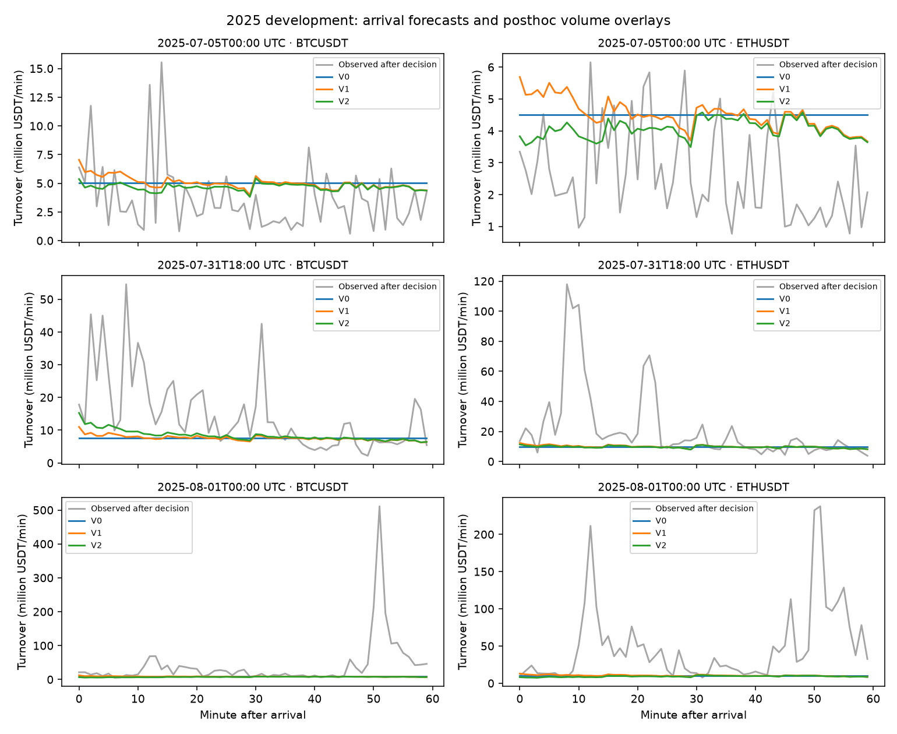
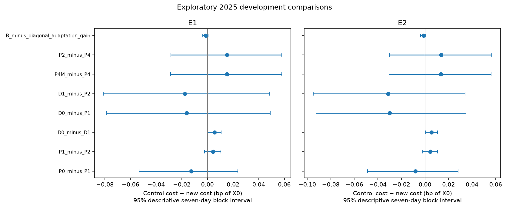
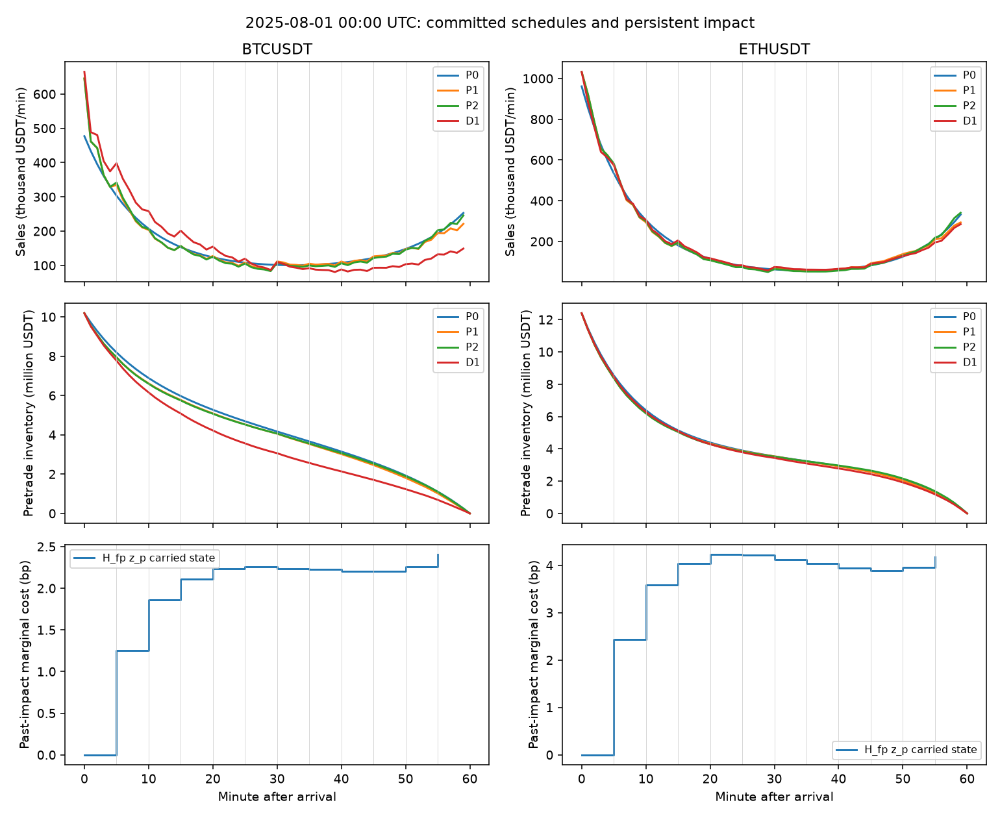
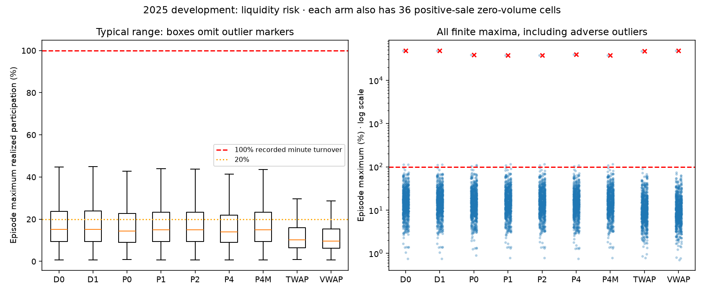

# X1: adaptive execution and scenario-based stochastic liquidity

UTC 2026-10-28T14:48:22.347168+00:00. **X1-G0 PASS; X1-G1 PASS; X1-G2 PASS.**
Implementation **PASS**; adaptive-cost scientific result **INCONCLUSIVE**.
This is exploratory July–December 2025 development replay, after original model
selection and previously inspected Stage5 results. It supplies no fresh held-out
confirmation. All original Stage1–5 files, models, hashes and results are preserved.
No 2026 canonical outcome was accessed; no Session2 robust optimization was begun.

## Frozen design and mathematics

[Protocol](../../docs/extensions/x1_adaptive_liquidity_protocol_v1.md) and
[config](../../configs/extension_x1_adaptive_liquidity.yaml) were written before
execution scoring. Training origins: Jan29 2024–Jun30 2025, four/day, after28d
warmup; development736/736 original episodes, four/day,60min. All inputs are
Binance Vision USD-M BTCUSDT/ETHUSDT perpetual last-trade1m klines. Quote turnover
is USDT/min, bar opens at b and becomes available b+1min. Filtered reads reject
2026 before opening. At replan t+5 only bar opens<=t+4 enter; all arms' prefixes
commit before the next observations are revealed. Completed volume can change
later prefixes, never earlier commitments. No alpha or contemporaneous future flow.

V0 reproduces Stage4. V1 pools28 complete UTC days, median positive within-hour
reference, normalized minute ratios including genuine zeros, shrinkage n/(n+50),
mean-one profile and original positive past-p1 floor. Excluded/partial hours and
floor counts are saved in forecast_qa.json. V2 adds completed-span5/60 EWMA ratio,
clipped[.5,2], exponentially returning to1 with tau15; no tau search or56d tuning.
V1 profiles use complete days; the V0 hourly level updates at replans with the
latest completed minutes. The main fixed risk/kernel/caps never update.

Parent X0=.02 sum V0, cap0=.1V0, original Sigma and beta, arrival prices and
monthly B remain fixed across arms. D0/D1 remove each B cross component while
preserving its self terms/tau/L, i.e. T3B, not separately fitted A. P0=B/V0 static;
P1=B/V1 static; P2=B/V1 MPC; gated P3=B/V2 MPC; gated P4=scenario-weighted MPC;
P4M=median-only matched scenario control. TWAP/VWAP are diagnostics under cap0.
Cadence5min, frozen five-minute prefixes, sell-only hard terminal, no repairs.

Let z=(zp,zf), full exact-cell USDT cash Hessian H. Expanding
C=.5 zp'Hpp zp + zf'Hfp zp + .5 zf'Hff zf shows the conditional linear term
**Hfp zp** must remain. We retain it; independent exponential-state sums and
finite-difference gradients agree. Future risk uses Xremaining=X0−sum(zp),
unchanged beta/Sigma, hbefore=Xremaining−prefix(zf). This gives
Hfuture=Hff+2kappa diag(invV)+2beta A'RA and
qfuture=Hfp zp−2beta A'R tile(Xremaining)+.0006.
The .0006 fee/spread is schedule-invariant under liquidation. Risk is a
preference, not cash expense. Every conditional solve checks PSD, scaled KKT,
constraints and decomposition. Full schedule cash/risk is evaluated once;
local QP objectives are never summed. Unchanged deterministic forecasts recover
the initial optimum's tail; deliberately resetting past impact fails that control.

S1 residuals log(max(realized,past floor)/prediction) use training labels only,
three horizon buckets1–5/6–15/16–60 and empirical10/50/90 factors. Scenario
curvature is kappa z²(.25/Vlow+.50/Vmid+.25/Vhigh); P4M uses kappa z²/Vmid.
This is a three-point expectation/stress proxy, not a full stochastic process,
robust optimization, random impact kernel, joint-path band or AJNT theorem.

## Forecast evidence and gate, before policy scoring

V2 enabled: **False**, primary scenario base **V1**.
Forecast assessment uses timestamp-aligned60min forecasts issued at the four
arrival origins each day. It does not claim to assess every overlapping MPC
forecast origin. MAE in USDT/min; RMSLE uses log1p so observed zero volumes are
retained; median APE is restricted to positive observations.

| model | asset | n | mae_usdt | rmsle | median_ape_positive | zero_labels |
| --- | --- | --- | --- | --- | --- | --- |
| V0 | BTCUSDT | 44160 | 6.84508e+06 | 1.03338 | 0.590387 | 18 |
| V0 | ETHUSDT | 44160 | 8.72675e+06 | 1.03783 | 0.601597 | 18 |
| V1 | BTCUSDT | 44160 | 6.82297e+06 | 1.02748 | 0.589284 | 18 |
| V1 | ETHUSDT | 44160 | 8.71251e+06 | 1.03365 | 0.600265 | 18 |
| V2 | BTCUSDT | 44160 | 6.81419e+06 | 1.0324 | 0.577136 | 18 |
| V2 | ETHUSDT | 44160 | 8.67893e+06 | 1.03795 | 0.591712 | 18 |

Positive forecast contrast favors the new model. Separate daily/seven-day block
uncertainty (500draws,seed20261027):

| control | new | metric | mean | ci_low | ci_high |
| --- | --- | --- | --- | --- | --- |
| V0 | V1 | log_squared | 0.0104001 | 0.00662307 | 0.0140047 |
| V0 | V1 | mae_usdt | 18174.5 | 9090.25 | 27392 |
| V1 | V2 | log_squared | -0.00951495 | -0.0268521 | 0.00422728 |
| V1 | V2 | mae_usdt | 21182.7 | -27011.8 | 62413.7 |
| V0 | V2 | log_squared | 0.000885117 | -0.0183697 | 0.0161778 |
| V0 | V2 | mae_usdt | 39357.2 | -8905.27 | 80378.4 |

Training-only S1: 2076 origins;
status **PASS**, max absolute coverage error
4.21 percentage points. A failed coverage
gate does not erase bands: all measured coverage/pinball results remain below;
P4/P4M are then NOT_RUN. Bands remain marginal approximations even when they pass.

| asset | bucket | quantile | factor | coverage | pinball_usdt | n |
| --- | --- | --- | --- | --- | --- | --- |
| BTCUSDT | 0 | 0.1 | 0.359797 | 0.101902 | 1.00418e+06 | 3680 |
| BTCUSDT | 0 | 0.5 | 1.00314 | 0.521467 | 4.05142e+06 | 3680 |
| BTCUSDT | 0 | 0.9 | 3.61756 | 0.90462 | 4.18064e+06 | 3680 |
| BTCUSDT | 1 | 0.1 | 0.334014 | 0.113587 | 759331 | 7360 |
| BTCUSDT | 1 | 0.5 | 0.973963 | 0.524185 | 2.96134e+06 | 7360 |
| BTCUSDT | 1 | 0.9 | 3.64349 | 0.913859 | 2.74034e+06 | 7360 |
| BTCUSDT | 2 | 0.1 | 0.335017 | 0.121467 | 861664 | 33120 |
| BTCUSDT | 2 | 0.5 | 1.01033 | 0.524758 | 3.44098e+06 | 33120 |
| BTCUSDT | 2 | 0.9 | 3.91906 | 0.907126 | 3.42762e+06 | 33120 |
| ETHUSDT | 0 | 0.1 | 0.364383 | 0.1375 | 1.19227e+06 | 3680 |
| ETHUSDT | 0 | 0.5 | 0.998568 | 0.536957 | 4.76164e+06 | 3680 |
| ETHUSDT | 0 | 0.9 | 3.65788 | 0.91413 | 4.79367e+06 | 3680 |
| ETHUSDT | 1 | 0.1 | 0.333242 | 0.124592 | 962567 | 7360 |
| ETHUSDT | 1 | 0.5 | 0.994915 | 0.54212 | 3.80803e+06 | 7360 |
| ETHUSDT | 1 | 0.9 | 3.73373 | 0.922554 | 3.57025e+06 | 7360 |
| ETHUSDT | 2 | 0.1 | 0.335604 | 0.121196 | 1.10341e+06 | 33120 |
| ETHUSDT | 2 | 0.5 | 1.03649 | 0.526479 | 4.44478e+06 | 33120 |
| ETHUSDT | 2 | 0.9 | 4.18934 | 0.913496 | 4.35078e+06 | 33120 |

Full by-minute, horizon-bucket and month errors: forecast_metrics.csv;
training residual construction: scenario_calibration.json. No development label
calibrated its own quantile. V2 failure, if any, remains a negative forecast result.



## Matched exploratory modeled cash costs

E1 uses the unchanged frozen-family Stage5 factory with exact180d ending30d
before each2025 month, tau(5,30),ridge1, own-window L/standardization. E2 removes
E1 cross terms. Six models are saved only in the X1 namespace. E1 is a separate
past-data parameterization, not causally independent evidence. All policies
share one evaluator hash per episode/world and frozen V0 temporary-cost volume.
Recorded next-bin closes score arrival shortfall only after schedule commitments.
Five cash components: path+transient+temporary+assumed fee5bp+halfspread1bp;
**funding unobserved/omitted**, all-in cost unestimated. Risk is reported separately.
No E0 result is used as evidence; no realized-volume cost variant was added.

| world | policy | episodes | mean_bps | median_bps | path_usdt | transient_usdt | temporary_usdt |
| --- | --- | --- | --- | --- | --- | --- | --- |
| E1 | D0 | 736 | 9.2378 | 7.99086 | 3736.85 | 2152.58 | 594.828 |
| E1 | D1 | 736 | 9.23219 | 8.09638 | 3724.49 | 2152.66 | 594.459 |
| E1 | P0 | 736 | 9.24141 | 7.84187 | 3935.07 | 2077.86 | 541.857 |
| E1 | P1 | 736 | 9.25411 | 8.04466 | 3862.9 | 2102.92 | 584.638 |
| E1 | P2 | 736 | 9.24972 | 8.03351 | 3852.07 | 2103.13 | 584.219 |
| E1 | P4 | 736 | 9.23457 | 7.91261 | 3889.74 | 2084.57 | 546.967 |
| E1 | P4M | 736 | 9.24978 | 8.01537 | 3850.48 | 2103.18 | 584.742 |
| E1 | TWAP | 736 | 9.39303 | 7.70307 | 4772.87 | 1968.4 | 323.073 |
| E1 | VWAP | 736 | 9.34906 | 7.77541 | 4657.67 | 1967.26 | 326.779 |
| E2 | D0 | 736 | 8.93738 | 7.77319 | 3736.85 | 1578.79 | 594.828 |
| E2 | D1 | 736 | 8.93179 | 7.77782 | 3724.49 | 1578.87 | 594.459 |
| E2 | P0 | 736 | 8.95913 | 7.52006 | 3935.07 | 1538.3 | 541.857 |
| E2 | P1 | 736 | 8.96736 | 7.66805 | 3862.9 | 1555.23 | 584.638 |
| E2 | P2 | 736 | 8.96298 | 7.67328 | 3852.07 | 1555.41 | 584.219 |
| E2 | P4 | 736 | 8.94926 | 7.58574 | 3889.74 | 1539.06 | 546.967 |
| E2 | P4M | 736 | 8.96266 | 7.66745 | 3850.48 | 1554.78 | 584.742 |
| E2 | TWAP | 736 | 9.1178 | 7.45588 | 4772.87 | 1436.95 | 323.073 |
| E2 | VWAP | 736 | 9.07424 | 7.4428 | 4657.67 | 1436.59 | 326.779 |

**Sign: cost(control)−cost(new), positive favors new**, bp of original total X0.
P1_minus_P2 isolates adaptation with V1; D0_minus_D1 is the matched diagonal
adaptation; B_minus_diagonal_adaptation_gain is their difference. P4 versus its
base combines median recalibration/weighting; P4M_minus_P4 isolates weighting.
All intervals are descriptive post-search seven-day calendar-block500draws;
calendar days preserve four paired episodes. No confirmatory p-value or causal
savings claim. Negative episodes, signs and adverse months remain in outputs.

| world | contrast | mean | ci_low | ci_high | median_bps | negative_share | worst_bps |
| --- | --- | --- | --- | --- | --- | --- | --- |
| E1 | P0_minus_P1 | -0.0126997 | -0.0534007 | 0.0236122 | -0.021505 | 0.513587 | -2.43838 |
| E1 | P1_minus_P2 | 0.00438231 | -0.00227659 | 0.0105146 | 0.000708308 | 0.486413 | -0.679579 |
| E1 | D0_minus_D1 | 0.00560538 | 0.00034131 | 0.0106905 | 0.00226228 | 0.470109 | -0.497513 |
| E1 | D0_minus_P1 | -0.016307 | -0.078575 | 0.0490408 | 0.0287648 | 0.478261 | -8.82652 |
| E1 | D1_minus_P2 | -0.0175301 | -0.081158 | 0.0483946 | 0.0291185 | 0.476902 | -9.19856 |
| E1 | P4M_minus_P4 | 0.01521 | -0.0288157 | 0.05807 | 0.0153476 | 0.487772 | -3.52306 |
| E1 | P2_minus_P4 | 0.015156 | -0.0285118 | 0.0580511 | 0.0129804 | 0.480978 | -3.32087 |
| E1 | B_minus_diagonal_adaptation_gain | -0.00122307 | -0.00376739 | 0.000638486 | -0.000367554 | 0.513587 | -0.372041 |
| E2 | P0_minus_P1 | -0.00823072 | -0.0487748 | 0.0281973 | -0.0168165 | 0.512228 | -2.43045 |
| E2 | P1_minus_P2 | 0.00437823 | -0.00226984 | 0.0105155 | 0.000786704 | 0.485054 | -0.679831 |
| E2 | D0_minus_D1 | 0.00559197 | 0.000374001 | 0.0106495 | 0.0022841 | 0.467391 | -0.499421 |
| E2 | D0_minus_P1 | -0.029981 | -0.0925922 | 0.0348503 | 0.0144025 | 0.490489 | -8.84135 |
| E2 | D1_minus_P2 | -0.0311948 | -0.0949185 | 0.03417 | 0.0171588 | 0.486413 | -9.21365 |
| E2 | P4M_minus_P4 | 0.0134058 | -0.0306114 | 0.0561365 | 0.0133333 | 0.48913 | -3.52596 |
| E2 | P2_minus_P4 | 0.0137272 | -0.0299029 | 0.0566464 | 0.0111589 | 0.482337 | -3.32339 |
| E2 | B_minus_diagonal_adaptation_gain | -0.00121374 | -0.00375632 | 0.00067605 | -0.000359814 | 0.516304 | -0.372303 |

The main full-B adaptive contrast is **+0.004382bp** under E1,
95% descriptive interval **[−0.002277,+0.010515]**: its sign remains uncertain
and the magnitude is small. The diagonal V1 adaptation contrast is +0.005605bp
[+0.000341,+0.010691]; it does not establish an advantage of cross-impact.
V1 static versus original P0 has a negative E1 point (−0.012700bp), despite
better volume forecasts. Scenario P4 versus P2 is +0.015156bp
[−0.028512,+0.058051]; median-controlled scenario weighting is also uncertain.
These are development diagnostics, not evidence of causal execution savings.

Monthly, weekend and past-liquidity-tercile effects: paired_contrasts.csv;
worst10 cases per contrast/world: adverse_episodes.csv. Terciles use episode-start
past-predicted turnover only. Effects must be read across E1/E2; not every
forecast or adaptive change need improve cash costs.



## Feasibility, liquidity risk and runtime

| policy | episodes | cap_violations | terminal_max_usdt | primal_max | kkt_max | replans | max_replan_seconds | repairs |
| --- | --- | --- | --- | --- | --- | --- | --- | --- |
| D0 | 736 | 0 | 2.23517e-08 | 1.07791e-15 | 4.84802e-15 | 736 | 0.119801 | 0 |
| D1 | 736 | 0 | 3.72529e-09 | 1.07791e-15 | 4.84802e-15 | 8832 | 0.487186 | 0 |
| P0 | 736 | 0 | 1.49012e-08 | 1.14323e-15 | 4.52755e-15 | 736 | 0.0231076 | 0 |
| P1 | 736 | 0 | 1.49012e-08 | 1.11184e-15 | 4.44144e-15 | 736 | 0.0976092 | 0 |
| P2 | 736 | 0 | 3.72529e-09 | 1.11184e-15 | 4.44144e-15 | 8832 | 0.249654 | 0 |
| P4 | 736 | 0 | 3.72529e-09 | 1.10001e-15 | 3.75966e-15 | 8832 | 0.0672317 | 0 |
| P4M | 736 | 0 | 3.72529e-09 | 1.009e-15 | 4.03496e-15 | 8832 | 0.25713 | 0 |

No silent clipping, cap relaxation or terminal repair. Risk/raw USDT² and full
runtime/decomposition are in policy_qa_summary.csv. Original T4 reproduction
max sale difference / initial inventory=1.09e-15;
V1 vs V0 median relative L2=0.1069;
forecast VWAP vs TWAP median relative L2=0.1069.
Matched policies use identical initial/covariance/cap/input hashes and beta.

| policy | episodes | positive_volume_cells | zero_volume_cells | positive_sales_zero_volume | over10_pct | over20_pct | over100_pct | max_positive_volume_ratio | median_episode_p99 | episodes_any_over10 | episodes_any_over100 |
| --- | --- | --- | --- | --- | --- | --- | --- | --- | --- | --- | --- |
| D0 | 736 | 88284 | 36 | 36 | 5.0111 | 1.02284 | 0.00453083 | 482.016 | 0.121248 | 532 | 3 |
| D1 | 736 | 88284 | 36 | 36 | 4.96806 | 1.00584 | 0.00453083 | 482.861 | 0.120883 | 532 | 3 |
| P0 | 736 | 88284 | 36 | 36 | 4.89443 | 0.979792 | 0.00566354 | 390.439 | 0.115669 | 520 | 4 |
| P1 | 736 | 88284 | 36 | 36 | 4.91482 | 1.02623 | 0.00453083 | 376.813 | 0.1207 | 534 | 3 |
| P2 | 736 | 88284 | 36 | 36 | 4.89443 | 1.00924 | 0.00453083 | 375.167 | 0.119969 | 536 | 3 |
| P4 | 736 | 88284 | 36 | 36 | 4.68941 | 0.907299 | 0.00453083 | 399.936 | 0.115724 | 514 | 3 |
| P4M | 736 | 88284 | 36 | 36 | 4.89556 | 1.00924 | 0.00453083 | 375.992 | 0.120235 | 535 | 3 |
| TWAP | 736 | 88284 | 36 | 36 | 3.84328 | 0.545965 | 0.00226542 | 477.628 | 0.0823713 | 375 | 1 |
| VWAP | 736 | 88284 | 36 | 36 | 3.60541 | 0.471207 | 0.00226542 | 486.93 | 0.0795984 | 355 | 1 |

Threshold denominators and maximum-ratio columns use positive-volume asset-minutes. Zero-volume bins are
undefined and positive sales in them explicitly infeasible. Exact pooled upper
quantiles are in participation_quantiles.csv; episode p95/p99/max and miss
concentration are retained. Above100% is evidence that modeled orders cannot be
interpreted as executable fills; it is retained, not repaired or excluded.
Forecast-cap feasibility is not realized-liquidity feasibility. Compare all arms'
participation rates/maxima rather than inferring liquidity improvement from cost.

For P1→P2, the share above10% falls only from4.9148% to4.8944% of
positive-volume cells; above20% from1.0262% to1.0092%. P4 lowers the above10%
share to4.6894%, but retains severe outliers. Every arm has **36 positive-sale
asset-minutes with observed zero turnover**, explicitly infeasible. P2's largest
finite ratio is **375.17 times** recorded turnover; P4's is399.94 times.
These extreme development-source/liquidity cases invalidate any fill claim and
remain in all comparisons. Neither feedback nor the scenario proxy solves
realized-liquidity feasibility in this replay. Episode-level concentration and
adverse IDs are retained, not used to revise eligibility.





## Verification, limitations and next-session handoff

Focused tests cover future mutations/availability, original V0/T4 parity,
complete-hour/zero/scenario construction, signed admissible cross terms,
Hessian/state/gradient identities, unchanged-tail time consistency at0/5/55/59,
zero inventory/kernel, independent CLARABEL parity, risk/cap/terminal checks,
scenario curvature and common-evaluator independence. Actual pytest results are
saved in test_results.json/pytest.xml. Original source tests were rerun excluding
Stage1 integration cases because they open2026 source pilots. Pilot deterministic
rerun evidence is pilot_reproducibility.json. All 456 prior
protected files and 60 canonical stat snapshots
are unchanged. Numerical-source/config/scenario/model/source hashes, versions and
reader bounds are in run_manifest.json and run_development.json.

Final suite: **202 passed, 0 failed, 0 errors**;
36 X1 cases; two integration cases deselected; four pre-existing
parser deprecation warnings. pip check passed. One temporary indentation error
during editing was corrected before the pilot/lock. The output-only zero-volume
JSON failure and unchanged numerical algorithm AST are preserved in
zero_volume_serialization_fix.json and provenance/. No episode was removed.
The independent output audit verifies all736 episodes/37536 issued
prefixes and 108 direct triangular cash checks:
max discrepancy 3.18e-11 USDT, complete-score
reproduction discrepancy 0, max terminal
2.24e-08 USDT. Source/model/cap/risk/clock checks pass.

Scenario tail calibration improves on using a single V1 point as every quantile;
the median is slightly worse, retained as a negative result. The numerical
comparison is scenario_point_reference.csv; this degenerate point reference is
not a competing probabilistic model.

Data attribution: [Binance Vision public-data documentation](https://github.com/binance/binance-public-data),
recorded CC BY-NC-SA terms; no raw data redistributed. Mathematics builds on the
locally verified [AJNT v2](../../references/2403.10273v2.pdf), using the constrained
applied variant, not the stochastic Fredholm theorem. Public-flow confounding is
discussed in [Naviglio et al.](https://arxiv.org/abs/2501.17096).
No new causal identification, live savings, BBO/fills or all-in perpetual-P&L
claims. Development reuse, unmodeled volume dependence, marginal-band
misspecification, deterministic impact and proxy temporary liquidity remain limits.

Incremental retained disk ~226.4MiB; conservative temporary/retained
peak estimate<452.8MiB. Replay measured peakRSS
301.9MiB, runtime8.80min. No packages/downloads.

```sh
.venv/bin/python -m pytest tests/test_extension_x1.py -q
.venv/bin/python scripts/extension_x1.py forecasts
.venv/bin/python scripts/extension_x1.py pilot
.venv/bin/python scripts/extension_x1.py development
.venv/bin/python scripts/extension_x1.py report
```

Existing decisions resume by input/gate/schedule hashes; they are not overwritten.
The safe next action is to review this exploratory evidence before separately
authorizing Session2. Preserve future Option2 (genuinely random Volterra kernels
and adapted path control) as future research; it is not implemented here.
Stop before robust optimization and any new final-test access.
