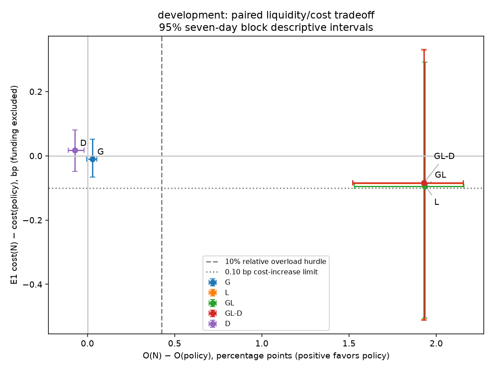
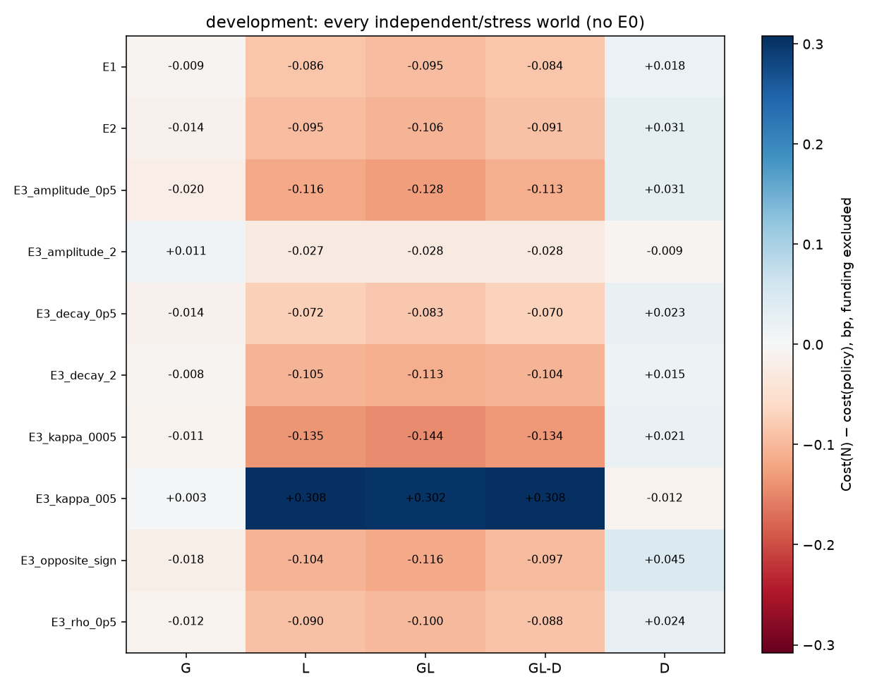
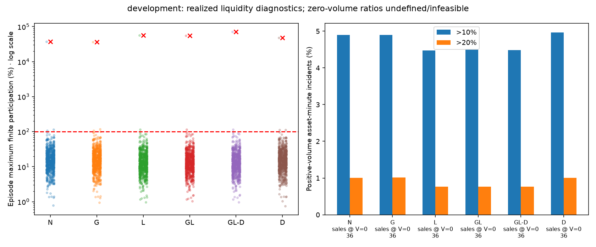

# X2+X3 development: robust impact, liquidity tails and funding-excluded execution

UTC 2026-10-28T16:55:51.819872+00:00. **Implementation PASS; scientific label TRADEOFF_OR_MIXED.**
DEVELOPMENT: PASS. PRETEST: READY.
NEW_OOS: COMPLETE. New July–September2026 source values opened:
**True**. This development sample is
exploratory July–December2025, already used for research/model selection.
No old H1/H2 or X1 result was changed. All amounts exclude funding, which is
unobserved/omitted, not zero. No live fills or causal own-trade gains are established.

## Frozen question and design

[Protocol](../../docs/extensions/x2x3_robust_liquidity_protocol_v1.md),
[config](../../configs/extension_x2x3.yaml), and
[extension change record](../../docs/extensions/x2x3_spec_amendment_v1.md) define
H-L overload risk, H-G independent-world regret/tails, H-GL incremental combined
protection and H-cross same-self diagonal comparison. Original documents remain
immutable; a root changelog append would break their old lock hashes, so the
new dated extension record preserves those predecessors.

N reproduces X1 P2 (B/V1/five-minute MPC); D is X1 D1. G uses fixed finite
admissible kernel ambiguity; L adds CVaR90 overload preference; GL combines;
GL-D diagonalizes each same-self scenario. TWAP is context, not part of the
six-policy ex-post regret reference. X0=.02sum(V0), cap0=.1V0, beta/full Sigma,
reference prices, B/tau/L and fee5bp/halfspread1bp assumptions are fixed at arrival.
Kappa.001, theta1, no alpha, 60min, four starts/day, exact-cell cash convention.
Observed next-bar closes and volume affect scoring only after commitment.
No future value/existence check selects episodes or constraints. Source clocks
are UTC bar open b, available at b+1min; prefixes persist before next reveal.

Ambiguity is B, diag(B), half-cross PSD interpolation, opposite-sign DBD and
frozen June2025 B with its own L. There are no new fitted kernel families.
E1 remains separate180d ending30d before month, tau5/30,ridge1; E2 diagonal E1;
all eight original E3 stresses retained, E0 excluded. Future as-of B fits use
365 complete preceding days, same tau60/ridge1. Already inspected Jan–Jun2026
is disclosed past calibration history only. No hyperparameter retuning after freeze.

## Conditional optimization and numerical checks

For scenario g, remaining transient cost is .5zf'Hff_g zf+zf'Hfp_g zp.
Past-only .5zp'Hpp_g zp is excluded from max ordering. Original reference-USDT
normalization10^-4 and each scenario's sqrt(L) factors appear once. Risk uses
Xremaining=X0−sum(zp), unchanged beta/Sigma. G/GL epigraphs are convex because
Hff_g is PSD; negative admissible cross terms are permitted. No material PSD
projection, cap relaxation, clipping or inventory repair. Never sum local QPs.

12 joint paired-asset historical hours come from preceding28 complete days at
matching hour. Deterministic SHA256 date/seed rank selects12; min support12,
otherwise HOLD. Each minute is scaled by its positive past matching-hour median
and current known V1. Zero historical capacity stays zero. Marginal S1 bands
are not substituted for a joint law. Scenario timestamps/support and posthoc
10/50/90 coverage diagnostics are retained. The bank approximates dependence;
it does not claim calibrated joint path coverage or firm liquidity.

For future z, e_s=sum(max(z−.1V_s,0))/ORIGINAL W. Preference is
(W/10000)*lambda*CVaR90(e), with equal scenario weights. e=.05,lambda100 means
5bp of preference, not paid cost. A nonnegative VaR bound is redundant because
e_s>=0; it improves numerical conditioning. Conic retries tighten tolerances
rather than changing acceptance gates. All attempts/status/KKT/duals/epigraph
checks are retained. Exact elementwise Hessian dominance proves redundant max
constraints on the nonnegative-sale cone; certified singleton QPs use the verified
X1 solver, while genuine QCQPs use CLARABEL. All declared scenarios/costs remain
in audits; no unfavorable ambiguity point is dropped for economic reasons.

Actual active-scenario shares for this development sample:

| policy | scenario | replans | dominance_reduction_share | mean_predicted_remaining_CVaR | active_share |
| --- | --- | --- | --- | --- | --- |
| G | B_fixed_June2025 | 8832 | 1 | 0 | 1 |
| GL | B_fixed_June2025 | 8832 | 1 | 0.00409414 | 1 |
| GL-D | B_fixed_June2025 | 8832 | 1 | 0.0037677 | 1 |

Predicted remaining CVaR uses original W at every replan; these averages are
optimization diagnostics, not paid cash or joint calibration tests. All scenario
dual weights and full physical remaining costs stay in immutable episode records.

## Development selection fixed before holdout

Arrival-horizon marginal scenario diagnostics (not joint-path calibration):
joint12-path empirical quantiles versus the unchanged training-calibrated X1
S1 bands. These are diagnostics only; no scenario weighting or penalty is tuned
from this table. Buckets0/1/2 mean1–5/6–15/16–60min; pinball units USDT/min.

| model | asset | bucket | quantile | coverage | pinball_usdt | n |
| --- | --- | --- | --- | --- | --- | --- |
| X1_frozen_S1_marginal | BTCUSDT | 0 | 0.1 | 0.101902 | 1.00418e+06 | 3680 |
| X1_frozen_S1_marginal | BTCUSDT | 0 | 0.5 | 0.521467 | 4.05142e+06 | 3680 |
| X1_frozen_S1_marginal | BTCUSDT | 0 | 0.9 | 0.90462 | 4.18064e+06 | 3680 |
| X1_frozen_S1_marginal | BTCUSDT | 1 | 0.1 | 0.113587 | 759331 | 7360 |
| X1_frozen_S1_marginal | BTCUSDT | 1 | 0.5 | 0.524185 | 2.96134e+06 | 7360 |
| X1_frozen_S1_marginal | BTCUSDT | 1 | 0.9 | 0.913859 | 2.74034e+06 | 7360 |
| X1_frozen_S1_marginal | BTCUSDT | 2 | 0.1 | 0.121467 | 861664 | 33120 |
| X1_frozen_S1_marginal | BTCUSDT | 2 | 0.5 | 0.524758 | 3.44098e+06 | 33120 |
| X1_frozen_S1_marginal | BTCUSDT | 2 | 0.9 | 0.907126 | 3.42762e+06 | 33120 |
| X1_frozen_S1_marginal | ETHUSDT | 0 | 0.1 | 0.1375 | 1.19227e+06 | 3680 |
| X1_frozen_S1_marginal | ETHUSDT | 0 | 0.5 | 0.536957 | 4.76164e+06 | 3680 |
| X1_frozen_S1_marginal | ETHUSDT | 0 | 0.9 | 0.91413 | 4.79367e+06 | 3680 |
| X1_frozen_S1_marginal | ETHUSDT | 1 | 0.1 | 0.124592 | 962567 | 7360 |
| X1_frozen_S1_marginal | ETHUSDT | 1 | 0.5 | 0.54212 | 3.80803e+06 | 7360 |
| X1_frozen_S1_marginal | ETHUSDT | 1 | 0.9 | 0.922554 | 3.57025e+06 | 7360 |
| X1_frozen_S1_marginal | ETHUSDT | 2 | 0.1 | 0.121196 | 1.10341e+06 | 33120 |
| X1_frozen_S1_marginal | ETHUSDT | 2 | 0.5 | 0.526479 | 4.44478e+06 | 33120 |
| X1_frozen_S1_marginal | ETHUSDT | 2 | 0.9 | 0.913496 | 4.35078e+06 | 33120 |
| joint_12_paths | BTCUSDT | 0 | 0.1 | 0.166848 | 1.09096e+06 | 3680 |
| joint_12_paths | BTCUSDT | 0 | 0.5 | 0.522826 | 4.15599e+06 | 3680 |
| joint_12_paths | BTCUSDT | 0 | 0.9 | 0.847554 | 4.52476e+06 | 3680 |
| joint_12_paths | BTCUSDT | 1 | 0.1 | 0.18288 | 851580 | 7360 |
| joint_12_paths | BTCUSDT | 1 | 0.5 | 0.536005 | 3.06701e+06 | 7360 |
| joint_12_paths | BTCUSDT | 1 | 0.9 | 0.853261 | 2.93745e+06 | 7360 |
| joint_12_paths | BTCUSDT | 2 | 0.1 | 0.159239 | 919328 | 33120 |
| joint_12_paths | BTCUSDT | 2 | 0.5 | 0.519565 | 3.53008e+06 | 33120 |
| joint_12_paths | BTCUSDT | 2 | 0.9 | 0.853986 | 3.76527e+06 | 33120 |
| joint_12_paths | ETHUSDT | 0 | 0.1 | 0.18288 | 1.31418e+06 | 3680 |
| joint_12_paths | ETHUSDT | 0 | 0.5 | 0.537228 | 4.87406e+06 | 3680 |
| joint_12_paths | ETHUSDT | 0 | 0.9 | 0.853804 | 5.07598e+06 | 3680 |
| joint_12_paths | ETHUSDT | 1 | 0.1 | 0.196332 | 1.08912e+06 | 7360 |
| joint_12_paths | ETHUSDT | 1 | 0.5 | 0.546875 | 3.94493e+06 | 7360 |
| joint_12_paths | ETHUSDT | 1 | 0.9 | 0.851902 | 3.67276e+06 | 7360 |
| joint_12_paths | ETHUSDT | 2 | 0.1 | 0.169354 | 1.18428e+06 | 33120 |
| joint_12_paths | ETHUSDT | 2 | 0.5 | 0.516938 | 4.5358e+06 | 33120 |
| joint_12_paths | ETHUSDT | 2 | 0.9 | 0.844958 | 4.77187e+06 | 33120 |

Selected lambda: **25**; selected candidate: **L**.
L25/L100 were compared on all736 fixed development episodes, selecting the
smallest nonzero lambda achieving>=10% mean overload reduction and E1 mean
shortfall increase<=.10bp. No GL-specific tuning; no penalty/family expansion.
If neither qualifies, candidate N continues and lambda25 L/GL/GL-D remain fixed
negative ablations. All tested variants, hashes and freeze time remain saved.

| lambda_liq | baseline_mean_overload | mean_overload | relative_reduction | E1_cost_increase_bps | qualifies |
| --- | --- | --- | --- | --- | --- |
| 25 | 0.0424057 | 0.0231072 | 0.455092 | 0.085928 | True |
| 100 | 0.0424057 | 0.0231073 | 0.455089 | 0.0862243 | True |

Original X1 background/context values below are retained read-only, not rescored
or reinterpreted as X2/X3 confirmation. They use the same development episodes
and E1/E2 definitions and do not enter the six-policy regret reference.

| world | policy | episodes | mean_bps | median_bps |
| --- | --- | --- | --- | --- |
| E1 | P0 | 736 | 9.24141 | 7.84187 |
| E1 | P1 | 736 | 9.25411 | 8.04466 |
| E1 | P4 | 736 | 9.23457 | 7.91261 |
| E2 | P0 | 736 | 8.95913 | 7.52006 |
| E2 | P1 | 736 | 8.96736 | 7.66805 |
| E2 | P4 | 736 | 8.94926 | 7.58574 |

## Observed overload and liquidity incidents

O=sum_all(max(z−.1Vreal,0))/W, including zero-volume minutes. It is an overload
diagnostic, not unfilled volume or a fill model. Ratios at zero volume are
undefined; positive sales there are explicitly infeasible. Percentages below
use positive-volume asset-minute denominators; maxima and zero counts are retained.

| policy | episodes | mean_overload | median_overload | p90_overload | p95_overload | zero_overload_rate | worst_day | worst_day_mean_overload | positive_volume_cells | over10_pct | over20_pct | over100_pct | zero_volume_cells | positive_sales_zero_cells | zero_sale_affected_episodes | maximum_finite_ratio | episodes_over100 |
| --- | --- | --- | --- | --- | --- | --- | --- | --- | --- | --- | --- | --- | --- | --- | --- | --- | --- |
| D | 736 | 0.0431182 | 0.017068 | 0.135187 | 0.176344 | 0.277174 | 2025-12-25 | 0.182404 | 88284 | 4.96806 | 1.00584 | 0.00453083 | 36 | 36 | 1 | 482.861 | 3 |
| G | 736 | 0.042127 | 0.0163278 | 0.130995 | 0.170745 | 0.269022 | 2025-12-25 | 0.176975 | 88284 | 4.89556 | 1.0183 | 0.00566354 | 36 | 36 | 1 | 362.243 | 4 |
| GL | 736 | 0.0230739 | 0.00570192 | 0.0683996 | 0.111896 | 0.350543 | 2025-12-25 | 0.181875 | 88284 | 4.49119 | 0.762313 | 0.00339812 | 36 | 36 | 1 | 547.823 | 2 |
| GL-D | 736 | 0.0231253 | 0.00522582 | 0.0677351 | 0.113901 | 0.355978 | 2025-12-25 | 0.181027 | 88284 | 4.47986 | 0.763445 | 0.00339812 | 36 | 36 | 1 | 704.093 | 2 |
| L | 736 | 0.0231072 | 0.00529169 | 0.0684105 | 0.112762 | 0.360054 | 2025-12-25 | 0.181319 | 88284 | 4.47533 | 0.769109 | 0.00339812 | 36 | 36 | 1 | 566.988 | 2 |
| N | 736 | 0.0424057 | 0.0163076 | 0.132555 | 0.172256 | 0.271739 | 2025-12-25 | 0.178852 | 88284 | 4.89443 | 1.00924 | 0.00453083 | 36 | 36 | 1 | 375.167 | 3 |
| TWAP | 736 | 0.0109046 | 0.000113245 | 0.0284304 | 0.0619098 | 0.490489 | 2025-12-25 | 0.142823 | 88284 | 3.84328 | 0.545965 | 0.00226542 | 36 | 36 | 1 | 477.628 | 1 |

Paired overload differences positive favor new; units are fractions of original
parent notional (multiply100 for percentage points). Relative reductions and
95% intervals use shared seven-day calendar blocks,500draws,seed20261027.

| control | new | episodes | mean_control | mean_new | mean | ci_low | ci_high | relative_reduction | relative_ci_low | relative_ci_high | relative_ratio_status |
| --- | --- | --- | --- | --- | --- | --- | --- | --- | --- | --- | --- |
| N | G | 736 | 0.0424057 | 0.042127 | 0.000278726 | -4.30788e-05 | 0.00052779 | 0.00657285 | -0.00110874 | 0.0125216 | ESTIMATED |
| N | L | 736 | 0.0424057 | 0.0231072 | 0.0192985 | 0.015243 | 0.0215411 | 0.455092 | 0.400748 | 0.506077 | ESTIMATED |
| N | GL | 736 | 0.0424057 | 0.0230739 | 0.0193318 | 0.0152931 | 0.0215909 | 0.455877 | 0.401716 | 0.506765 | ESTIMATED |
| N | GL-D | 736 | 0.0424057 | 0.0231253 | 0.0192804 | 0.0152059 | 0.021552 | 0.454665 | 0.400421 | 0.506012 | ESTIMATED |
| N | D | 736 | 0.0424057 | 0.0431182 | -0.000712482 | -0.00110008 | -0.000202961 | -0.0168016 | -0.0267939 | -0.00528265 | ESTIMATED |
| L | GL | 736 | 0.0231072 | 0.0230739 | 3.33058e-05 | -6.30091e-05 | 0.000147552 | 0.00144136 | -0.00319249 | 0.00606648 | ESTIMATED |
| GL-D | GL | 736 | 0.0231253 | 0.0230739 | 5.13841e-05 | -8.42924e-05 | 0.000206481 | 0.00222199 | -0.0039025 | 0.00932787 | ESTIMATED |



## Common independent-world modeled shortfall, funding excluded

Every policy is scored once over its complete schedule under common V0 temporary
volume, next-close path, exact-cell evaluator impact and assumed linear fees/spread.
Risk and CVaR preferences stay separate from cash. Positive delta is
cost(control)−cost(new), bp of original total W. Full/month/weekend/past-liquidity
regime cuts retain all adverse cases. Regime thresholds are fixed from development
past-information turnover, not holdout realized liquidity. These are short,
time-dependent observational/scenario comparisons, not causal intervention evidence.

| world | policy | episodes | mean_shortfall_bps | median_shortfall_bps | path_usdt | transient_usdt | temporary_usdt | fee_usdt | spread_usdt |
| --- | --- | --- | --- | --- | --- | --- | --- | --- | --- |
| E1 | D | 736 | 9.23219 | 8.09638 | 3724.49 | 2152.66 | 594.459 | 8076.82 | 1615.36 |
| E1 | G | 736 | 9.25913 | 7.85243 | 3926.84 | 2065.57 | 581.407 | 8076.82 | 1615.36 |
| E1 | GL | 736 | 9.34454 | 7.49568 | 4412.98 | 1989.9 | 429.444 | 8076.82 | 1615.36 |
| E1 | GL-D | 736 | 9.33421 | 7.62995 | 4371.1 | 2010.37 | 430.169 | 8076.82 | 1615.36 |
| E1 | L | 736 | 9.33565 | 7.58094 | 4378.51 | 2004.57 | 429.912 | 8076.82 | 1615.36 |
| E1 | N | 736 | 9.24972 | 8.03351 | 3852.07 | 2103.13 | 584.219 | 8076.82 | 1615.36 |
| E1 | TWAP | 736 | 9.39303 | 7.70307 | 4772.87 | 1968.4 | 323.073 | 8076.82 | 1615.36 |
| E2 | D | 736 | 8.93179 | 7.77782 | 3724.49 | 1578.87 | 594.459 | 8076.82 | 1615.36 |
| E2 | G | 736 | 8.97671 | 7.52808 | 3926.84 | 1525.82 | 581.407 | 8076.82 | 1615.36 |
| E2 | GL | 736 | 9.06854 | 7.30445 | 4412.98 | 1459.18 | 429.444 | 8076.82 | 1615.36 |
| E2 | GL-D | 736 | 9.05389 | 7.40416 | 4371.1 | 1471.54 | 430.169 | 8076.82 | 1615.36 |
| E2 | L | 736 | 9.05777 | 7.37552 | 4378.51 | 1470.36 | 429.912 | 8076.82 | 1615.36 |
| E2 | N | 736 | 8.96298 | 7.67328 | 3852.07 | 1555.41 | 584.219 | 8076.82 | 1615.36 |
| E2 | TWAP | 736 | 9.1178 | 7.45588 | 4772.87 | 1436.95 | 323.073 | 8076.82 | 1615.36 |

| control | new | episodes | mean | ci_low | ci_high | negative_share | p95_disadvantage_bps | worst_bps |
| --- | --- | --- | --- | --- | --- | --- | --- | --- |
| N | G | 736 | -0.0094097 | -0.0664691 | 0.0513721 | 0.461957 | 1.68565 | -8.0336 |
| N | L | 736 | -0.085928 | -0.509381 | 0.3277 | 0.502717 | 8.80151 | -41.0752 |
| N | GL | 736 | -0.0948149 | -0.504707 | 0.291472 | 0.502717 | 8.78487 | -45.0372 |
| N | GL-D | 736 | -0.0844863 | -0.512237 | 0.330879 | 0.509511 | 8.65048 | -40.0636 |
| N | D | 736 | 0.0175301 | -0.0483946 | 0.081158 | 0.523098 | 1.64156 | -8.19995 |
| L | GL | 736 | -0.00888695 | -0.0447399 | 0.032759 | 0.491848 | 0.777943 | -4.00824 |
| GL-D | GL | 736 | -0.0103286 | -0.0503502 | 0.0389986 | 0.495924 | 1.10227 | -4.97367 |

TWAP context: mean overload=1.0905% and E1 mean
shortfall=9.39303bp. Its overload is
lower than L's.
This descriptive baseline is retained; liquidity protection is not uniformly
best across the original strategies.

H-L: read N→L overload/cost jointly. H-G: N→G plus all independent-world tails.
H-GL: L→GL; H-cross: GL-D→GL holds each scenario self/tau/L and all other
inputs fixed. A low robust objective alone is not evidence of better performance.
The point practical-interest hurdle is>=10% relative overload reduction with
<=.10bp E1 mean cost increase; reported intervals preserve uncertainty and are
not independent evidence across correlated evaluator worlds.

The selected N→L contrast by calendar month, weekday/weekend and frozen past
liquidity tercile is below. Overload quantities are fractions of W; E1 advantage
is cost(N)−cost(L), bp, funding excluded. All other fixed-policy grouped
contrasts remain in the corresponding pairwise CSV files. Empty regimes have
no observations and are not pooled with another regime.

| group | episodes | E1_advantage_bps | E1_CI_low | E1_CI_high | O_N | O_L | overload_reduction | O_CI_low | O_CI_high |
| --- | --- | --- | --- | --- | --- | --- | --- | --- | --- |
| all | 736 | -0.085928 | -0.509381 | 0.3277 | 0.0424057 | 0.0231072 | 0.0192985 | 0.015243 | 0.0215411 |
| 2025-07 | 124 | 0.654008 | -0.103596 | 1.34312 | 0.0275055 | 0.013802 | 0.0137035 | 0.00436373 | 0.0215683 |
| 2025-08 | 124 | -1.0238 | -1.76171 | 0.151852 | 0.0308571 | 0.0151445 | 0.0157125 | 0.00952007 | 0.0200363 |
| 2025-09 | 120 | 0.162035 | -0.155942 | 0.527853 | 0.0603143 | 0.0306055 | 0.0297087 | 0.0258251 | 0.0364368 |
| 2025-10 | 124 | 0.0163029 | -0.710548 | 0.882081 | 0.0275357 | 0.0128546 | 0.0146811 | 0.00857895 | 0.0223119 |
| 2025-11 | 120 | -0.989763 | -1.9121 | -0.445 | 0.0418983 | 0.0221145 | 0.0197838 | 0.0136577 | 0.0208546 |
| 2025-12 | 124 | 0.644491 | 0.535391 | 1.61272 | 0.0668845 | 0.0443319 | 0.0225527 | 0.0152056 | 0.0274846 |
| weekend_False | 528 | -0.146173 | -0.623747 | 0.31612 | 0.0389353 | 0.020467 | 0.0184683 | 0.0143542 | 0.0207985 |
| weekend_True | 208 | 0.0670013 | -0.671644 | 0.659373 | 0.0512152 | 0.0298093 | 0.0214059 | 0.0159967 | 0.026982 |
| liquidity_low | 246 | 0.0664202 | -0.690362 | 0.727273 | 0.0401068 | 0.0229498 | 0.017157 | 0.0116618 | 0.0219524 |
| liquidity_middle | 245 | 0.121116 | -0.420365 | 0.774159 | 0.0298635 | 0.0158863 | 0.0139772 | 0.0108419 | 0.0156936 |
| liquidity_high | 245 | -0.445942 | -1.20414 | 0.284651 | 0.0572562 | 0.0304861 | 0.02677 | 0.0207837 | 0.0312987 |

Measured H-L: overload reduction **1.9298 percentage points**,
95% interval[1.5243,2.1541]; relative point reduction
45.51%. E1 cost increase (new minus N)
**0.08593bp**, interval[-0.32770,0.50938].
The practical hurdle is a point criterion; uncertainty can still permit a cost
increase exceeding0.10bp. L's maximum finite participation is
566.99× versus N's 375.17×;
L retains 36 positive-sale/zero-volume cells.
Lower average overload therefore does not establish feasible realized fills or
a universally improved participation tail.

H-GL incremental mean overload reduction=0.00333percentage points,
interval[-0.00630,0.01476]; E1 cost advantage
-0.00889bp[-0.04474,+0.03276]. H-cross analogous
overload reduction=0.00514points, E1 cost advantage
-0.01033bp[-0.05035,+0.03900].
H-G mean overload reduction=0.02787percentage points,
interval[-0.00431,0.05278]; E1 cost advantage
-0.00941bp[-0.06647,+0.05137].
All independent-world H-G tail/regret outcomes below remain primary evidence;
dominance of one ambiguity point is explicitly not proof that uncertainty
optimization adds an adaptive kernel-selection benefit.

| policy | mean_worst_world_bps | p95_worst_world_bps | p95_worst_world_disadvantage_to_N_bps | maximum_worst_world_disadvantage_to_N_bps |
| --- | --- | --- | --- | --- |
| N | 10.8189 | 45.0381 | 0 | 0 |
| G | 10.8085 | 45.1857 | 1.65507 | 8.05083 |
| L | 10.6117 | 50.1866 | 8.39814 | 40.9316 |
| GL | 10.6137 | 50.551 | 8.6115 | 44.8731 |
| GL-D | 10.6139 | 50.1227 | 8.38161 | 39.926 |
| D | 10.8368 | 42.9956 | 1.67289 | 8.2453 |

All ten evaluation worlds (including adverse E2/opposite/amplitude/decay/kappa)
and ex-post regret/loss shares are in development_independent_scenario_stress.csv.
The ex-post best among six fixed policies is a descriptive reference, never a
policy available to the trader. Largest finite participation and zero-volume
failures are retained; no hypothetical order is asserted to be executable.





## Development context figures and interpretation

[Cash-consistent ambiguity curves](../../figures/extension_x2x3/kernel_ambiguity.png),
[active worst-case scenarios](../../figures/extension_x2x3/active_scenarios.png),
[joint paths and posthoc overlay](../../figures/extension_x2x3/joint_paths.png), and
[committed MPC paths with carried state](../../figures/extension_x2x3/committed_paths.png)
are explicitly development illustrations. Frozen June2025 B is active in every
development G/GL/GL-D replan: that ambiguity family collapses to a stronger
fixed kernel on the nonnegative-sale feasible cone. No adaptive kernel-selection
benefit is established, and no replacement family was searched. The joint12-path
arrival bands have development 10% coverage about16–20% and 90% coverage about84–85%;
they are narrower than the frozen S1 marginal bands. This imperfect marginal
calibration is disclosed, not tuned away, and says nothing about joint-path
coverage guarantees.

## Implementation, preservation and limits

| policy | cap_violations | terminal_max_usdt | KKT_max | epigraph_gap_max | decomposition_max | primal_max | repairs | solve_seconds | maximum_solve_seconds | risk_preference_mean_usdt | liquidity_preference_at_arrival_mean_usdt | mean_solve_seconds |
| --- | --- | --- | --- | --- | --- | --- | --- | --- | --- | --- | --- | --- |
| D | 0 | 3.72529e-09 | 4.84802e-15 | 0 | 7.9478e-16 | 1.07791e-15 | 0 | 33.4891 | 0.0541074 | 747.945 | 0 | 0.00379179 |
| G | 0 | 3.72529e-09 | 4.04957e-15 | 0 | 7.89085e-16 | 9.81607e-16 | 0 | 31.5292 | 0.0426663 | 832.794 | 0 | 0.00356988 |
| GL | 0 | 0.000173571 | 4.83812e-09 | 0 | 2.32633e-07 | 5.31002e-10 | 0 | 504.238 | 0.776812 | 1195.97 | 450.09 | 0.0570921 |
| GL-D | 0 | 0.000614194 | 1.85395e-09 | 0 | 7.26671e-08 | 4.113e-10 | 0 | 502.932 | 0.691819 | 1174.4 | 450.008 | 0.0569443 |
| L | 0 | 0.000180909 | 3.0648e-09 | 0 | 1.57487e-07 | 3.39856e-10 | 0 | 576.48 | 1.0448 | 1179.03 | 450.038 | 0.0652718 |
| N | 0 | 3.72529e-09 | 4.44144e-15 | 0 | 8.21459e-16 | 1.11184e-15 | 0 | 37.3692 | 0.0667589 | 791.588 | 0 | 0.00423112 |

Final pretest suite: 255 passed,
0 failures; integration tests opening original
2026 source pilots excluded. Focused coverage: singleton/zero-lambda X1 parity,
three actual2025 P2 schedule/cost reproductions, cash/state/gradient/PSD checks,
independent SCS small conic/QP and enumerated two-kernel QCQP, CVaR hand cases, no-reset negative control, all12
replan future-field mutations, permutation, adapter/UTC/QC parity and guarded
ready/receipt access. Detailed JUnit/source hashes and independent complete-cost
output audits are in extension_x2x3_artifacts. All scientific artifacts among 2745 protected prior paths and
189 data stat snapshots are unchanged. macOS independently
changed Finder metadata reports/.DS_Store; its original hash and explicit
metadata-only exception remain recorded. Research files have no exemption.

Genuine OOS requires evidence-linked PRETEST_READY_X2X3 before six official
monthly archives can be acquired or parsed. Source QC is distinguished from
first policy outcome reveal. The ready lock binds code/config/spec/selection/
tests/source identities; a manual marker cannot unlock data. New source hashes,
CRC/schema/coverage and first-access receipts are retained if acquisition runs.
No holdout tuning, resampling of dates, alternate-source substitution or old
January–June test rebranding is allowed. Current OOS gate: **COMPLETE**;
reason: Required gates passed and registered run completed.

Binance Vision data attribution and recorded CC BY-NC-SA noncommercial terms
apply to derived summaries; raw archives are not redistributed. Current
[provider terms](https://github.com/binance/binance-public-data/blob/master/TERMS_AND_CONDITIONS.md)
were checked before new acquisition. [Neuman–Stockinger–Zhang](https://arxiv.org/abs/2309.02994)
motivates accounting for estimation uncertainty; no guarantee from that paper
is claimed for our finite-scenario construction. The referenced SSRN page
returned403, so its theorem/content was not independently verified. The local
AJNT benchmark remains a deterministic reference, distinct from this constrained
finite-scenario MPC. Full random stochastic Volterra control is not implemented.

Remaining limits: public-flow endogeneity, assumed intervention kernels, uncertain
joint volume law, three-month OOS power, unrealized fills, proxies for fees/spread,
funding omission and extreme actual liquidity/source anomalies. Negative, null,
dominated-ambiguity and infeasible-realized-liquidity findings are valid outcomes.

```sh
.venv/bin/python scripts/extension_x2x3.py development
.venv/bin/python scripts/audit_extension_x2x3.py
.venv/bin/python scripts/extension_x2x3.py freeze
.venv/bin/python scripts/extension_x2x3.py holdout
.venv/bin/python scripts/extension_x2x3.py report
```

Only freeze/holdout after all checks pass; holdout refuses a missing/invalid lock.
No commit/push or original-result rewrite. Future Option2 requires separate
theorem-level specification and authorization.
