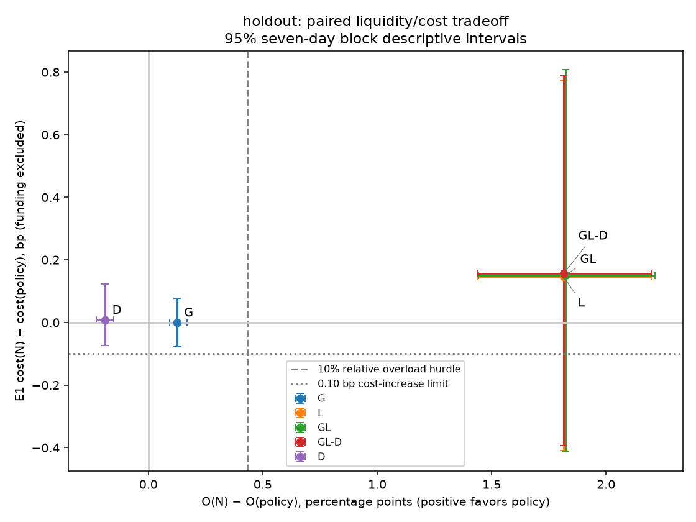
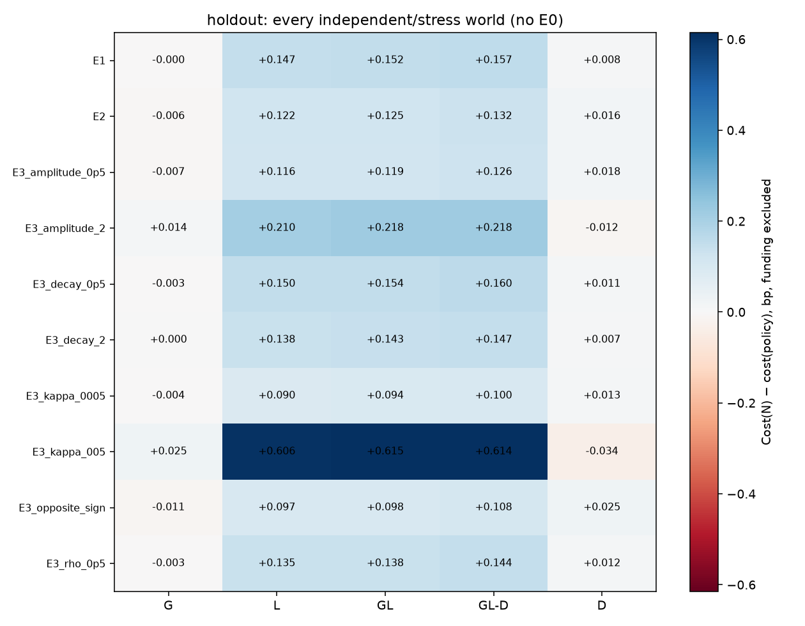
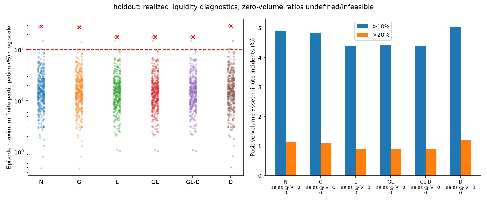

# X2+X3 holdout: robust impact, liquidity tails and funding-excluded execution

UTC 2026-10-28T16:55:53.465840+00:00. **Implementation PASS; scientific label TRADEOFF_OR_MIXED.**
DEVELOPMENT: PASS. PRETEST: READY.
NEW_OOS: COMPLETE. New July–September2026 source values opened:
**True**. This holdout sample is
a separately frozen three-month holdout.
No old H1/H2 or X1 result was changed. All amounts exclude funding, which is
unobserved/omitted, not zero. No live fills or causal own-trade gains are established.

## Frozen question and design

[Protocol](../../docs/extensions/x2x3_robust_liquidity_protocol_v1.md),
[config](../../configs/extension_x2x3.yaml), and
[extension change record](../../docs/extensions/x2x3_spec_amendment_v1.md) define
H-L overload risk, H-G independent-world regret/tails, H-GL incremental combined
protection and H-cross same-self diagonal comparison. Original documents remain
immutable; a root changelog append would break their old lock hashes, so the
new dated extension record preserves those predecessors.

N reproduces X1 P2 (B/V1/five-minute MPC); D is X1 D1. G uses fixed finite
admissible kernel ambiguity; L adds CVaR90 overload preference; GL combines;
GL-D diagonalizes each same-self scenario. TWAP is context, not part of the
six-policy ex-post regret reference. X0=.02sum(V0), cap0=.1V0, beta/full Sigma,
reference prices, B/tau/L and fee5bp/halfspread1bp assumptions are fixed at arrival.
Kappa.001, theta1, no alpha, 60min, four starts/day, exact-cell cash convention.
Observed next-bar closes and volume affect scoring only after commitment.
No future value/existence check selects episodes or constraints. Source clocks
are UTC bar open b, available at b+1min; prefixes persist before next reveal.

Ambiguity is B, diag(B), half-cross PSD interpolation, opposite-sign DBD and
frozen June2025 B with its own L. There are no new fitted kernel families.
E1 remains separate180d ending30d before month, tau5/30,ridge1; E2 diagonal E1;
all eight original E3 stresses retained, E0 excluded. Future as-of B fits use
365 complete preceding days, same tau60/ridge1. Already inspected Jan–Jun2026
is disclosed past calibration history only. No hyperparameter retuning after freeze.

## Conditional optimization and numerical checks

For scenario g, remaining transient cost is .5zf'Hff_g zf+zf'Hfp_g zp.
Past-only .5zp'Hpp_g zp is excluded from max ordering. Original reference-USDT
normalization10^-4 and each scenario's sqrt(L) factors appear once. Risk uses
Xremaining=X0−sum(zp), unchanged beta/Sigma. G/GL epigraphs are convex because
Hff_g is PSD; negative admissible cross terms are permitted. No material PSD
projection, cap relaxation, clipping or inventory repair. Never sum local QPs.

12 joint paired-asset historical hours come from preceding28 complete days at
matching hour. Deterministic SHA256 date/seed rank selects12; min support12,
otherwise HOLD. Each minute is scaled by its positive past matching-hour median
and current known V1. Zero historical capacity stays zero. Marginal S1 bands
are not substituted for a joint law. Scenario timestamps/support and posthoc
10/50/90 coverage diagnostics are retained. The bank approximates dependence;
it does not claim calibrated joint path coverage or firm liquidity.

For future z, e_s=sum(max(z−.1V_s,0))/ORIGINAL W. Preference is
(W/10000)*lambda*CVaR90(e), with equal scenario weights. e=.05,lambda100 means
5bp of preference, not paid cost. A nonnegative VaR bound is redundant because
e_s>=0; it improves numerical conditioning. Conic retries tighten tolerances
rather than changing acceptance gates. All attempts/status/KKT/duals/epigraph
checks are retained. Exact elementwise Hessian dominance proves redundant max
constraints on the nonnegative-sale cone; certified singleton QPs use the verified
X1 solver, while genuine QCQPs use CLARABEL. All declared scenarios/costs remain
in audits; no unfavorable ambiguity point is dropped for economic reasons.

Actual active-scenario shares for this holdout sample:

| policy | scenario | replans | dominance_reduction_share | mean_predicted_remaining_CVaR | active_share |
| --- | --- | --- | --- | --- | --- |
| G | B_fixed_June2025 | 4416 | 1 | 0 | 1 |
| GL | B_fixed_June2025 | 4416 | 1 | 0.00988376 | 1 |
| GL-D | B_fixed_June2025 | 4416 | 1 | 0.00964518 | 1 |

Predicted remaining CVaR uses original W at every replan; these averages are
optimization diagnostics, not paid cash or joint calibration tests. All scenario
dual weights and full physical remaining costs stay in immutable episode records.

## Development selection fixed before holdout

Arrival-horizon marginal scenario diagnostics (not joint-path calibration):
joint12-path empirical quantiles versus the unchanged training-calibrated X1
S1 bands. These are diagnostics only; no scenario weighting or penalty is tuned
from this table. Buckets0/1/2 mean1–5/6–15/16–60min; pinball units USDT/min.

| model | asset | bucket | quantile | coverage | pinball_usdt | n |
| --- | --- | --- | --- | --- | --- | --- |
| X1_frozen_S1_marginal | BTCUSDT | 0 | 0.1 | 0.126087 | 637831 | 1840 |
| X1_frozen_S1_marginal | BTCUSDT | 0 | 0.5 | 0.525543 | 2.49915e+06 | 1840 |
| X1_frozen_S1_marginal | BTCUSDT | 0 | 0.9 | 0.904348 | 2.58509e+06 | 1840 |
| X1_frozen_S1_marginal | BTCUSDT | 1 | 0.1 | 0.106522 | 593221 | 3680 |
| X1_frozen_S1_marginal | BTCUSDT | 1 | 0.5 | 0.492935 | 2.41397e+06 | 3680 |
| X1_frozen_S1_marginal | BTCUSDT | 1 | 0.9 | 0.883152 | 2.4696e+06 | 3680 |
| X1_frozen_S1_marginal | BTCUSDT | 2 | 0.1 | 0.1218 | 623210 | 16560 |
| X1_frozen_S1_marginal | BTCUSDT | 2 | 0.5 | 0.51413 | 2.57818e+06 | 16560 |
| X1_frozen_S1_marginal | BTCUSDT | 2 | 0.9 | 0.895833 | 2.79089e+06 | 16560 |
| X1_frozen_S1_marginal | ETHUSDT | 0 | 0.1 | 0.1125 | 500672 | 1840 |
| X1_frozen_S1_marginal | ETHUSDT | 0 | 0.5 | 0.527174 | 2.0135e+06 | 1840 |
| X1_frozen_S1_marginal | ETHUSDT | 0 | 0.9 | 0.907609 | 2.1612e+06 | 1840 |
| X1_frozen_S1_marginal | ETHUSDT | 1 | 0.1 | 0.107065 | 496428 | 3680 |
| X1_frozen_S1_marginal | ETHUSDT | 1 | 0.5 | 0.505978 | 2.06197e+06 | 3680 |
| X1_frozen_S1_marginal | ETHUSDT | 1 | 0.9 | 0.882609 | 2.27137e+06 | 3680 |
| X1_frozen_S1_marginal | ETHUSDT | 2 | 0.1 | 0.108213 | 494762 | 16560 |
| X1_frozen_S1_marginal | ETHUSDT | 2 | 0.5 | 0.499457 | 2.0491e+06 | 16560 |
| X1_frozen_S1_marginal | ETHUSDT | 2 | 0.9 | 0.892995 | 2.22294e+06 | 16560 |
| joint_12_paths | BTCUSDT | 0 | 0.1 | 0.159239 | 690908 | 1840 |
| joint_12_paths | BTCUSDT | 0 | 0.5 | 0.516304 | 2.5807e+06 | 1840 |
| joint_12_paths | BTCUSDT | 0 | 0.9 | 0.824457 | 2.96133e+06 | 1840 |
| joint_12_paths | BTCUSDT | 1 | 0.1 | 0.148098 | 632344 | 3680 |
| joint_12_paths | BTCUSDT | 1 | 0.5 | 0.512772 | 2.48563e+06 | 3680 |
| joint_12_paths | BTCUSDT | 1 | 0.9 | 0.841848 | 2.79457e+06 | 3680 |
| joint_12_paths | BTCUSDT | 2 | 0.1 | 0.146437 | 662785 | 16560 |
| joint_12_paths | BTCUSDT | 2 | 0.5 | 0.51256 | 2.66079e+06 | 16560 |
| joint_12_paths | BTCUSDT | 2 | 0.9 | 0.8468 | 3.03746e+06 | 16560 |
| joint_12_paths | ETHUSDT | 0 | 0.1 | 0.161413 | 544447 | 1840 |
| joint_12_paths | ETHUSDT | 0 | 0.5 | 0.530435 | 2.05774e+06 | 1840 |
| joint_12_paths | ETHUSDT | 0 | 0.9 | 0.844022 | 2.37161e+06 | 1840 |
| joint_12_paths | ETHUSDT | 1 | 0.1 | 0.145109 | 529349 | 3680 |
| joint_12_paths | ETHUSDT | 1 | 0.5 | 0.509511 | 2.118e+06 | 3680 |
| joint_12_paths | ETHUSDT | 1 | 0.9 | 0.854076 | 2.49179e+06 | 3680 |
| joint_12_paths | ETHUSDT | 2 | 0.1 | 0.140399 | 521300 | 16560 |
| joint_12_paths | ETHUSDT | 2 | 0.5 | 0.492029 | 2.10335e+06 | 16560 |
| joint_12_paths | ETHUSDT | 2 | 0.9 | 0.837258 | 2.42308e+06 | 16560 |

Selected lambda: **25**; selected candidate: **L**.
L25/L100 were compared on all736 fixed development episodes, selecting the
smallest nonzero lambda achieving>=10% mean overload reduction and E1 mean
shortfall increase<=.10bp. No GL-specific tuning; no penalty/family expansion.
If neither qualifies, candidate N continues and lambda25 L/GL/GL-D remain fixed
negative ablations. All tested variants, hashes and freeze time remain saved.

| lambda_liq | baseline_mean_overload | mean_overload | relative_reduction | E1_cost_increase_bps | qualifies |
| --- | --- | --- | --- | --- | --- |
| 25 | 0.0424057 | 0.0231072 | 0.455092 | 0.085928 | True |
| 100 | 0.0424057 | 0.0231073 | 0.455089 | 0.0862243 | True |

Original X1 background/context values below are retained read-only, not rescored
or reinterpreted as X2/X3 confirmation. They use the same development episodes
and E1/E2 definitions and do not enter the six-policy regret reference.

Original X1 background remains in the separate development report.

## Observed overload and liquidity incidents

O=sum_all(max(z−.1Vreal,0))/W, including zero-volume minutes. It is an overload
diagnostic, not unfilled volume or a fill model. Ratios at zero volume are
undefined; positive sales there are explicitly infeasible. Percentages below
use positive-volume asset-minute denominators; maxima and zero counts are retained.

| policy | episodes | mean_overload | median_overload | p90_overload | p95_overload | zero_overload_rate | worst_day | worst_day_mean_overload | positive_volume_cells | over10_pct | over20_pct | over100_pct | zero_volume_cells | positive_sales_zero_cells | zero_sale_affected_episodes | maximum_finite_ratio | episodes_over100 |
| --- | --- | --- | --- | --- | --- | --- | --- | --- | --- | --- | --- | --- | --- | --- | --- | --- | --- |
| D | 368 | 0.0450465 | 0.0180074 | 0.12252 | 0.175389 | 0.258152 | 2026-08-09 | 0.193136 | 44160 | 5.05435 | 1.19565 | 0.0113225 | 0 | 0 | 0 | 2.88744 | 4 |
| G | 368 | 0.0419093 | 0.0161672 | 0.118495 | 0.165482 | 0.266304 | 2026-08-09 | 0.183738 | 44160 | 4.84601 | 1.09601 | 0.0113225 | 0 | 0 | 0 | 2.77073 | 4 |
| GL | 368 | 0.0249244 | 0.00912421 | 0.0672476 | 0.105168 | 0.296196 | 2026-08-16 | 0.132171 | 44160 | 4.41123 | 0.908062 | 0.00452899 | 0 | 0 | 0 | 1.77958 | 2 |
| GL-D | 368 | 0.0250034 | 0.00912421 | 0.067687 | 0.107408 | 0.307065 | 2026-08-16 | 0.131451 | 44160 | 4.38859 | 0.894475 | 0.00452899 | 0 | 0 | 0 | 1.77958 | 2 |
| L | 368 | 0.0250139 | 0.00912421 | 0.0668385 | 0.106676 | 0.298913 | 2026-08-16 | 0.131675 | 44160 | 4.40444 | 0.896739 | 0.00452899 | 0 | 0 | 0 | 1.77958 | 2 |
| N | 368 | 0.0431553 | 0.0168341 | 0.119488 | 0.171343 | 0.269022 | 2026-08-09 | 0.187378 | 44160 | 4.91848 | 1.12772 | 0.0113225 | 0 | 0 | 0 | 2.86168 | 4 |
| TWAP | 368 | 0.0115088 | 0.000581089 | 0.0339151 | 0.0500326 | 0.461957 | 2026-08-16 | 0.116247 | 44160 | 3.87228 | 0.67029 | 0.00452899 | 0 | 0 | 0 | 1.14999 | 2 |

Paired overload differences positive favor new; units are fractions of original
parent notional (multiply100 for percentage points). Relative reductions and
95% intervals use shared seven-day calendar blocks,500draws,seed20261027.

| control | new | episodes | mean_control | mean_new | mean | ci_low | ci_high | relative_reduction | relative_ci_low | relative_ci_high | relative_ratio_status |
| --- | --- | --- | --- | --- | --- | --- | --- | --- | --- | --- | --- |
| N | G | 368 | 0.0431553 | 0.0419093 | 0.00124601 | 0.00091637 | 0.00167988 | 0.0288727 | 0.0244712 | 0.0329744 | ESTIMATED |
| N | L | 368 | 0.0431553 | 0.0250139 | 0.0181414 | 0.0143761 | 0.0219886 | 0.420374 | 0.370653 | 0.473692 | ESTIMATED |
| N | GL | 368 | 0.0431553 | 0.0249244 | 0.0182309 | 0.0144129 | 0.0221372 | 0.422448 | 0.37212 | 0.474789 | ESTIMATED |
| N | GL-D | 368 | 0.0431553 | 0.0250034 | 0.0181519 | 0.0143678 | 0.0219841 | 0.420618 | 0.371382 | 0.474553 | ESTIMATED |
| N | D | 368 | 0.0431553 | 0.0450465 | -0.00189125 | -0.00227527 | -0.0015034 | -0.0438243 | -0.0485772 | -0.0388019 | ESTIMATED |
| L | GL | 368 | 0.0250139 | 0.0249244 | 8.95126e-05 | -2.49828e-05 | 0.000186606 | 0.00357851 | -0.00104067 | 0.00797116 | ESTIMATED |
| GL-D | GL | 368 | 0.0250034 | 0.0249244 | 7.90116e-05 | -8.40917e-05 | 0.000198763 | 0.00316003 | -0.00323582 | 0.00882464 | ESTIMATED |



## Common independent-world modeled shortfall, funding excluded

Every policy is scored once over its complete schedule under common V0 temporary
volume, next-close path, exact-cell evaluator impact and assumed linear fees/spread.
Risk and CVaR preferences stay separate from cash. Positive delta is
cost(control)−cost(new), bp of original total W. Full/month/weekend/past-liquidity
regime cuts retain all adverse cases. Regime thresholds are fixed from development
past-information turnover, not holdout realized liquidity. These are short,
time-dependent observational/scenario comparisons, not causal intervention evidence.

| world | policy | episodes | mean_shortfall_bps | median_shortfall_bps | path_usdt | transient_usdt | temporary_usdt | fee_usdt | spread_usdt |
| --- | --- | --- | --- | --- | --- | --- | --- | --- | --- |
| E1 | D | 368 | 7.44854 | 7.44278 | 406.391 | 645.965 | 320.763 | 3990.03 | 798.005 |
| E1 | G | 368 | 7.45711 | 7.48545 | 470.9 | 609.253 | 307.029 | 3990.03 | 798.005 |
| E1 | GL | 368 | 7.30515 | 7.38862 | 500.248 | 563.845 | 223.005 | 3990.03 | 798.005 |
| E1 | GL-D | 368 | 7.30006 | 7.34633 | 495.177 | 569.502 | 224.165 | 3990.03 | 798.005 |
| E1 | L | 368 | 7.30943 | 7.35627 | 505.067 | 567.952 | 223.872 | 3990.03 | 798.005 |
| E1 | N | 368 | 7.45674 | 7.4518 | 448.256 | 624.019 | 311.818 | 3990.03 | 798.005 |
| E1 | TWAP | 368 | 7.44184 | 7.89313 | 688.844 | 550.913 | 159.601 | 3990.03 | 798.005 |
| E2 | D | 368 | 7.19493 | 7.25962 | 406.391 | 390.438 | 320.763 | 3990.03 | 798.005 |
| E2 | G | 368 | 7.21692 | 7.35315 | 470.9 | 368.237 | 307.029 | 3990.03 | 798.005 |
| E2 | GL | 368 | 7.08649 | 7.18787 | 500.248 | 341.916 | 223.005 | 3990.03 | 798.005 |
| E2 | GL-D | 368 | 7.07925 | 7.17071 | 495.177 | 345.243 | 224.165 | 3990.03 | 798.005 |
| E2 | L | 368 | 7.08927 | 7.17088 | 505.067 | 344.428 | 223.872 | 3990.03 | 798.005 |
| E2 | N | 368 | 7.21135 | 7.28354 | 448.256 | 377.485 | 311.818 | 3990.03 | 798.005 |
| E2 | TWAP | 368 | 7.22781 | 7.74016 | 688.844 | 332.456 | 159.601 | 3990.03 | 798.005 |

| control | new | episodes | mean | ci_low | ci_high | negative_share | p95_disadvantage_bps | worst_bps |
| --- | --- | --- | --- | --- | --- | --- | --- | --- |
| N | G | 368 | -0.000378864 | -0.0773514 | 0.0777711 | 0.519022 | 0.87152 | -4.08282 |
| N | L | 368 | 0.14731 | -0.409035 | 0.773331 | 0.529891 | 7.13072 | -20.6877 |
| N | GL | 368 | 0.151581 | -0.414133 | 0.807236 | 0.529891 | 7.10652 | -22.2721 |
| N | GL-D | 368 | 0.156678 | -0.394243 | 0.788878 | 0.532609 | 7.13672 | -19.0658 |
| N | D | 368 | 0.00819601 | -0.0743979 | 0.123187 | 0.491848 | 1.22202 | -7.01519 |
| L | GL | 368 | 0.00427088 | -0.0334522 | 0.046745 | 0.527174 | 0.339687 | -1.85303 |
| GL-D | GL | 368 | -0.00509729 | -0.0581113 | 0.0403808 | 0.524457 | 0.477507 | -3.21615 |

TWAP context: mean overload=1.1509% and E1 mean
shortfall=7.44184bp. Its overload is
lower than L's.
This descriptive baseline is retained; liquidity protection is not uniformly
best across the original strategies.

H-L: read N→L overload/cost jointly. H-G: N→G plus all independent-world tails.
H-GL: L→GL; H-cross: GL-D→GL holds each scenario self/tau/L and all other
inputs fixed. A low robust objective alone is not evidence of better performance.
The point practical-interest hurdle is>=10% relative overload reduction with
<=.10bp E1 mean cost increase; reported intervals preserve uncertainty and are
not independent evidence across correlated evaluator worlds.

The selected N→L contrast by calendar month, weekday/weekend and frozen past
liquidity tercile is below. Overload quantities are fractions of W; E1 advantage
is cost(N)−cost(L), bp, funding excluded. All other fixed-policy grouped
contrasts remain in the corresponding pairwise CSV files. Empty regimes have
no observations and are not pooled with another regime.

| group | episodes | E1_advantage_bps | E1_CI_low | E1_CI_high | O_N | O_L | overload_reduction | O_CI_low | O_CI_high |
| --- | --- | --- | --- | --- | --- | --- | --- | --- | --- |
| all | 368 | 0.14731 | -0.409035 | 0.773331 | 0.0431553 | 0.0250139 | 0.0181414 | 0.0143761 | 0.0219886 |
| 2026-07 | 124 | -0.299786 | -0.506481 | 0.536594 | 0.0401126 | 0.0197881 | 0.0203245 | 0.0147072 | 0.0244523 |
| 2026-08 | 124 | 0.570246 | -0.251364 | 1.9224 | 0.0523034 | 0.033775 | 0.0185284 | 0.0106062 | 0.0280025 |
| 2026-09 | 120 | 0.172275 | -0.5137 | 1.16934 | 0.0368463 | 0.0213608 | 0.0154855 | 0.012748 | 0.0199972 |
| weekend_False | 264 | -0.0235061 | -0.746107 | 0.765909 | 0.0346234 | 0.0186383 | 0.0159851 | 0.0124918 | 0.0198761 |
| weekend_True | 104 | 0.58092 | 0.0514362 | 1.1053 | 0.0648131 | 0.0411981 | 0.023615 | 0.0165683 | 0.0310937 |
| liquidity_low | 318 | 0.146352 | -0.334192 | 0.868962 | 0.0393682 | 0.0232522 | 0.0161161 | 0.0121639 | 0.0208723 |
| liquidity_middle | 41 | -0.0158143 | -2.02299 | 1.2733 | 0.0697342 | 0.0377267 | 0.0320075 | 0.0220168 | 0.0388824 |
| liquidity_high | 9 | 0.924273 | -6.88493 | 3.87573 | 0.0558825 | 0.0293489 | 0.0265336 | 0.00890155 | 0.0471811 |

Measured H-L: overload reduction **1.8141 percentage points**,
95% interval[1.4376,2.1989]; relative point reduction
42.04%. E1 cost increase (new minus N)
**-0.14731bp**, interval[-0.77333,0.40904].
The practical hurdle is a point criterion; uncertainty can still permit a cost
increase exceeding0.10bp. L's maximum finite participation is
1.78× versus N's 2.86×;
L retains 0 positive-sale/zero-volume cells.
Lower average overload therefore does not establish feasible realized fills or
a universally improved participation tail.

H-GL incremental mean overload reduction=0.00895percentage points,
interval[-0.00250,0.01866]; E1 cost advantage
+0.00427bp[-0.03345,+0.04675]. H-cross analogous
overload reduction=0.00790points, E1 cost advantage
-0.00510bp[-0.05811,+0.04038].
H-G mean overload reduction=0.12460percentage points,
interval[0.09164,0.16799]; E1 cost advantage
-0.00038bp[-0.07735,+0.07777].
All independent-world H-G tail/regret outcomes below remain primary evidence;
dominance of one ambiguity point is explicitly not proof that uncertainty
optimization adds an adaptive kernel-selection benefit.

| policy | mean_worst_world_bps | p95_worst_world_bps | p95_worst_world_disadvantage_to_N_bps | maximum_worst_world_disadvantage_to_N_bps |
| --- | --- | --- | --- | --- |
| N | 9.04938 | 32.2883 | 0 | 0 |
| G | 9.02407 | 33.1211 | 0.841543 | 4.06839 |
| L | 8.45354 | 37.7786 | 6.72371 | 20.47 |
| GL | 8.44389 | 38.0595 | 6.62623 | 22.0505 |
| GL-D | 8.44608 | 37.7079 | 6.72606 | 18.8498 |
| D | 9.08354 | 31.1793 | 1.26827 | 7.06271 |

All ten evaluation worlds (including adverse E2/opposite/amplitude/decay/kappa)
and ex-post regret/loss shares are in holdout_independent_scenario_stress.csv.
The ex-post best among six fixed policies is a descriptive reference, never a
policy available to the trader. Largest finite participation and zero-volume
failures are retained; no hypothetical order is asserted to be executable.





## Development context figures and interpretation

[Cash-consistent ambiguity curves](../../figures/extension_x2x3/kernel_ambiguity.png),
[active worst-case scenarios](../../figures/extension_x2x3/active_scenarios.png),
[joint paths and posthoc overlay](../../figures/extension_x2x3/joint_paths.png), and
[committed MPC paths with carried state](../../figures/extension_x2x3/committed_paths.png)
are explicitly development illustrations. Frozen June2025 B is active in every
development G/GL/GL-D replan: that ambiguity family collapses to a stronger
fixed kernel on the nonnegative-sale feasible cone. No adaptive kernel-selection
benefit is established, and no replacement family was searched. The joint12-path
arrival bands have development 10% coverage about16–20% and 90% coverage about84–85%;
they are narrower than the frozen S1 marginal bands. This imperfect marginal
calibration is disclosed, not tuned away, and says nothing about joint-path
coverage guarantees.

## Implementation, preservation and limits

| policy | cap_violations | terminal_max_usdt | KKT_max | epigraph_gap_max | decomposition_max | primal_max | repairs | solve_seconds | maximum_solve_seconds | risk_preference_mean_usdt | liquidity_preference_at_arrival_mean_usdt | mean_solve_seconds |
| --- | --- | --- | --- | --- | --- | --- | --- | --- | --- | --- | --- | --- |
| D | 0 | 1.86265e-09 | 3.90798e-15 | 0 | 6.78853e-16 | 1.04594e-15 | 0 | 17.0961 | 0.0487609 | 323.867 | 0 | 0.0038714 |
| G | 0 | 1.86265e-09 | 4.21022e-15 | 0 | 6.97141e-16 | 1.54186e-15 | 0 | 17.0319 | 0.175431 | 357.838 | 0 | 0.00385686 |
| GL | 0 | 2.93991e-05 | 3.54821e-09 | 0 | 1.79953e-07 | 3.886e-10 | 0 | 317.045 | 0.927193 | 585.92 | 613.792 | 0.0717945 |
| GL-D | 0 | 3.95328e-05 | 1.25847e-09 | 0 | 5.62292e-08 | 1.38221e-10 | 0 | 316.998 | 0.741296 | 580.367 | 613.793 | 0.0717839 |
| L | 0 | 0.000116358 | 1.17218e-09 | 0 | 6.1085e-08 | 4.24041e-10 | 0 | 317.665 | 1.17978 | 581.698 | 613.792 | 0.071935 |
| N | 0 | 1.86265e-09 | 5.41681e-15 | 0 | 6.25361e-16 | 1.29999e-15 | 0 | 18.9685 | 0.0747326 | 342.699 | 0 | 0.0042954 |

Final pretest suite: 255 passed,
0 failures; integration tests opening original
2026 source pilots excluded. Focused coverage: singleton/zero-lambda X1 parity,
three actual2025 P2 schedule/cost reproductions, cash/state/gradient/PSD checks,
independent SCS small conic/QP and enumerated two-kernel QCQP, CVaR hand cases, no-reset negative control, all12
replan future-field mutations, permutation, adapter/UTC/QC parity and guarded
ready/receipt access. Detailed JUnit/source hashes and independent complete-cost
output audits are in extension_x2x3_artifacts. All scientific artifacts among 2745 protected prior paths and
189 data stat snapshots are unchanged. macOS independently
changed Finder metadata reports/.DS_Store; its original hash and explicit
metadata-only exception remain recorded. Research files have no exemption.

Genuine OOS requires evidence-linked PRETEST_READY_X2X3 before six official
monthly archives can be acquired or parsed. Source QC is distinguished from
first policy outcome reveal. The ready lock binds code/config/spec/selection/
tests/source identities; a manual marker cannot unlock data. New source hashes,
CRC/schema/coverage and first-access receipts are retained if acquisition runs.
No holdout tuning, resampling of dates, alternate-source substitution or old
January–June test rebranding is allowed. Current OOS gate: **COMPLETE**;
reason: Required gates passed and registered run completed.

Binance Vision data attribution and recorded CC BY-NC-SA noncommercial terms
apply to derived summaries; raw archives are not redistributed. Current
[provider terms](https://github.com/binance/binance-public-data/blob/master/TERMS_AND_CONDITIONS.md)
were checked before new acquisition. [Neuman–Stockinger–Zhang](https://arxiv.org/abs/2309.02994)
motivates accounting for estimation uncertainty; no guarantee from that paper
is claimed for our finite-scenario construction. The referenced SSRN page
returned403, so its theorem/content was not independently verified. The local
AJNT benchmark remains a deterministic reference, distinct from this constrained
finite-scenario MPC. Full random stochastic Volterra control is not implemented.

Remaining limits: public-flow endogeneity, assumed intervention kernels, uncertain
joint volume law, three-month OOS power, unrealized fills, proxies for fees/spread,
funding omission and extreme actual liquidity/source anomalies. Negative, null,
dominated-ambiguity and infeasible-realized-liquidity findings are valid outcomes.

```sh
.venv/bin/python scripts/extension_x2x3.py development
.venv/bin/python scripts/audit_extension_x2x3.py
.venv/bin/python scripts/extension_x2x3.py freeze
.venv/bin/python scripts/extension_x2x3.py holdout
.venv/bin/python scripts/extension_x2x3.py report
```

Only freeze/holdout after all checks pass; holdout refuses a missing/invalid lock.
No commit/push or original-result rewrite. Future Option2 requires separate
theorem-level specification and authorization.
