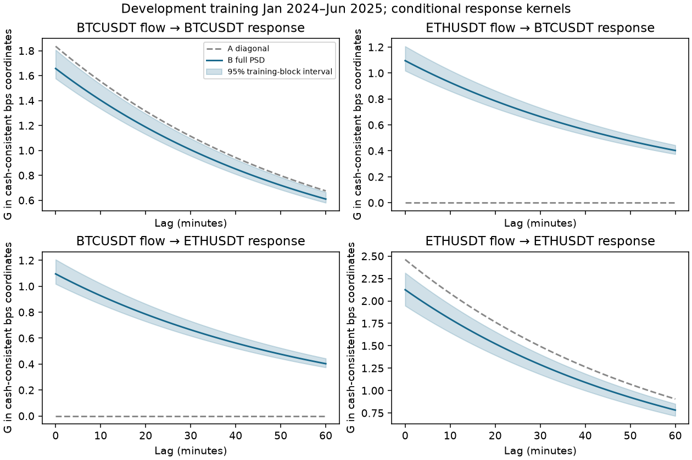
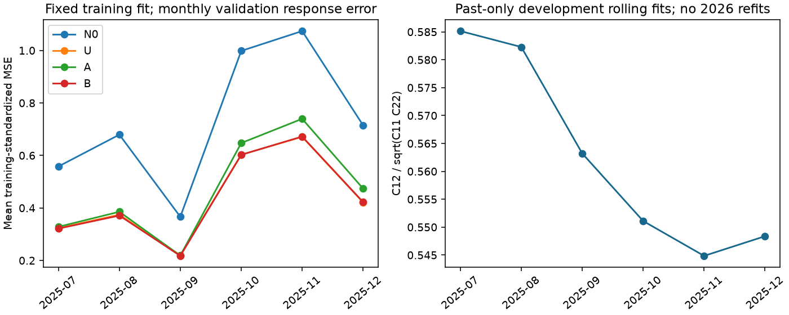
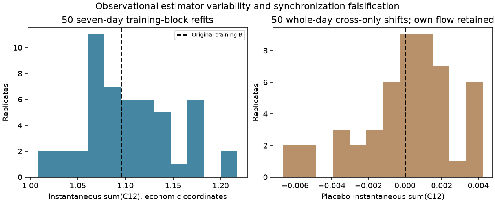
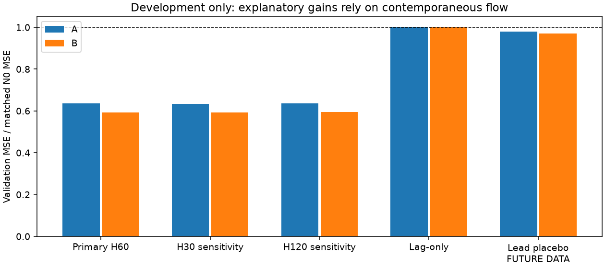

# Stage 2: admissible BTC/ETH conditional flow-response kernels

Generated UTC: 2026-10-27T23:37:37.388353+00:00. **G2 implementation: PASS. Development-only scientific verdict: SUPPORTS_HYPOTHESIS.**

The full PSD model B reduces pooled July–December 2025 conditional response MSE by **6.65%** relative to matched diagonal A. Cross response is positive and persists across training halves and development rolling windows. This is evidence of an observational contemporaneous association. It does not identify the causal effect of our hypothetical orders, establish an implementable forecast, or test the January–June 2026 H1/H2 hypotheses.

## Mathematics, units and reference

The governing protocol is [specification v1.0 §§4–6](../../CryptoCrossImpact_Research_Specification_v1_2026-10-27.md). The supplied [AJNT preprint v2](../../references/2403.10273v2.pdf), dated February 20, 2026, defines nonnegative-definite Volterra kernels in §2.1, equation (2.7), and gives convolution sufficient conditions in §2.3, Theorem 2.15 (printed p.11) and Corollary 2.18 (p.12). Those pages were text-extracted and visually reviewed. A sum of PSD matrices times scalar exponentials satisfies the quadratic-form monotonicity/convexity conditions, including valid negative off-diagonal entries. These are published admissibility results; no new theorem or numerical reproduction of AJNT's optimizer is claimed.

For each asset, L is the median positive train-window minute quote turnover (USDT). f=q/sqrt(L), r=log(close_t)-log(close_{t-1}), and y=10,000 sqrt(L) r. y is already a one-bar return. Here L=[6233267.0166, 3488186.03573] USDT, estimated through June 30, 2025 and frozen for validation.

For each time constant tau, the fitted return basis is z_tau,t = f_t + sum_{ell=1..H}(exp(-ell/tau)-exp(-(ell-1)/tau)) f_{t-ell}. The regression is y_t=sum C_tau z_tau,t + asset-specific nuisance/intercept + error, with H=60. Positive-lag weights are negative. No H+1 boundary term is silently added: that term would arise only if exactly differencing a finitely truncated *level* kernel, a different equation.

Predictors are centered/scaled on eligible training rows; the loss divides each asset's y by its own training SD. The minimized objective is mean standardized squared error over assets plus lambda/2 times the sum of squared standardized coefficients, excluding intercepts. The standardized flow coefficient is beta_ij = C_ij s(z_j)/s(y_i); economic C remains symmetric PSD. A common numerical C scale is reversible and does not constrain a whitened or raw bps/USDT matrix.

Hypothetical signed notional u has modeled log displacement 10^-4 D(L)^(-1/2) G D(L)^(-1/2)u. The small $100,000-notional displacement table is a unit-conversion assumption, not an observed execution or cost result. Same-cell finite-grid validation uses half self-impact. Cell-integrated production discretization, cash Hessian factors and execution constraints remain Stage 3 work.

## Data, masks and available information

Source: Binance Vision USD-M USDT perpetual BTCUSDT/ETHUSDT last-trade 1m klines. Development train January 2024–June 2025; validation July–December 2025. Stage 2 opens only 48 development symbol-month partitions, verifies their Stage 1 canonical hashes, and rejects 2026 paths before Parquet I/O. The original source manifest and canonical files are unchanged. Dataset attribution: Binance Vision; derived analytical tables/figures are CC BY-NC-SA 4.0 under the recorded dataset terms.

There are 786,239 synchronized eligible train targets and 264,960 validation targets for all N0/U/A/B primary fits. Initial attrition is one unavailable target return plus 1,440 target/history warmup rows; no additional calendar gaps or malformed observations. All primary models use identical rows, controls, normalization and A/B grid budget. The null permutation diagnostic has a separately disclosed common 783,239-row mask because all shifted lag windows must be valid.

Controls use each asset's prior returns at lags 1/2/5/15; log1p(mean prior unsigned USDT turnover) over 5/15/60 minutes; previous-bar log1p turnover minus its prior 1,440-bar median; prior population RMS returns over 60/1,440 minutes; and smooth UTC intraday/weekly sine/cosine. The equally weighted lag-one factor is omitted because it is an exact linear combination of included returns. Full source/lookback/availability metadata are in features.json. Nuisance inputs end at target bar open (the prior bar's completion); observed target-bar flow and y become available at target bar end. No centered windows or same-bar returns enter controls.

Recorded zero-turnover bars are retained (BTC 126, ETH 127 across development), including the October 2024 shared plateau. No raw values or flow signs were filled or replaced. Stage 1's 14-day aggTrades audit remains QUALIFIED: the sign agrees, exact minute aggregation does not. A separately declared October 28–30 sensitivity excludes 4,320 training target minutes, including conservative history padding; the primary sample is untouched.

## Matched estimation and development selection

N0 is nuisance-only; U has unconstrained/asymmetric component matrices and is diagnostic-only; A has nonnegative diagonals; B has jointly fitted symmetric PSD components. [CVXPY solver capabilities](https://www.cvxpy.org/tutorial/solvers/index.html) were checked against a real SDP smoke problem. CLARABEL performs constrained fits at 1e-9 feasibility / 1e-8 relative gap tolerances; direct design fits and SCS independently cross-check synthetic fits. OSQP was installed transitively with CVXPY and was not used as an SDP solver or to implement execution.

Every one- or two-element family from {2,5,10,30,60} minutes and every lambda in {0,0.0001,0.001,0.01,0.1,1} was attempted: 90 U, 90 A, 90 B fits, plus six N0 penalties. All 276 converged; no screening, skipped candidates or hidden fit failures. Within 0.1% of minimum validation MSE, the fixed preference is fewer exponentials, stronger penalty, then lower MSE. All candidates and their objective/status/sample sizes remain in candidate_selection.csv.

| model | tau_minutes | ridge | training_rows | validation_mse |
|---|---|---|---|---|
| N0 |  | 1 | 786239 | 0.731973 |
| U | 60 | 1 | 786239 | 0.435261 |
| A | 60 | 1 | 786239 | 0.465341 |
| B | 60 | 1 | 786239 | 0.434409 |

Monthly raw sufficient statistics use float64; numerical fitting is a small Gram-matrix problem, not a dense multi-million-row conic program. No feature dataset or rowwise predictions were persisted. Bootstrap uses small daily statistics; the cross-flow permutation uses only transient training arrays. All normalizers are training-only and all source-defined masks are shared. Near-zero numerical Gram eigenvalues are checked as accumulation roundoff; no economic kernel is projected or repaired.

## Actual validation errors

MSE is normalized by the training target SD. MAE and RMSE are log-return basis points. R² is same-minute conditional explanatory R², not forecast R².

| model | asset | standardized_mse | mae_bps | rmse_bps | conditional_response_r2 |
|---|---|---|---|---|---|
| N0 | BTCUSDT | 0.587852 | 3.57438 | 5.71766 | 0.000126795 |
| N0 | ETHUSDT | 0.876093 | 6.05414 | 9.41347 | 0.000601041 |
| N0 | pooled | 0.731973 | 4.81426 | 7.78797 | 0.000363918 |
| U | BTCUSDT | 0.377338 | 2.86721 | 4.58088 | 0.358189 |
| U | ETHUSDT | 0.493184 | 4.62793 | 7.06284 | 0.437403 |
| U | pooled | 0.435261 | 3.74757 | 5.95265 | 0.397796 |
| A | BTCUSDT | 0.41184 | 3.01464 | 4.78573 | 0.299505 |
| A | ETHUSDT | 0.518842 | 4.75491 | 7.24423 | 0.408133 |
| A | pooled | 0.465341 | 3.88478 | 6.1393 | 0.353819 |
| B | BTCUSDT | 0.375526 | 2.86355 | 4.56987 | 0.361272 |
| B | ETHUSDT | 0.493292 | 4.62721 | 7.06362 | 0.437279 |
| B | pooled | 0.434409 | 3.74538 | 5.94888 | 0.399275 |

Residual BTC/ETH correlations and all training/monthly/weekend/liquidity results are in fit_metrics.csv. Validation liquidity groups compare a strictly past 60-minute activity measure against a fixed training median; they use neither future realized volume nor validation-derived thresholds. A validation gain does not settle final H1. Similar U/B errors indicate the constraint cost is modest on this sample, not that the observed response is causal.

| group | model | rows | standardized_mse | residual_cross_correlation |
|---|---|---|---|---|
| validation_weekend | N0 | 74880 | 0.385953 | 0.728753 |
| validation_weekday | N0 | 190080 | 0.868283 | 0.773242 |
| validation_liquidity_high | N0 | 169891 | 1.00085 | 0.768253 |
| validation_liquidity_low | N0 | 95069 | 0.251479 | 0.75303 |
| validation_weekend | U | 74880 | 0.227252 | 0.647506 |
| validation_weekday | U | 190080 | 0.517204 | 0.69905 |
| validation_liquidity_high | U | 169891 | 0.591079 | 0.69208 |
| validation_liquidity_low | U | 95069 | 0.15681 | 0.685755 |
| validation_weekend | A | 74880 | 0.240017 | 0.646635 |
| validation_weekday | A | 190080 | 0.554105 | 0.686216 |
| validation_liquidity_high | A | 169891 | 0.63221 | 0.677074 |
| validation_liquidity_low | A | 95069 | 0.16714 | 0.700534 |
| validation_weekend | B | 74880 | 0.226357 | 0.650618 |
| validation_weekday | B | 190080 | 0.516369 | 0.70077 |
| validation_liquidity_high | B | 169891 | 0.589932 | 0.693981 |
| validation_liquidity_low | B | 95069 | 0.156485 | 0.687816 |

## Matrix and time stability diagnostics

| model | tau_minutes | C00 | C01 | C10 | C11 | eigen_min | eigen_max | cross_ratio | psd_binding |
|---|---|---|---|---|---|---|---|---|---|
| A | 60 | 1.83556 | 0 | 0 | 2.46221 | 1.83556 | 2.46221 | 0 | False |
| B | 60 | 1.65715 | 1.09543 | 1.09543 | 2.12483 | 0.770884 | 3.0111 | 0.583768 | False |

| window | C00_reference | C01_reference | C11_reference | cross_ratio |
|---|---|---|---|---|
| train_half1 | 2.05697 | 1.30169 | 2.56854 | 0.566307 |
| train_half2 | 1.3827 | 0.943206 | 1.94164 | 0.57565 |
| 2025-07 | 1.50225 | 1.02153 | 2.02878 | 0.585146 |
| 2025-08 | 1.41795 | 0.940522 | 1.83993 | 0.582288 |
| 2025-09 | 1.31521 | 0.81459 | 1.59051 | 0.563215 |
| 2025-10 | 1.26591 | 0.756586 | 1.48886 | 0.551099 |
| 2025-11 | 1.25362 | 0.737851 | 1.46292 | 0.544847 |
| 2025-12 | 1.25018 | 0.740672 | 1.45924 | 0.548372 |

Half-window fits recompute L and training transforms. The table maps their matrices by congruence to the primary liquidity coordinates for comparison; cross ratios are scale invariant. The six monthly fits use 365 prior complete calendar days and end before July–December 2025. They are development-only stability diagnostics; primary validation errors use the fixed June-end model, not those rolling fits.





## Recovery, falsification and uncertainty

Synthetic one/two-exponential recoveries include zero, positive and valid negative cross coefficients with observed nuisance-correlated flows, independently convolved targets, and sample-noise tolerances. The tests recover the known family in a fixed one-decay comparison, agree with direct design fitting on synthetic and real train-only subsets, preserve asset permutations/diagonal limits, reject indefinite matrices and block U from admissible-kernel export. Finite-grid kernels and 100 signed round trips are checked for each admissible candidate. Focused timing tests cover month/validation boundaries, the no-H+1 equation, input units, shared masks, unchanged past controls under future perturbations and pre-I/O test rejection.

Fifty seven-day training-block refits give instantaneous sum(C12) 95% interval **[1.017872375768831, 1.2062490473648926]**, with 0 sign reversals and 0.0% binding-PSD replicate fraction. This conditions on the selected candidate and original preprocessing. Blocks resample original feature/return rows consistently; no lags are recalculated across resampled boundaries. It measures observational estimator variability, excluding hyperparameter/model uncertainty and causal uncertainty.

Fifty fixed whole-day cross-only shifts preserve each asset's own flow/return alignment. On the common null mask, observed training gain B over matched A is 9.163%; null gains range [-6.486852052328841e-08, 4.017771425053551e-06]; shifted C12 sums range [-0.006654676589555612, 0.004237812293609707]. The finite-sample diagnostic tail fraction is 0.019608. This is not a final-test p-value or proof of intervention identification.



| mode | H | model | training_rows | validation_rows | validation_mse_pooled | instantaneous_cross |
|---|---|---|---|---|---|---|
| lag_only | 60 | N0 | 786239 | 264960 | 0.731973 | 0 |
| lag_only | 60 | U | 786239 | 264960 | 0.731988 | 0.194696 |
| lag_only | 60 | A | 786239 | 264960 | 0.731969 | 0 |
| lag_only | 60 | B | 786239 | 264960 | 0.731982 | 0.116377 |
| lead_placebo | 60 | N0 | 786221 | 264954 | 0.731972 | 0 |
| lead_placebo | 60 | U | 786221 | 264954 | 0.711472 | 0.396286 |
| lead_placebo | 60 | A | 786221 | 264954 | 0.71628 | 0 |
| lead_placebo | 60 | B | 786221 | 264954 | 0.711147 | 0.322816 |
| primary | 30 | N0 | 786239 | 264960 | 0.731973 | 0 |
| primary | 30 | U | 786239 | 264960 | 0.434201 | 1.17277 |
| primary | 30 | A | 786239 | 264960 | 0.464459 | 0 |
| primary | 30 | B | 786239 | 264960 | 0.433346 | 1.09901 |
| primary | 120 | N0 | 786239 | 264960 | 0.731973 | 0 |
| primary | 120 | U | 786239 | 264960 | 0.43601 | 1.1667 |
| primary | 120 | A | 786239 | 264960 | 0.465908 | 0 |
| primary | 120 | B | 786239 | 264960 | 0.435155 | 1.09348 |

Lag-only flow contributes essentially no validation gain beyond nuisance controls. The lead-flow placebo contains future observed flow and still improves fit: that is explicit evidence compatible with feedback/correlated information, not a predictor. Lead-mode last bars are excluded each month, preventing train/validation or December/2026 crossing. Each mode compares N0/U/A/B on its own identical mask; primary choices are unchanged.

The selected tau=60 equals the grid upper boundary, and G(60)/G(0) retains **36.788%** in norm. The hypothetical omitted truncated-level H+1 term has training RMS/target SD [0.14228179851514466, 0.14932566236416858]. The prespecified equation intentionally omits this term; it is not silently changed. H=30 and H=120 fitted sensitivities preserve the qualitative A/B comparison, but the data do not establish the full decay tail or structural causal kernel.

| mode | model | training_rows | validation_mse_pooled | instantaneous_cross |
|---|---|---|---|---|
| source_flag_interval_mask | A | 781919 | 0.465252 | 0 |
| no_return_controls | A | 786239 | 0.471527 | 0 |
| source_flag_interval_mask | B | 781919 | 0.434371 | 1.09687 |
| no_return_controls | B | 786239 | 0.443628 | 1.07041 |



## Scope, reproducibility and Stage 3 handoff

G2 passes implementation checks separately from the development-only scientific association. The optional one-/five-minute forward-prediction diagnostic was NOT RUN; mandatory G2 estimation, falsification and uncertainty were prioritized, as allowed by the Stage 2 prompt. There is no alpha claim. Remaining scientific limits are public-flow endogeneity, same-bar information timing, aggregate-trade mismatch, training-only selection, coefficient/time drift, fixed-preprocessing bootstrap uncertainty and a long tail at the selected grid boundary. No mandatory G2 diagnostic remains incomplete.

`model_A.json` and `model_B.json` hold validated economic matrices, ordered assets, tau in minutes, H, L, original training transforms, coefficients/intercepts, cutoffs and provenance. `kernel.fit.level_kernel(model, lags)` returns the admissible level kernel; `predict` reconstructs conditional responses using the same standardized design. `kernel.diagnostics.refit_historical` exposes the fixed-family past-window refit API with the Stage 2 I/O firewall. U is saved with diagnostic_only=true and export blocked. Stage 3 can use these artifacts without reacquiring Stage 1 data, while explicitly treating them as scenario assumptions. It must independently verify AJNT V1, its cell-integrated cash Hessian/factors, half-cell convention and constrained V2 solver. None is implemented here.

The estimation-only pretest lock records family, lambda, masks, normalization, future refit protocol and metrics. It explicitly is not the final policy/evaluator lock: Stages 3/4 must finish their rules before Stage 5 can open final outcomes. See [implementation clarifications](../../SPEC_CHANGELOG.md).

```sh
.venv/bin/python -m pip install --no-cache-dir -r requirements.txt
.venv/bin/python -m pytest tests/test_stage02_kernel.py -q
.venv/bin/python scripts/stage02.py synthetic
.venv/bin/python scripts/stage02.py all
```

Individual restart commands are `prepare`, `fit`, `metrics`, `diagnostics`, `report` with the same script. Run Stage 1 synthetic tests with `-m 'not integration'`; do not rerun Stage 1 integration tests that open 2026 pilot outcomes during Stage 2. Compact tables/models are trackable under reports/research/stage02_artifacts; only small sufficient statistics are cached under ignored results/kernel_development.

**Stage 2 only was executed. No January–June 2026 research outcomes, liquidation policies, execution-cost backtests, or Stage 3 solver were evaluated.**
