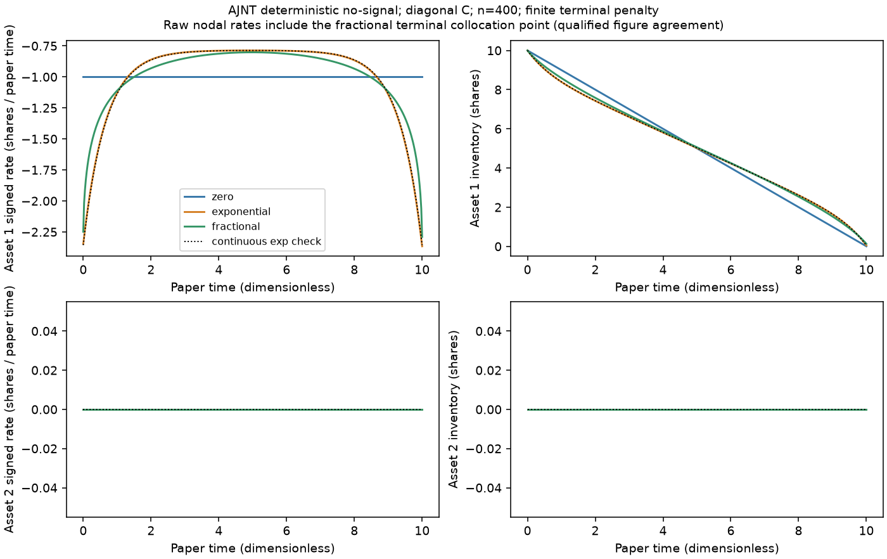
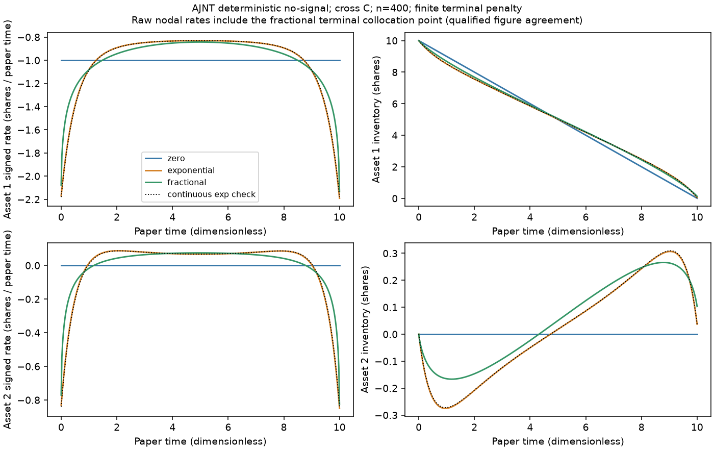
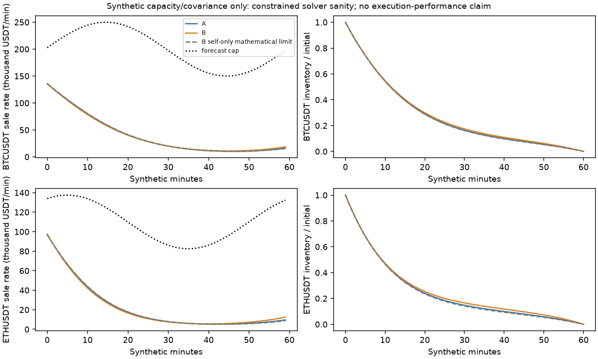
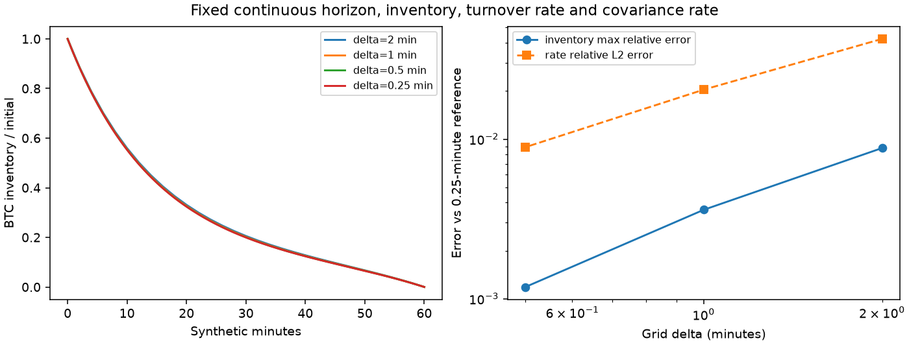

# Stage 3: AJNT deterministic benchmark and constrained execution mathematics

Generated UTC: 2026-10-28T02:01:05.972750+00:00. **G3 PASS. V1 required zero/exponential cases REPRODUCED; optional fractional pointwise figure agreement QUALIFIED. V2 PASS.**

These are mathematical and synthetic/scenario results. No new empirical/economic hypothesis is tested, and there is no historical execution evidence or causal savings claim. The 2026 final-test period was not inspected; no historical execution backtest or Stage 4 episode/policy work was performed.

## V1: exact reference problem and numerical scheme

Source: the supplied [AJNT arXiv v2](../../references/2403.10273v2.pdf), title date February 20, 2026. The deterministic solution is Corollary 2.9 with D in equation (2.13). The liquidation terminal penalty and forcing are in Remark 2.10, equation **(2.15)** (printed p.9). The no-signal experiment is §3.1, equations (3.1)–(3.4), Figures 1–2 (pp.12–15). The unnumbered D_n scheme and Table 1 are in §3.4, pp.20–21. The prompt/spec's other equation numbers do not match this local version; the actual PDF formulas govern. Relevant pages and original figures were rendered and inspected.

Paper parameters: T=10 dimensionless time, X0=(10,0) shares, varrho=4, Pi=I, gamma=0, Lambda=0.03 I. C_diag=diag(0.06,0.06); C_cross=[[0.06,0.05],[0.05,0.06]]. Kernels are zero, exp(-0.5 lag), and lag^(-0.25). The signed rate is u=dX/dt: negative sells, positive buys. There are no participation caps, sign constraints or exact terminal-inventory equality in V1. The expected unaffected-price term cancels without alpha; the finite terminal penalty still supplies g=-varrho Pi X0.

We construct every Table 1 L/U cell integral on n+1 collocation nodes, including U's diagonal. L2+U2 contains delta in each integration column 0..n-1, and its final column is zero: u(T) is a terminal collocation value, not another traded bin. With gamma=0, D_n=I⊗Lambda+(L+U)⊗C+varrho(L2+U2)⊗Pi. scipy.linalg.solve(D_n,g_n) is used; no numerical inverse is formed. Inventories integrate the n left-cell rates, and the reported finite-bin cost is transient + one-half Lambda times integrated squared rate + one-half varrho XT'Pi XT. For zero impact, the exact constant rate is u1=-40/(40+0.03), u2=0, with terminal X1=10*0.03/(40+0.03)=0.00749438 shares.

An independent exact-cell Galerkin quadratic first-order system verifies the same continuous problem. For exponential impact there is also a continuous analytic check: in each C eigenmode, Lambda v+c w=k, w''=rho² w-2rho v, with w'(0)=rho w(0), w'(T)=-rho w(T), and k=-varrho XT. The resulting constant-plus-cosh rate and integrated inventory are evaluated independently of D_n. The finite penalty determines k; it is not replaced by hard liquidation.

| matrix | kernel | n | first_order_relative_residual | condition_number | maximum_inventory_reference_error | objective |
|---|---|---|---|---|---|---|
| diagonal | zero | 100 | 1.598721e-15 | 1347.657 | 4.7784e-13 | 0.1498876 |
| diagonal | zero | 200 | 1.776357e-15 | 1340.995 | 4.28102e-13 | 0.1498876 |
| diagonal | zero | 400 | 2.4869e-15 | 1337.664 | 1.971756e-13 | 0.1498876 |
| diagonal | exponential | 100 | 3.552714e-16 | 1388.247 | 0.02592384 | 1.060248 |
| diagonal | exponential | 200 | 8.881784e-16 | 1365.145 | 0.01278601 | 1.060167 |
| diagonal | exponential | 400 | 7.105427e-16 | 1353.225 | 0.006350818 | 1.060147 |
| diagonal | fractional | 100 | 5.329071e-16 | 1447.28 | 0.02575547 | 2.659588 |
| diagonal | fractional | 200 | 3.552714e-16 | 1410.931 | 0.01227974 | 2.659418 |
| diagonal | fractional | 400 | 8.881784e-16 | 1388.294 | 0.005949927 | 2.659371 |
| cross | zero | 100 | 1.598721e-15 | 1347.657 | 4.7784e-13 | 0.1498876 |
| cross | zero | 200 | 1.776357e-15 | 1340.995 | 4.28102e-13 | 0.1498876 |
| cross | zero | 400 | 2.4869e-15 | 1337.664 | 1.971756e-13 | 0.1498876 |
| cross | exponential | 100 | 7.105427e-16 | 1412.26 | 0.02029356 | 1.050144 |
| cross | exponential | 200 | 1.065814e-15 | 1380.096 | 0.009979954 | 1.050039 |
| cross | exponential | 400 | 8.881784e-16 | 1363.511 | 0.004950826 | 1.050013 |
| cross | fractional | 100 | 7.105427e-16 | 1521.215 | 0.02327116 | 2.634806 |
| cross | fractional | 200 | 7.105427e-16 | 1464.031 | 0.009649696 | 2.634533 |
| cross | fractional | 400 | 8.881784e-16 | 1427.618 | 0.004642759 | 2.634455 |

Inventory-reference errors are against the continuous closed form for zero/exponential cases; fractional errors are against the independent same-grid exact-cell Galerkin solution. They are not digitized errors against the paper image. At n=400, the maximum exponential inventory discrepancy is about 0.00635 shares (diagonal) and 0.00495 (cross), under 0.064% of the initial 10 shares, with approximately first-order refinement. The maximum Fredholm relative residual is below 3e-15. Diagonal C leaves asset 2 inactive; cross C induces shorting, middle buying and renewed selling, with both negative and positive asset-2 inventory. The finite penalty leaves small nonzero terminal inventories, including asset 2. No exact pixel/pointwise match to published figures is claimed because their numerical grid and digitized points are unavailable.

| matrix | kernel | terminal_asset1 | terminal_asset2 | asset2_rate_min | asset2_rate_max | asset2_inventory_min | asset2_inventory_max | endpoint_rate_asymmetry |
|---|---|---|---|---|---|---|---|---|
| diagonal | zero | 0.007494379 | 0 | 0 | 0 | 0 | 0 | 2.447709e-12 |
| diagonal | exponential | 0.05300705 | 0 | 0 | 0 | 0 | 0 | 0.01963155 |
| diagonal | fractional | 0.1329656 | 0 | 0 | 0 | 0 | 0 | 0.04156449 |
| cross | zero | 0.007494379 | 0 | 0 | 0 | 0 | 0 | 2.447709e-12 |
| cross | exponential | 0.0525003 | 0.03714722 | -0.849827 | 0.08735649 | -0.2750911 | 0.3069011 | 0.02161976 |
| cross | fractional | 0.1317187 | 0.1029565 | -0.8257247 | 0.07462933 | -0.1666888 | 0.2660447 | 0.05718859 |

### Optional fractional endpoint qualification

The fractional singularity is integrated exactly using Table 1 powers; lag zero is never evaluated or epsilon-clipped. Its inventory and finite-bin objective converge against Galerkin. However, the printed left-cell collocation is not exactly time-symmetric at finite n; its terminal nodal rate can show a conspicuous final-point excursion. For cross C, max|u(0)-u(T)| is approximately 0.1844, 0.1043 and 0.05719 at n=100/200/400, while Galerkin's rate-reversal discrepancy is below 6e-13. The final u(T) is excluded from inventory/cost integration by the stated scheme. We retain and plot all raw nodal rates rather than infer or tune the authors' plotting/endpoint convention. Thus the optional fractional **pointwise figure match is QUALIFIED**; Table 1 residual and inventory convergence checks pass. This does not block the required zero/exponential reproduction or V2. No stochastic signal or general Theorem 2.8 conditional-expectation solver was implemented.





## V2: level-kernel to USDT cash derivation

The [governing specification §§4.2, 5.3, 8](../../CryptoCrossImpact_Research_Specification_v1_2026-10-27.md) maps signed quote flow u to modeled log displacement 10^-4 D_L^(-1/2) ∫G(t,s)D_L^(-1/2)u(s) ds. With positive sale notional z and u=-z, both signs cancel in the quadratic impact cash cost. For uniform rate in bin k, w_k=D_L^(-1/2)z_k and rate=w_k/delta. Therefore C_G=10^-4 sum_{k>=j} w_k' K_kj w_j, where K is the causal double-cell integral of G divided by delta². This applies 10^-4 and each sqrt(L) exactly once; no token-price or additional minute factor is inserted. It is a small log-price, constant-reference-notional approximation.

For x=delta/tau, exact exponential factors are a0=(x+expm1(-x))/x² and a_m=exp(-(m-1)x)[expm1(-x)/x]², m>=1. Near x=0 we use a0=1/2-x/6+x²/24-x³/120+x⁴/720. The diagonal is the causal same-bin triangle once, not two full squares. Every component C_a multiplies these factors before summation. Regression H=60 is not a physical cutoff of the fitted exponential level at longer lags.

If T_cash is the lower time-block matrix with blocks 10^-4 D_L^(-1/2) K_kj D_L^(-1/2), then H_G=T_cash+T_cash'. Thus diagonal H blocks are 2*10^-4 a0 times the scaled C, and each off-time block is 10^-4 a_m times scaled C. Exactly **0.5 z'H_G z=C_G(z)**. We neither double-count off-time pairs nor silently project/regularize a failing Hessian.

Hand check in the constant-kernel limit: one asset, C=3, L=4, sale z=2 gives w=1 and C_G=10^-4*(1/2)*3=0.00015 USDT. Two bins z=(2,4) give w=(1,2), C_G=10^-4*3*(1/2+2+2)=0.00135 USDT. For a two-asset same bin, the expression is 10^-4 a0 w'Cw, including both symmetric cross entries within that single quadratic form. Finite-tau scalar/two-bin results agree independently with numerical quadrature:

| delta_minutes | tau_minutes | a0 | a1 | quadrature_a0 | quadrature_a1 | max_absolute_error |
|---|---|---|---|---|---|---|
| 1 | 60 | 0.4972338 | 0.9834942 | 0.4972338 | 0.9834942 | 5.218048e-15 |
| 2 | 0.7 | 0.2345355 | 0.1088331 | 0.2345355 | 0.1088331 | 1.387779e-17 |
| 0.5 | 30 | 0.4972338 | 0.9834942 | 0.4972338 | 0.9834942 | 5.218048e-15 |
| 1 | 1e+10 | 0.5 | 1 | 0.5 | 1 | 1.110223e-16 |

The approved Stage 3 numerical refinement uses exact cells as production convention, replacing the initial half G(0)/sampled-lag approximation explicitly. [SPEC_CHANGELOG](../../SPEC_CHANGELOG.md) records this; C, tau, L and the statistical equation are unchanged. At delta=1 and tau=60, a0≈0.497234 versus 0.5. The half-cell comparison below converges as delta tends to zero. PSD tolerance is relative to the actual Hessian norm, not max(1,norm), since cash Hessian entries are naturally tiny.

| model | min_eigenvalue | relative_min_eigenvalue | condition_number | round_trips | min_round_trip_cash_usdt | maximum_triangular_identity_error_usdt |
|---|---|---|---|---|---|---|
| A | 8.196553e-14 | 2.619529e-05 | 38174.8 | 100 | 2.067487 | 6.394885e-14 |
| B | 4.079199e-14 | 1.263256e-05 | 79160.53 | 100 | 2.025943 | 1.953993e-14 |
| B_same_self_zero_cross_synthetic | 7.399872e-14 | 2.740421e-05 | 36490.74 | 100 | 1.299308 | 3.019807e-14 |
| zero | 0 | 0 | - | 100 | 0 | 0 |
| negative_cross_PSD | 1.695402e-13 | 0.0003187848 | 3136.912 | 100 | 2.684832 | 8.881784e-15 |
| two_components | 4.897688e-13 | 0.0008326006 | 1201.056 | 100 | 4.082615 | 4.440892e-14 |

Each listed kernel has 100 synthetic signed round-trip checks. Zero, negative-but-PSD cross and two-component cases are included; materially indefinite matrices are rejected even at a 1e-15 scale. Stage 2 A/B loaders verify their estimation-lock hashes, known implicit schema, canonical asset order, USD-M identity, development provenance, units, PSD and positive L/tau. Unknown revisions, U, wrong units/order/market and 2026 input paths are rejected. No canonical outcome data are loaded.

## V2 constrained scenario objective and solution

Inputs are provided ex-ante/synthetic turnover per bin, initial USDT inventory, per-minute return covariance, cap and cost assumptions. z>=0, z<=pmax Vhat, and each asset's sum(z)=X0. Pretrade h_k=X0-sum_{j<k}z_j; terminal equality and nonnegative sales rule out intermediate borrowing/round trips. Analytical aggregate-cap feasibility is checked before solving, with no forecast replacement, cap relaxation or terminal-inventory repair.

Objective (USDT) = C_G + kappa sum z²/Vhat + beta sum h'Sigma_delta h + 10^-4(fee_bps+spread_bps)sum z - sum z*m. Sigma_delta=Sigma_per_minute*delta, beta=theta*(W/10000)/R_ref. The common R_ref uses the unique cap-constrained closest-uniform schedule; if its risk is effectively zero, theta is explicitly set to zero with a diagnostic flag. Risk is a preference penalty; raw inventory risk is separately reported in USDT², not booked cash shortfall. The temporary kappa proxy is distinct from V1's one-half Lambda rate cost. Linear fees/spread are illustrative assumptions and schedule-constant under full equal-notional liquidation. The default drift m is zero; supplied nonzero m must be a frozen fractional expectation, never realized prices or same-bar flow.

Expanding h=b-Az gives H=H_G+2 kappa diag(1/Vhat)+2 beta A'R A; q=-2 beta A'R b+linear fee/spread-m; c=beta b'R b. Decision variables are scaled by each positive initial inventory (unit scale for zero legs); the objective is divided by W/10000 for conditioning. All values are restored to USDT for reports. OSQP is primary and CLARABEL independently verifies each synthetic case. [OSQP settings](https://osqp.org/docs/interfaces/solver_settings.html) are eps_abs=eps_rel=1e-9 with polishing and bounded iterations. Status alone is insufficient: physical inventory/cap/sell feasibility, dual feasibility, complementarity, stationarity and decomposition residuals are checked. Returned schedules retain floating-point residuals transparently, with no clipping or silent economic changes.

Synthetic sanity inputs: T=60 minutes, predetermined sinusoidal turnover rates around (2,000,000,1,100,000) USDT/min, X0=2% of integrated turnover=(2,400,000,1,320,000) USDT, full covariance [[1e-6,4e-7],[4e-7,2e-6]] per minute, cap=10%, kappa=0.001, theta=1, fee=5 bps, half-spread=1 bp. These rates/covariances are invented mathematical inputs, not estimated market forecasts or measured fees. A/B use identical inputs; their self diagonals also differ, so a B-same-self-zero-cross mathematical limit is separately shown. Each row below reports its own assumed objective, not cross-scored policy performance or a savings comparison.

| model | transient_usdt | temporary_usdt | risk_preference_usdt | fee_usdt | spread_usdt | objective_usdt | raw_inventory_risk_usdt_squared |
|---|---|---|---|---|---|---|---|
| A | 115.904 | 127.3094 | 148.6455 | 1860 | 372 | 2623.859 | 9.650224e+07 |
| B | 160.035 | 125.2218 | 152.064 | 1860 | 372 | 2669.321 | 9.872152e+07 |
| B_same_self_zero_cross_synthetic | 102.9976 | 127.9875 | 147.6371 | 1860 | 372 | 2610.622 | 9.584757e+07 |

| model | terminal_max_usdt | normalized_primal_residual | relative_stationarity_residual | objective_decomposition_relative_residual | minimum_sale_usdt | minimum_cap_slack_usdt |
|---|---|---|---|---|---|---|
| A | 4.656613e-10 | 1.940255e-16 | 1.055786e-15 | 1.733124e-16 | 5274.627 | 36924.69 |
| B | 0 | 0 | 8.258842e-16 | 0 | 5556.419 | 36441.2 |
| B_same_self_zero_cross_synthetic | 4.656613e-10 | 1.940255e-16 | 8.502069e-16 | 3.483823e-16 | 5122.252 | 36866.5 |

| model | primary | independent | max_schedule_error_over_inventory | relative_objective_difference |
|---|---|---|---|---|
| A | OSQP | CLARABEL | 1.18914e-11 | 1.733124e-16 |
| B | OSQP | CLARABEL | 1.185986e-11 | 1.703607e-16 |
| B_same_self_zero_cross_synthetic | OSQP | CLARABEL | 1.305647e-11 | 3.483823e-16 |

Schedule changes are modest: A versus B has about 2.35% relative rate L2 difference and a 1.90% maximum inventory-path difference relative to initial notional. Holding B self coefficients fixed and removing cross terms changes rates by about 3.03% in L2 and inventory by 2.51%. These are geometry checks, not savings or performance estimates.

| B_compared_to | relative_rate_L2_difference | max_inventory_difference_over_initial |
|---|---|---|
| A | 0.02349383 | 0.01897378 |
| B_same_self_zero_cross_synthetic | 0.03030926 | 0.02514039 |



## Grid convergence and tests

For convergence only, turnover rates are constant, with horizon, initial inventory and diffusion covariance rate fixed. Vhat_delta=rate*delta and Sigma_delta=Sigma_per_minute*delta; the latter multiplication occurs once internally. We compare rates/cumulative inventory, never per-bin totals across different bin widths. Coarse rates are also embedded uniformly on the common 0.25-minute grid to evaluate one common numerical objective. This is a discretization check, not a historical evaluator or policy comparison.

| delta_minutes | intervals | objective_usdt | objective_on_common_fine_grid_usdt | max_inventory_error_over_initial | relative_rate_L2_error | half_minus_exact_impact_usdt |
|---|---|---|---|---|---|---|
| 2 | 30 | 2691.919 | 2682.854 | 0.008788627 | 0.04244532 | 0.1206532 |
| 1 | 60 | 2686.597 | 2682.624 | 0.003607323 | 0.02040905 | 0.03060481 |
| 0.5 | 120 | 2683.909 | 2682.57 | 0.001184633 | 0.00890362 | 0.007704554 |
| 0.25 | 240 | 2682.559 | 2682.559 | 0 | 0 | 0.00193268 |

Inventory relative sup errors versus 0.25-minute reference decrease from 0.8789% to 0.3607% to 0.1185% for 2/1/0.5-minute grids. The exact/half-cell transient discrepancy falls approximately quadratically with delta. Own-grid objective changes also contain the prescribed left-end pretrade-risk quadrature error. Half-/quarter-minute grids are synthetic numerical refinements, never claims of observed subminute market data.



Focused pytest evidence: 45 passed, 0 failed. Coverage includes Table 1 and finite penalty, signed paper controls, independent exponential/zero solutions, fractional integrals/convergence, quadrature and hand cash units, PSD/signed Hessian identities, quadratic scaling, null volume-proportional allocation, diagonal decomposition, asset permutation, capped risk normalization, infeasibility, zero-inventory legs, fee invariance, frozen-drift units, second solver, invalid inputs/schema/U/market and test-file rejection. The diagonal independence check preserves one common risk multiplier; independently renormalizing each leg would define a different problem. No general stochastic solver or historical policy/backtest tests were run because those are out of scope.

## Preservation, scientific caveats and Stage 4 interface

All 105 protected prior research files match their initial hashes; all 60 canonical partitions match stat-only byte-size/mtime snapshots. Canonical outcomes were not opened even for this preservation check. Stage 1/2 reports, configs, code, models/locks, manifests, dependency declaration and original PDF are unchanged. Only current README/changelog documentation is extended. Stage 2's estimation lock remains intact; a full policy/evaluator freeze is still required before final-test scoring.

Stage 2 C is an observational public-flow response. Using it in C_G is a structural scenario assumption, not causal identification. The selected tau=60 and ridge=1 are upper-grid choices, and the level retains exp(-1) at 60 minutes; no retuning or test inspection occurred. Fees, spreads and temporary liquidity are assumptions; no BBO/fill/funding reconstruction is claimed. V1 permits signed finite-penalty round trips; V2 enforces sell-only hard terminal liquidation. These two mathematical objects must not be conflated.

Stage 4 can call `execution.impact_cost.load_stage02(root, 'A'/'B')` and `execution.solver.solve_execution(kernel, X0, Vhat, Sigma_per_minute, ...)`. Shapes: X0[assets], Vhat[bins,assets], Sigma[assets,assets], optional frozen m[bins,assets]; all orders must agree with the immutable kernel. Output contains schedule, before/after inventories, terminal residual, caps/reference schedule, separate objective/risk/cash components, and solver/KKT/Hessian diagnostics. `build_problem` exposes the verified quadratic pieces; `triangular_cash` independently audits cash factors. The caller must supply and verify empirical input availability as of arrival. No episode dates, capacity estimator, TWAP/VWAP policy comparison or E0–E4 scoring module is implemented here. There is no essential V2 blocker; the optional fractional endpoint figure caveat remains isolated.

```sh
.venv/bin/python -m pytest tests/test_stage03_execution.py -q
.venv/bin/python scripts/stage03.py paper
.venv/bin/python scripts/stage03.py synthetic
.venv/bin/python scripts/stage03.py models-smoke
.venv/bin/python scripts/stage03.py all
```

The report-only restart is `scripts/stage03.py report` with the same interpreter after the numerical outputs exist. Run manifests bind prompt/spec/config/PDF/model/code hashes, Git/dirty status, packages, seed, component conventions and measured runtime/RSS. No data acquisition, kernel refit, historical episode enumeration, final-test scoring or Stage 4 was performed.
