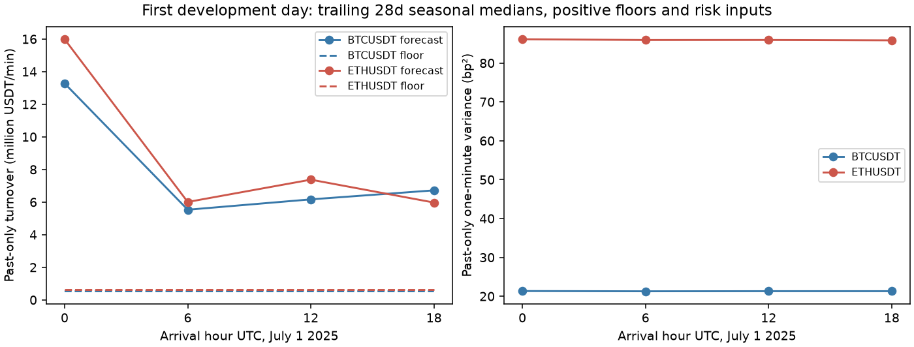
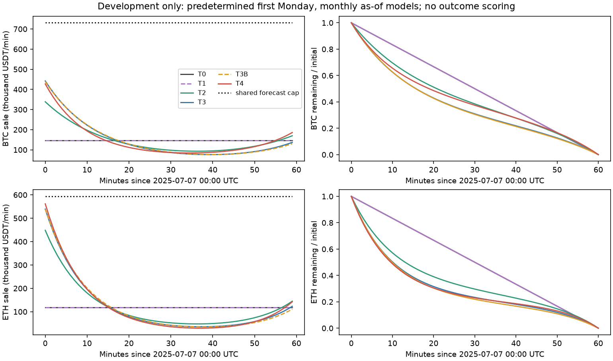
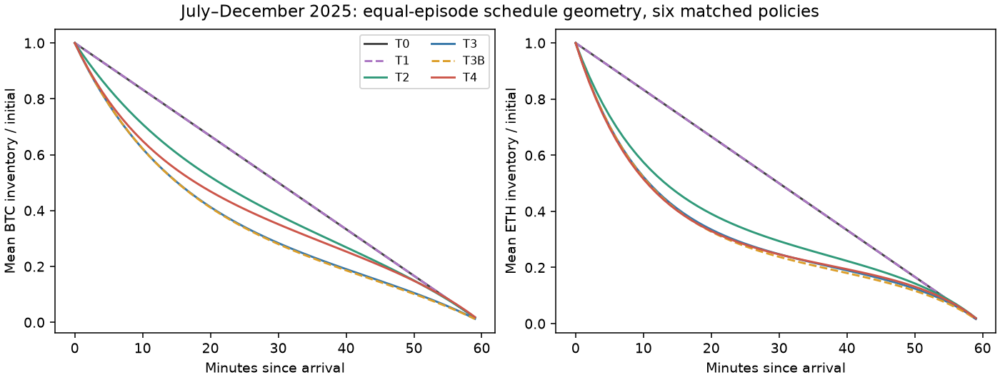

# Stage 4: causal historical episodes and matched development policies

Generated UTC: 2026-10-28T03:11:52.048563+00:00. **Implementation PASS; stage QUALIFIED / PRETEST_LOCK_PENDING.**
G4 OOS evaluation is NOT RUN. No economic hypothesis, shortfall or savings comparison was evaluated.
Stage 5 was not begun; January–June 2026 canonical observations were never opened.

## Scope, chronology and inputs

Reuse the [specification](../../CryptoCrossImpact_Research_Specification_v1_2026-10-27.md),
Stage 1 validated Binance USD-M perpetual trade-price minute bars, Stage 2 frozen
family (tau=60 minutes, ridge=1), and Stage 3 exact exponential-cell constrained
QP. The published AJNT signed terminal-penalty problem remains a separate verified
benchmark; no theorem extension is claimed. Data attribution: Binance Vision;
derived data summaries follow the recorded CC BY-NC-SA terms.

Arrival t0 includes the completed bar opening t0−1min (available exactly t0),
excluding the bar opening t0. Decisions are frozen/open-loop and contain no
alpha. Each history is the full paired [t0−28d,t0) UTC minute calendar, with all
valid source bars required. Missing, duplicate or invalid inputs exclude the
whole episode; diagnostic jumps/stale and verified zero turnover are retained.
No future-bar existence/value audit selects these Stage 4 schedules; Stage 5
will apply the locked mechanical evaluation-window QC independently of values.

Per-bin turnover Vhat (USDT) is the past hour-of-week median (minimum120), then
hour-of-day (minimum120), then overall median; floor=max(past positive 1st
percentile,1e-8 USDT). Covariance is sample/ddof1 of consecutive close log
returns wholly inside the window: 40319 pairs, minimum40000; no eigenvalue
clipping. Sigma is per minute; Stage 3 multiplies by delta once. P0 is the last
completed close, retained for later scoring only. No historical future-price
cost or realized-volume participation was computed here.

X0=0.02 sum Vhat per leg, caps=0.10 Vhat, 60 one-minute bins. Inventories and
sales use continuous reference USDT; no lot-size/fill reconstruction. Kappa=.001,
theta=1, fee=5bp, half-spread=1bp are assumptions; m=0. Common beta is computed
from full past covariance and capped closest-uniform TWAP, including pretrade
inventory. T2 retains this exact global beta while deciding with own variance.
All policies report full-covariance raw risk and risk preference separately.

## As-of kernels and matched policies

T0 closest capped TWAP; T1 forecast VWAP; T2 two independent A own-kernel QPs;
T3 joint A/full risk; T4 joint B/full risk; T3B diagonal of EACH B component,
same B tau/L/full risk. T4–T3 compares estimated families (A and B self terms
differ); T4–T3B isolates off-diagonal impact. The authorized clarification is in
[SPEC_CHANGELOG](../../SPEC_CHANGELOG.md). No baseline was relabeled.

Main diagnostics use six monthly as-of 365-complete-day fits. Existing B refits
are reused; six missing A fits were produced through refit_historical with the
same selected family/penalty. Every kernel retains its own fitted L, without
mixing coordinates. Original context can precede the target window for lag
features, but target labels and L lie inside it, ending before the month. All
365d windows have 525600 eligible fit rows. Full fit windows, L, C, hashes and
sources: [model_registry.csv](stage04_artifacts/model_registry.csv). The fixed
June-end models are a sensitivity on first UTC Monday's four arrivals each month
(24 episodes); its schedule distances are
retained, not used for selection.

## Development coverage and forecast QA

The two-day smoke completed 8 episodes / 48 schedules.
Full development nominal=736; eligible=736; complete=736;
six-policy schedules=4416; primary scalar/joint QPs=3680.
Common policy failures=0; no unfavorable episode was dropped.

| month | eligible | minimum_history_rows | minimum_cov_returns | solved | nominal | excluded |
|---|---|---|---|---|---|---|
| 2025-07 | 124 | 40320 | 40319 | 124 | 124 | 0 |
| 2025-08 | 124 | 40320 | 40319 | 124 | 124 | 0 |
| 2025-09 | 120 | 40320 | 40319 | 120 | 120 | 0 |
| 2025-10 | 124 | 40320 | 40319 | 124 | 124 | 0 |
| 2025-11 | 120 | 40320 | 40319 | 120 | 120 | 0 |
| 2025-12 | 124 | 40320 | 40319 | 124 | 124 | 0 |

Across 88320 forecast asset-bins: hour-of-week=88320,
hour-of-day=0, overall=0,
floored=0. Minimum fine-class count=240.
Median initial inventory: BTC 6,895,132.69 USDT;
ETH 8,414,595.51 USDT. Windows containing diagnostic
jumps=112, stale flags=0;
these are overlapping history counts, not independent anomalies/exclusions.
Verified zero turnover is retained and recorded in forecast_qa.csv.

All primary arrivals are at an hour boundary and T=60. An hour-of-week median
therefore gives a constant forecast within each primary episode, so T0 and T1
coincide by construction. This is a consequence of the approved simple forecast,
not a reason to tune it. Alternate 30/120-minute and cap smoke fixtures preserve
time-safe inputs and feasibility. Future mutation tests alter current/later bars
without changing forecasts, covariance, X0 or ANY of the six schedules.



## Fairness, solver and schedule geometry

| policy | schedules | terminal_max_usdt | normalized_residual_max | KKT_max | decomposition_max | cap_binding_cells | twap_adjusted_cells | iterations_max | solve_seconds_mean |
|---|---|---|---|---|---|---|---|---|---|
| T0 | 736 | 2.980232e-08 | 1.707688e-15 | 0 | 0 | 0 | 0 | 0 | 0 |
| T1 | 736 | 5.960464e-08 | 3.009955e-15 | 0 | 0 | 0 | 0 | 0 | 0 |
| T2 | 736 | 1.490116e-08 | 1.213247e-15 | 1.615292e-15 | 1.356972e-15 | 0 | 0 | 150 | 0.03779194 |
| T3 | 736 | 1.117587e-08 | 7.487313e-16 | 2.378693e-15 | 1.15822e-15 | 0 | 0 | 75 | 0.02803958 |
| T3B | 736 | 1.117587e-08 | 6.550389e-16 | 2.443968e-15 | 1.195934e-15 | 0 | 0 | 75 | 0.02834401 |
| T4 | 736 | 7.450581e-09 | 5.860007e-16 | 2.142385e-15 | 1.380197e-15 | 0 | 0 | 75 | 0.02871767 |

Every complete episode has one exact shared input hash and beta across all six
policies. Feasibility tolerances are relative to each leg's USDT inventory;
terminal tolerance max(1e-6 X_i,1e-8 USDT); stricter normalized residual<=1e-7.
OSQP requires optimal and checked KKT/decomposition; no clipping, cap relaxation,
PSD repair or residual inventory concealment. Deterministic formula policies have
no QP KKT condition (their zero in table means not applicable). T2 iterations sum
two scalar solves. Own-model objectives in raw QA tables are heterogeneous and
are NEVER used as a policy ranking. No E0–E4 evaluator or P&L matrix was run.

| contrast | mean_rate_l2 | max_rate_l2 | mean_inventory_difference | maximum_inventory_difference |
|---|---|---|---|---|
| T4_vs_T3 | 0.07551228 | 0.1171302 | 0.0677613 | 0.1425285 |
| T4_vs_T3B | 0.08296653 | 0.1291528 | 0.07166678 | 0.1416369 |

These are rate/inventory geometry differences only, not costs or savings. The
representative episode is July7 00:00, fixed as the first UTC Monday before
inspection; the aggregate is equally weighted over all complete episodes.





## Verification, preservation and handoff

Test evidence: 116 passed, 0 failed; 2 Stage 1 integration cases deselected to keep test outcomes closed. Stage 4: 30 cases; prior-stage regressions: 86. Exact command, test hashes and JUnit evidence are in stage04_artifacts/test_results.json and pytest.xml.
Two independent complete runs are required for the final deterministic replay
check; current recorded match=True.
Schedules are stored once in ignored results/stage04_development; compact source
tables and input/model IDs accompany them. Existing 148
protected prior files and all60 canonical stat snapshots are unchanged. The
sole previous-source edit adds optional risk_multiplier_override to the verified
QP, default unchanged; its original source is preserved and regression-tested.

[Versioned pretest protocol](../../docs/stage05_pretest_policy_evaluator_lock_v1.md)
and configs/stage05_pretest_lock.yaml freeze exact E1/E2/E3 definitions, contrasts,
uncertainty, fees/caps/risk and hold rules. The lock remains **PENDING** until the
Stage 5 preflight verifies actual funding settlement timestamps/rates (or actual
timestamp-only exclusions) and validates the E1 implementation on development
data before any test opening. E1's month-specific as-of artifacts must then be
generated before scoring each month, using only that month's permitted past.
Later E1 windows can contain previously elapsed test history; they are not
required to exist before January opens. No unverified
eight-hour settlement schedule or funding zero is assumed. These holds block test
opening, not completion of the authorized development policy work. G4 research
OOS gate is not passed. No user decision is needed to close this Stage 4 scope.

Public-flow conditional-response coefficients remain observational. Execution
impact, temporary liquidity, fees and spread are scenario assumptions. Matched
schedule correctness is no evidence of causal market savings; the long selected
decay and estimation/causal uncertainties persist. No new data/dependencies were
needed. Full resource/provenance details are in run manifests and session report.

```sh
.venv/bin/python -m pytest tests/test_stage04_policies.py -q
.venv/bin/python scripts/stage04.py all
```

**Stop at Stage 4. Final-test outcomes unopened; no historical implementation-shortfall backtest.**

<!-- pretest-lock-sha -->
Pretest lock v1 SHA-256: `a691a3db76a776d4f8e31b43f6c68663145891e1974e2bf6dc0f061130192e31`. Status: **PRETEST_LOCK_PENDING**.
