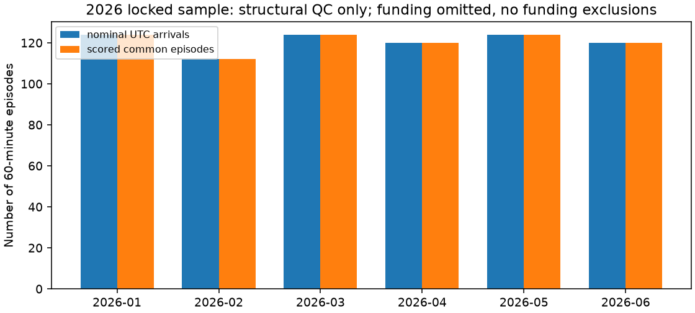
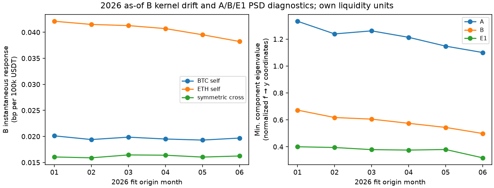
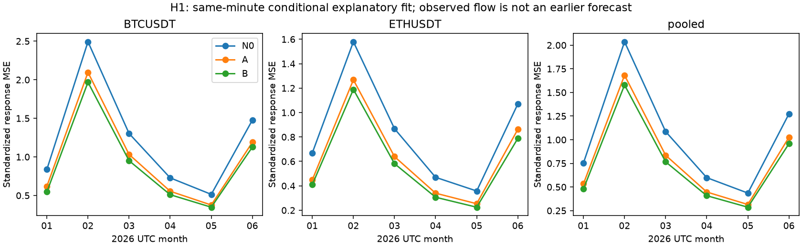
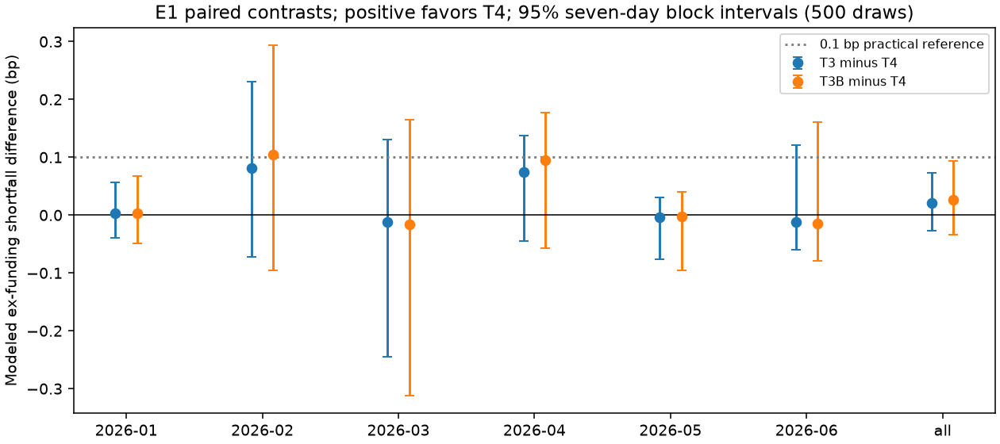
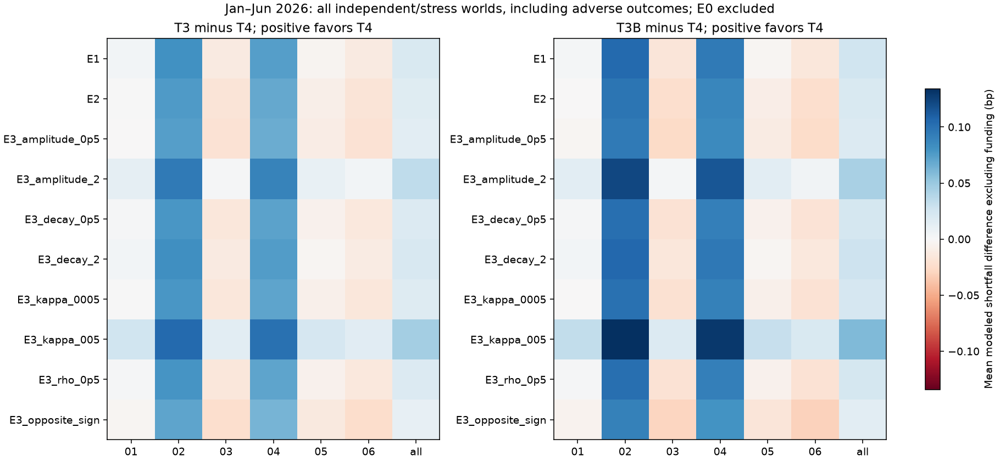
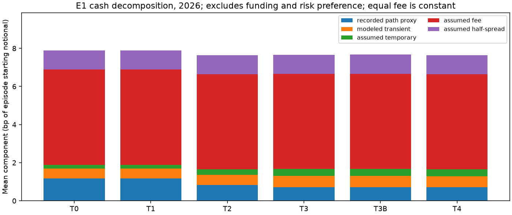
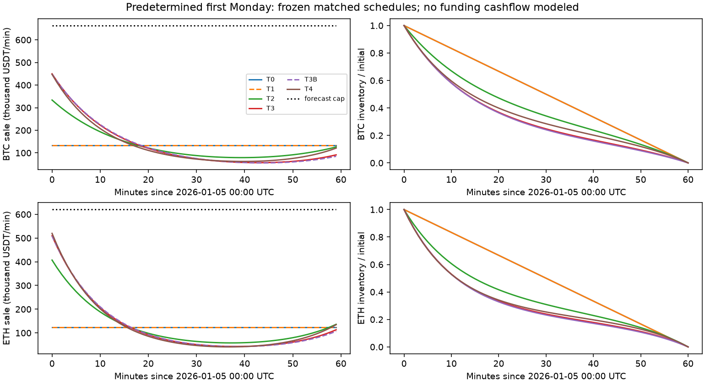

# Stage 5: locked BTC/ETH OOS evaluation — funding excluded

UTC: 2026-10-28T05:12:52.198465+00:00. **G4 OOS COMPLETE; implementation PASS.**
H1: **SUPPORTS_HYPOTHESIS** for observational conditional response. H2: **DOES_NOT_SUPPORT**
under the prespecified E1 practical/uncertainty comparison. Adverse E2/E3 worlds
remain explicit below; no universal evaluator or causal advantage is inferred.
Stage 6 was not begun.

We evaluate hypothetical, sell-only BTC/ETH perpetual-futures liquidation schedules
using recorded Binance prices and **model-based** transient/temporary impact
assumptions. All shortfalls **exclude funding payments** because verified
historical settlement-event/cashflow reconstruction was unavailable through
accessible sources. These amounts are not actual fills, live execution savings,
causal price effects, or all-in perpetual-futures P&L. This explicit ex-funding
scope was approved and frozen before the January–June 2026 test was opened.

## Lock lineage, sample and chronology

The original [v1 protocol](../../docs/stage05_pretest_policy_evaluator_lock_v1.md)
and [funding HOLD](stage05_oos_evaluation.md) remain historical artifacts, not
successful funding audits. The [approved amendment](../../docs/stage05_pretest_amendment_v2_funding_excluded.md)
supersedes funding accounting/prerequisite only. The [v2 protocol](../../docs/stage05_pretest_policy_evaluator_lock_v2.md)
and configs/stage05_pretest_lock_v2.yaml bind source, numerical code, grids,
independent E1 evidence, tests, normalization, scenarios and inference.
Ready UTC **2026-10-28T04:34:16.844872+00:00**; v2 lock SHA-256 `5ac1646ab235f841c8e4c5454099ad09f5a6e6d434009853853e18b1987b3507`.
The first actual outcome-opening receipt is in stage05_v2_artifacts/first_outcome_open_v2.json.

All 60 original canonical partitions are reused unchanged; no market or funding
data downloaded in this recovery. Dataset attribution: Binance Vision; derived
summaries follow recorded CC BY-NC-SA terms. Two USD-M perpetual last-trade 1m
contracts, UTC; 2026-01-01 through 2026-06-30. No funding-driven exclusions.
At t0, the last completed bar opens t0−1min; current/future bars are unavailable
to decisions. Filtered reads enforce actual requested bounds; mutation tests
verify future values cannot alter inputs/schedules. Immutable decisions and
model/world hashes precede outcome-bar reads. No within-month model revision.

| month | SCORED | nominal |
|---|---|---|
| 2026-01 | 124 | 124 |
| 2026-02 | 112 | 112 |
| 2026-03 | 124 | 124 |
| 2026-04 | 120 | 120 |
| 2026-05 | 124 | 124 |
| 2026-06 | 120 | 120 |

Nominal 724; scored common episodes 724; six
policies; 11 distinct worlds; 47784 primary rows.
Negative cash rows retained: 15273. Failures/exclusions
have separate status logs, never zero costs. Maximum normalized physical
residual 3.11e-15; terminal residual
3.17e-08 USDT; KKT stationarity
2.35e-15; decomposition residual
1.07e-15. Realized participation is a diagnostic,
not an ex-post cap: max ratio 1.4668
(146.68% of recorded minute turnover); E1 cells
above 10% across six schedules 18282.
Forecast-cap feasibility therefore does **not** establish executable fills or
feasibility against future realized liquidity. These cases remain in the sample;
the high realized-participation tail is a limitation of hypothetical replay.

| policy | maximum_realized_participation_pct | over10pct_cells | total_asset_minute_cells | over10pct_share_pct |
|---|---|---|---|---|
| T0 | 122.5321 | 2473 | 86880 | 2.846455 |
| T1 | 122.5321 | 2473 | 86880 | 2.846455 |
| T2 | 128.0378 | 2876 | 86880 | 3.310313 |
| T3 | 146.1957 | 3498 | 86880 | 4.026243 |
| T3B | 146.6837 | 3535 | 86880 | 4.068831 |
| T4 | 144.296 | 3427 | 86880 | 3.944521 |



## Frozen calibration and policies

Monthly A/B/N0 use the preceding 365 complete UTC days, fixed tau=60 min/ridge=1;
E1 uses [month−210d,month−30d), fixed tau=(5,30) min/ridge=1, with its own L and training
standardization. Sufficient statistics are congruently rescaled before fitting,
not coefficients copied between liquidity coordinates. Feature/forecast parity
on 2025 is tested against the original Stage 2/4 functions. Each monthly model
and evaluator is persisted before that month's scoring. Later fits use only
elapsed prior test history under the already frozen algorithm.

The two E1 development fits each have 259200 targets, exact 180-day/30-day-gap windows,
PSD components and reproducible fits distinct from optimizer B. Pretest evidence
and component diagnostics are under stage05_v2_artifacts/pretest_models/.
Rolling 2026 matrices, L, eigenvalues and file hashes are in asof_model_registry.csv.
Minimum component eigenvalue across fitted A/B/E1: 0.31791.
Decay remains a time constant in minutes, not a half-life; the exponential
level is not artificially cut off at regression memory 60.

T0 capped closest-TWAP; T1 past-only forecast-VWAP; T2 independent A with own variance
and shared global beta; T3 joint A/full risk; T3B B self terms/full risk; T4 full B.
T4–T3 compares separately fitted self AND cross terms; T4–T3B isolates cross terms.
X0=2% forecast 60-minute turnover, cap=10% forecast/bin, fixed 28-day seasonal medians and
ddof=1 covariance, theta=1, kappa=.001, fee=5 bp, half-spread=1 bp, zero alpha. T0 and T1 coincide
under constant within-hour forecasts; no forecast tuning separated them.



## H1: contemporaneous explanatory fit

| model | asset | rows | standardized_mse | mae_bps | rmse_bps | conditional_explanatory_r2 |
|---|---|---|---|---|---|---|
| A | BTCUSDT | 260640 | 0.9604169 | 3.899719 | 6.115201 | 0.2045739 |
| A | ETHUSDT | 260640 | 0.6250796 | 4.896816 | 7.910698 | 0.2432621 |
| B | BTCUSDT | 260640 | 0.8920213 | 3.7752 | 5.891539 | 0.2616948 |
| B | ETHUSDT | 260640 | 0.5737555 | 4.714756 | 7.581861 | 0.3048677 |
| N0 | BTCUSDT | 260640 | 1.205992 | 4.290322 | 6.855463 | 0.0003407286 |
| N0 | ETHUSDT | 260640 | 0.8240288 | 5.475268 | 9.092048 | 0.0003699754 |
| A | pooled | 260640 | 0.7927482 | 4.398267 | 7.070178 | 0.223918 |
| B | pooled | 260640 | 0.7328884 | 4.244978 | 6.789508 | 0.2832813 |
| N0 | pooled | 260640 | 1.015011 | 4.882795 | 8.051792 | 0.000355352 |

| group | delta_fit | delta_fit_ci_low | delta_fit_ci_high | mean_paired_standardized_loss_difference | loss_difference_ci_low | loss_difference_ci_high |
|---|---|---|---|---|---|---|
| all | 0.07550923 | 0.06975842 | 0.08361373 | 0.05985981 | 0.0480627 | 0.07492752 |
| 2026-01 | 0.1029786 | 0.09583464 | 0.1111801 | 0.05497963 | 0.03476086 | 0.06109103 |
| 2026-02 | 0.06143897 | 0.0562236 | 0.06939491 | 0.1033269 | 0.05830138 | 0.1494956 |
| 2026-03 | 0.08314195 | 0.07327135 | 0.09740878 | 0.06947129 | 0.05748589 | 0.07697045 |
| 2026-04 | 0.08715169 | 0.08102675 | 0.09412691 | 0.03897878 | 0.03332992 | 0.04807746 |
| 2026-05 | 0.09044128 | 0.08146917 | 0.1012672 | 0.0284838 | 0.02382994 | 0.03513817 |
| 2026-06 | 0.06602462 | 0.06311573 | 0.07325386 | 0.06770447 | 0.04555406 | 0.09488061 |

The pooled relative MSE difference is 7.5509% against
the 0.5% practical reference. Monthly points, per-asset errors and paired daily
loss uncertainty are retained. Flow q=2*taker-buy quote−total quote is observed
after the SAME bar; y=1e4 sqrt(L) log-return is already a return. Positive-lag
regressors use G(l)−G(l−1). This is not actionable forecasting or own-trade causal
identification; the prior lag-only null and lead-flow confounding remain relevant.



## H2: common evaluator shortfall excluding funding

Delta=1e4(C(T3)−C(T4))/W; positive favors T4. E1 is an alternative past-data
parameterization, not randomized/causal independence. E2 removes each E1 cross
component; eight distinct E3 stress worlds cover joint amplitude, decay,
temporary curvature, cross interpolation and PSD-certified opposite sign.
Base repetitions are deduplicated explicitly via aliases. E0 is **IN_MODEL_ONLY**.

| world | paired_episodes | mean_delta_ex_funding_bps | ci_low | ci_high | negative_share | worst_episode_bps | relative_ratio_status |
|---|---|---|---|---|---|---|---|
| E0 | 724 | 0.01802485 | -0.0296693 | 0.06994455 | 0.4875691 | -5.294287 | ESTIMATED |
| E1 | 724 | 0.02080951 | -0.0266692 | 0.07279886 | 0.4861878 | -5.2945 | ESTIMATED |
| E2 | 724 | 0.01583688 | -0.03175175 | 0.06775001 | 0.4889503 | -5.303464 | ESTIMATED |
| E3_amplitude_0p5 | 724 | 0.01419551 | -0.0334631 | 0.06607094 | 0.4903315 | -5.306475 | ESTIMATED |
| E3_amplitude_2 | 724 | 0.03403751 | -0.01308139 | 0.0862845 | 0.4751381 | -5.270551 | ESTIMATED |
| E3_decay_0p5 | 724 | 0.01853915 | -0.02898581 | 0.07047539 | 0.4889503 | -5.299171 | ESTIMATED |
| E3_decay_2 | 724 | 0.02149494 | -0.02597835 | 0.07350804 | 0.4861878 | -5.292811 | ESTIMATED |
| E3_kappa_0005 | 724 | 0.01767289 | -0.02985304 | 0.06967169 | 0.4903315 | -5.296808 | ESTIMATED |
| E3_kappa_005 | 724 | 0.04590243 | -0.001198481 | 0.0978297 | 0.4530387 | -5.276032 | ESTIMATED |
| E3_rho_0p5 | 724 | 0.0183232 | -0.02921047 | 0.07027443 | 0.4889503 | -5.298982 | ESTIMATED |
| E3_opposite_sign | 724 | 0.01086426 | -0.03683429 | 0.06270116 | 0.4903315 | -5.312429 | ESTIMATED |

Secondary controlled cross-term comparison:

| world | mean_delta_ex_funding_bps | ci_low | ci_high | negative_share |
|---|---|---|---|---|
| E0 | 0.02283495 | -0.03774103 | 0.08978046 | 0.4820442 |
| E1 | 0.02657314 | -0.03371605 | 0.09375278 | 0.480663 |
| E2 | 0.02017957 | -0.04026935 | 0.08726635 | 0.4820442 |
| E3_amplitude_0p5 | 0.01793153 | -0.04259609 | 0.08495866 | 0.4834254 |
| E3_amplitude_2 | 0.04385636 | -0.0162193 | 0.111341 | 0.4696133 |
| E3_decay_0p5 | 0.02364721 | -0.03670067 | 0.0907591 | 0.480663 |
| E3_decay_2 | 0.02743526 | -0.03284612 | 0.09464292 | 0.4792818 |
| E3_kappa_0005 | 0.02244413 | -0.03791306 | 0.08963447 | 0.4834254 |
| E3_kappa_005 | 0.05960528 | -0.0003499909 | 0.1266993 | 0.4475138 |
| E3_rho_0p5 | 0.02337636 | -0.03698846 | 0.09050956 | 0.4820442 |
| E3_opposite_sign | 0.013786 | -0.04683149 | 0.08074251 | 0.4834254 |

Monthly effects, medians, 25th/75th percentiles, cash differences, relative ratio
flags and confidence intervals are in primary_h2_contrasts.csv. E1 primary mean
0.0208095 bp, 95% interval
[-0.0266692,0.0727989], against the 0.1 bp practical
reference. 0 independent/stress worlds
have negative pooled primary means. No adverse world/month/episode was removed.
Intervals resample seven consecutive full calendar days, 500 shared draws,
seed20261027, preserving four within-day episodes/policy/world pairs and excluded
days. Means are episode-weighted. Monthly intervals use full within-month
calendars. Ratios are undefined for nonpositive or zero-crossing baseline cost.

The E1 sign remains uncertain, and its interval excludes the 0.1 bp practical
target. March, May and June have negative primary E1 point estimates; all six
monthly intervals cross zero. All independent/stress pooled primary intervals
also cross zero. These results do not establish a practical execution benefit.





Regret below is T4's cost minus the least cost among the six fixed policies in
the same episode/world. This is an ex-post descriptive comparison, not a policy
that could select the cheapest schedule before observing outcomes.

| world | maximum_T4_regret_bps | mean_T4_regret_bps | T4_underperforms_T3_share | T4_underperforms_T3B_share |
|---|---|---|---|---|
| E0 | 64.14886 | 4.081191 | 0.4875691 | 0.4820442 |
| E1 | 64.17983 | 4.103613 | 0.4861878 | 0.480663 |
| E2 | 64.1612 | 4.094578 | 0.4889503 | 0.4820442 |
| E3_amplitude_0p5 | 64.15185 | 4.090044 | 0.4903315 | 0.4834254 |
| E3_amplitude_2 | 64.2358 | 4.131051 | 0.4751381 | 0.4696133 |
| E3_decay_0p5 | 64.18069 | 4.106478 | 0.4889503 | 0.480663 |
| E3_decay_2 | 64.17326 | 4.098202 | 0.4861878 | 0.4792818 |
| E3_kappa_0005 | 64.10515 | 4.066979 | 0.4903315 | 0.4834254 |
| E3_kappa_005 | 64.77727 | 4.409396 | 0.4530387 | 0.4475138 |
| E3_opposite_sign | 64.14257 | 4.085586 | 0.4903315 | 0.4834254 |
| E3_rho_0p5 | 64.17052 | 4.099086 | 0.4889503 | 0.4820442 |

Regime results use UTC weekends and the unchanged 2025-only liquidity/volatility
terciles from v1; regime_contrasts.csv retains signed effects and block intervals.
They are overlapping time-series subsets, not independent experiments.

| regime_type | regime | paired_episodes | mean_delta_ex_funding_bps | ci_low | ci_high |
|---|---|---|---|---|---|
| weekend | False | 516 | 0.04648513 | -0.01770906 | 0.1295295 |
| weekend | True | 208 | -0.04288579 | -0.1086646 | 0.007870842 |
| liquidity_tercile | high | 37 | 0.2291555 | -0.1498775 | 0.6435365 |
| liquidity_tercile | low | 557 | 0.002961573 | -0.03713783 | 0.04868036 |
| liquidity_tercile | middle | 130 | 0.03798257 | -0.1101799 | 0.1939634 |
| volatility_tercile | high | 263 | 0.01826832 | -0.08775641 | 0.1449886 |
| volatility_tercile | low | 291 | 0.002643155 | -0.05144867 | 0.04283727 |
| volatility_tercile | middle | 170 | 0.05583741 | -0.03273358 | 0.1302821 |

Worst-case episode IDs and signed contrasts are retained in
stage05_v2_artifacts/worst_episode_diagnostics.csv; they are diagnostics, not exclusions.

## Cash components, risk and robustness

| policy | path_usdt | transient_usdt | temporary_usdt | fee_usdt | spread_usdt | shortfall_ex_funding_bps | full_cov_raw_risk_usdt_squared | full_cov_risk_preference_usdt |
|---|---|---|---|---|---|---|---|---|
| T0 | 533.3723 | 621.8132 | 195.4602 | 4886.505 | 977.3009 | 7.888776 | 1.674089e+09 | 977.3009 |
| T1 | 533.3723 | 621.8132 | 195.4602 | 4886.505 | 977.3009 | 7.888776 | 1.674089e+09 | 977.3009 |
| T2 | 373.7947 | 645.9626 | 268.5247 | 4886.505 | 977.3009 | 7.647289 | 1.015513e+09 | 576.8619 |
| T3 | 352.8278 | 705.1794 | 342.2802 | 4886.505 | 977.3009 | 7.664074 | 7.940032e+08 | 447.039 |
| T3B | 360.1301 | 710.3607 | 344.2955 | 4886.505 | 977.3009 | 7.669838 | 7.838094e+08 | 442.2261 |
| T4 | 322.5926 | 688.5766 | 336.2272 | 4886.505 | 977.3009 | 7.643265 | 8.306869e+08 | 464.6125 |

Cash total sums five components only. Risk is an ex-ante preference/proxy, not
an expense paid to an exchange. Fee/spread are illustrative assumptions, not
observed historical tiers/BBO. All-in and funding-cashflow fields remain null.
Per-asset cash tables use each leg's starting notional; impact allocation is
quadratic bookkeeping, not causal attribution.





All primary statistics were indexed before one-factor sensitivities. Robustness
compares E1/E2 for theta=0/2, sizes=.005/.01/.05, caps=.05/.20, horizons=30/120 min with
recomputed forecasts/size, fixed 100k USDT per leg and fixed June-2025 calibration. Open/OHLC and
fee/spread variants keep schedules unchanged. No scenario×size×risk full Cartesian
search. Robustness QA: `{'rows': 147696, 'variants': 17, 'failures': 0, 'linear_fee_spread_delta_invariance_max_bps': 2.393918396847994e-16}`. Full paired monthly/pooled results and failures
are in robustness_contrasts.csv and robustness_failures.json; they cannot replace
the locked primary analysis. Fixed linear fees change levels, not paired timing
advantage. Changing horizon changes its forecast total and size as predeclared.

Primary T3-minus-T4 one-factor results (positive favors T4; full secondary
T3B contrasts remain in the same CSV):

| variant | E1_delta_bp_and_95pct_CI | E2_delta_bp_and_95pct_CI |
|---|---|---|
| cap_05 | 0.020589 [-0.027269, 0.07115] | 0.016041 [-0.031874, 0.066556] |
| cap_20 | 0.02081 [-0.026669, 0.072799] | 0.015837 [-0.031752, 0.06775] |
| fee_bps_10 | 0.02081 [-0.026669, 0.072799] | 0.015837 [-0.031752, 0.06775] |
| fee_bps_2 | 0.02081 [-0.026669, 0.072799] | 0.015837 [-0.031752, 0.06775] |
| fixed_100k | -0.0015021 [-0.0055144, 0.0035006] | -0.001526 [-0.0055375, 0.0034768] |
| fixed_June_2025 | 0.018823 [-0.035359, 0.077283] | 0.013817 [-0.040409, 0.072302] |
| half_spread_bps_0 | 0.02081 [-0.026669, 0.072799] | 0.015837 [-0.031752, 0.06775] |
| half_spread_bps_2 | 0.02081 [-0.026669, 0.072799] | 0.015837 [-0.031752, 0.06775] |
| horizon_120 | 0.047034 [-0.080568, 0.17617] | 0.03856 [-0.089345, 0.16744] |
| horizon_30 | -0.0068679 [-0.02668, 0.016461] | -0.0082755 [-0.028019, 0.014948] |
| price_ohlc | 0.020382 [-0.026372, 0.071977] | 0.015409 [-0.031511, 0.06692] |
| price_open | 0.019721 [-0.027531, 0.071324] | 0.014748 [-0.03279, 0.066141] |
| size_005 | 0.0078959 [-0.026149, 0.050174] | 0.0063482 [-0.027675, 0.04857] |
| size_01 | 0.014589 [-0.030597, 0.06498] | 0.011415 [-0.033705, 0.061847] |
| size_05 | 0.023449 [-0.018642, 0.065068] | 0.017334 [-0.024742, 0.059082] |
| theta_two | 0.028041 [-0.017802, 0.07844] | 0.021729 [-0.02413, 0.07221] |
| theta_zero | 0.014594 [-0.020198, 0.046658] | 0.013443 [-0.021387, 0.045565] |

The fixed-100k and 30-minute sensitivities have negative pooled point estimates
under both E1 and E2. All pooled primary robustness intervals cross zero; none
replaces the original 60-minute, 2%-of-forecast primary analysis.

## Verification, limitations and restart

Pre-outcome suite: **166 passed, 0 failed**, two Stage 1 integration
tests deselected to avoid premature test access. Synthetic planted-kernel recovery,
independent E1 window/coordinates, exact cash factors/PSD across worlds,
funding omission, future mutation, immutable decisions, negative costs,
undefined participation, full-calendar paired bootstrap, and prior-stage
regressions passed before readiness. Outcome reads and output checkpoints carry
hashes; per-month manifests and the new run/session reports give resources.

A separate post-readiness suite passed 166 cases. The post-outcome audit verified 724 immutable primary decisions and 66 independent triangular cash calculations; maximum discrepancy 9.55e-12 USDT. This is implementation QA, not additional pretest or economic evidence. See post_ready_checks_v2.json and robustness_output_audit_v2.json in the artifact directory.

The original public-flow endogeneity, same-bar information timing, hypothetical
impact interpretation, long selected decay and parameter uncertainty remain.
These scenario differences do not establish realized causal execution gains.
Funding omission limits any all-in perpetual-P&L claim, even for short horizons.
No optional C/D/SOL/L2/L4 branch or Stage 6 manuscript/CV synthesis was begun.

```sh
.venv/bin/python scripts/stage05_v2.py all
```

Completed monthly checkpoints resume without duplicate decisions; hashes and
frozen code/config must match. New results live under results/stage05_exfunding_v2
and this v2 report, preserving the original HOLD report and all prior results.
